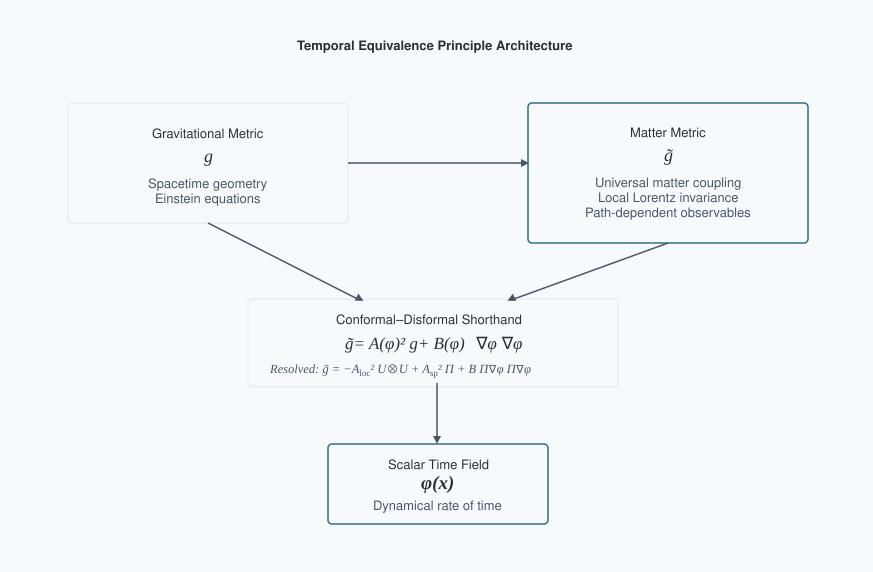
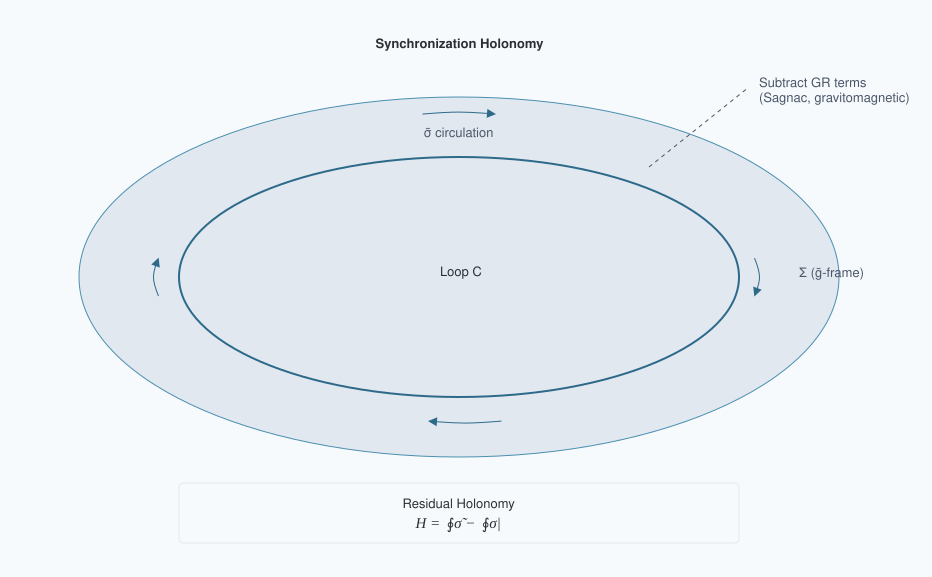
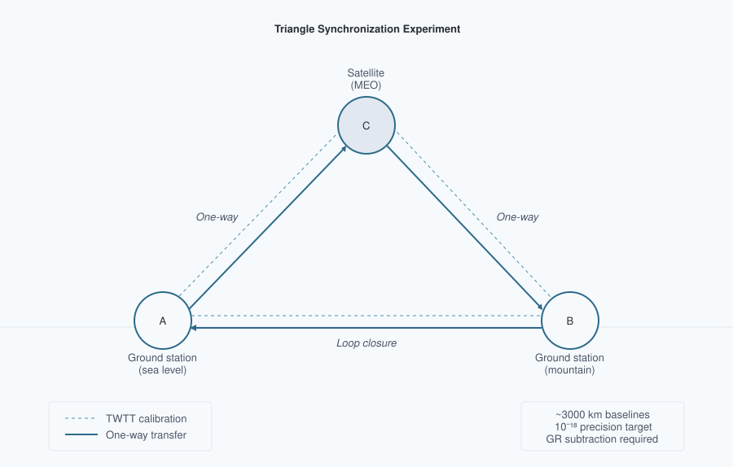

# Temporal Equivalence Principle: Dynamic Time & Emergent Light Speed
**Matthew Lukin Smawfield**
Version: v0.18 (Jakarta)
First published: 18 August 2025 · Last updated: 24 October 2026
DOI: 10.5281/zenodo.16921911

---

## Abstract

This paper proposes a covariant, testable reformulation of relativity in which proper time is a dynamical field and the "speed of light" is an emergent, strictly local invariant rather than a global constant. The framework is built on a single spacetime manifold endowed with two metrics: a gravitational metric $g_{\mu\nu}$ and a causal (matter) metric $\tilde{g}_{\mu\nu}$ to which all non-gravitational fields and clocks couple. In isotropic shorthand the metrics are related by a controlled disformal map, $\tilde{g}_{\mu\nu} = A^2(\phi) g_{\mu\nu} + B(\phi) \nabla_\mu\phi \nabla_\nu\phi$, where $\phi$ is the time field, $A(\phi) = \exp(\beta_A \phi/M_{\text{Pl}})$ is a universal conformal factor, and $B(\phi)$ encodes tiny, direction-dependent deformations of the light cone consistent with GW170817-class multi-messenger constraints ($|c_\gamma - c_g|/c \lesssim \text{few}\times10^{-15}$ today); decomposed along the unit cosmic temporal flow $U_\mu \equiv -\nabla_\mu\bar{\phi}/\sqrt{2\bar{X}}$ ($g^{\mu\nu}U_\mu U_\nu = -1$, orthogonal spatial projector $\Pi_{\mu\nu} = g_{\mu\nu} + U_\mu U_\nu$), this resolves into $\tilde{g}_{\mu\nu} = -A_{\rm loc}^2(u_{\rm grav})\,U_\mu U_\nu$ $+$ $A_{\rm sp}^2(u_{\rm drift})\,\Pi_{\mu\nu}$ $+$ $B(\phi)\bigl(\Pi_\mu^\alpha\Pi_\nu^\beta\nabla_\alpha\phi\nabla_\beta\phi - 2(U\cdot\nabla\phi)U_{(\mu}\Pi_{\nu)}{}^\alpha\nabla_\alpha\phi\bigr)$, separating the stationary baryon-sourced ADM lapse $N_{\rm TEP}(\mathbf{x}) = A_{\rm loc}(u_{\rm grav}(\mathbf{x}))N_{\rm GR}(\mathbf{x})$ from the secular matter-frame spatial ruler factor $A_{\rm sp}(u_{\rm drift}(t,\mathbf{x})) = \exp(-u_{\rm drift}(t,\mathbf{x}))$ on static gravitational 3-space $\gamma_{ij}(\mathbf{x})$. Proper time is elevated to a field by postulating that all matter, electromagnetism, and quantum phases evolve with respect to $\tilde{g}$-proper time $\tau$; in local freely falling frames, this guarantees exact local Lorentz invariance and a locally invariant $c$, while globally it implies that synchronization procedures and one-way light-time measurements can become path-dependent in the disformal/non-exact sector of a dynamical-time background. The covariant action, field equations, conservation laws, and PPN mapping are developed; screening is formulated via continuous Temporal Topology and nonlinear Temporal Shear ($P_{,X} = k\sqrt{\xi} + 2\xi$, $k\simeq 16$ fixed by $g_t$ and the empirical scale $a_0$). The breakdown of global simultaneity is formalized using a synchronization-transport law, deriving a convention-independent "synchronization holonomy," an invariant measure of non-integrability of time transport around closed loops. In the purely conformal subclass this holonomy vanishes after subtraction of the full GR, kinematic, clock-scale, and reference-frame synchronization model; nonzero holonomy at leading order requires residual non-exact synchronization structure, supplied in the minimal TEP model by disformal coupling $B(\phi)\neq0$, and in more general extensions by non-metricity or other explicitly non-exact transport structure. Explicit small-$B$ formulas are provided for the holonomy and the effective photon phase speed, showing how the measured one-way asymmetry is related to $\phi$-gradients and disformal scales under current constraints. The analysis demonstrates that Einstein's assumption of a universal $c$ was a brilliant local theorem arising from the Temporal Equivalence Principle; transcending it demands dynamical time: $c$ remains exactly invariant locally, but global, one-way-inferred "$c$" values differ by path-dependent amounts that experiments can detect or bound. Cosmologically, TEP adopts an eternal, spatially infinite, inhomogeneous background whose physical volume does not undergo cosmological expansion. Neither space nor matter changes size: the gravitational 3-metric $\gamma_{ij}$ is static, while the drift enters through the matter-frame ruler factor $A_{\rm sp}$, which recalibrates units rather than stretching geometry. Distances and densities expressed in matter units therefore evolve without any physical stretching, allowing the observed redshift and apparent Hubble relation to emerge directly from the macroscopic historical drift of the inhomogeneous temporal network over coordinate time, governed principally by the intergalactic ruler ratio $1+z = A_{\rm sp}(t_o)/A_{\rm sp}(t_e)$ integrated in flight across unscreened space, with constrained non-exact propagation corrections through the temporal topology. An exactly solved closed-static branch establishes that the specified action admits a static, eternal gravitational configuration with conformal unit drift; that branch is an analytical benchmark, neither an attractor nor capable of near-flat matter geometry. Numerical noncompact solutions now demonstrate a constraint-consistent, on-shell inhomogeneous temporal landscape with near-zero native matter-frame spatial curvature ($|\Omega_k^{\rm native}| = 1.40\times 10^{-4}$), sustained secular temporal roll, and a positive-definite linear fluctuation spectrum across both the canonical ($\lambda_0 = +0.413 > 0$, $\lambda_1 = +39.1$) and jointly on-shell two-branch kinetic ($\lambda_0 = +0.563 > 0$, $\lambda_1 = +555.4$) sectors, bounded from below by an all-twist Bloch gap $\lambda \ge \min m_{\rm eff}^2 > 0$ on a positive evolving constant-mean-curvature initial-slice lapse; the master-potential family $V(u) = V_{\rm matter}(u)e^{-(u/u_s)^4} + V_0 e^{-(u_s/u)^4}$ reproduces the reconstructed background profile to fractional deviation $\sim 10^{-16}$ across the matter domain while flattening onto the deep-well floor $V_0$. Early-universe and background closure—in which the Big Bang gravitational singularity is replaced by a geodesic-complete matter-frame temporal horizon without phenomenological thermal screening—is developed quantitatively through the companion transport and Boltzmann analyses (Papers 18, 26, 27, 29, 30), reproducing the Pantheon+/DESI DR2/Planck $\theta_*$ background history, the baryon-sourced ($\omega_{\rm cdm}=0$) CMB acoustic and lensing spectra, and the four-observable light-element reaction-flow equilibrium. Known weaknesses in the variable-$c$ literature are addressed by supplying a correct, operationally invariant observable (holonomy), clarifying when conformal couplings cannot produce a signal, and providing realistic, constraint-consistent benchmark sensitivity windows with explicit error budgets and statistical plans (pre-registration, blinding, publicly released code and data). The resulting theory preserves the empirical pillars of relativity (local Lorentz invariance, gravitational-wave causality, PPN bounds) while extending its conceptual foundation: simultaneity is not only relative but generally non-integrable; the speed of light is not a global constant but the local echo of a deeper, dynamical temporal geometry.

Long-standing confusions about "variable $c$" are resolved by replacing convention-dependent statements with invariant observables tied to measurement procedures. A synchronization one-form $\tilde{\sigma}$ is defined on spacelike slices of the matter metric; its curl $d\tilde{\sigma}$, after subtraction of the full GR, kinematic, clock-scale, and reference-frame synchronization model, yields a residual "temporal holonomy" $H_{\rm resid}$ that vanishes in GR and becomes nonzero only when time is dynamical in this sense. Embedding the preferred-foliation geometry in a spatially covariant ADM/khronon effective action establishes four key results: (i) conformal matter coupling preserves null cones, and electromagnetic waves and transverse-traceless gravitons share the identical principal wave operator $\Box_{\rm TEP} \equiv -(N_{\rm TEP}c)^{-2}\partial_t^2$ $+$ $A_{\rm sp}^{-2}(t,\mathbf{x})\gamma^{kl}\partial_k\partial_l$, enforcing $c_{\rm GW}(t,\mathbf{x}) = c_\gamma(t,\mathbf{x})$ at every event ($\Delta t_{\gamma\text{--}{\rm GW}} \equiv 0$ at $B=0$, satisfying GW170817); (ii) the static-space WKB tensor measure $\sqrt{A_{\rm sp}^{+1}\cdot A_{\rm sp}^{-1}} \equiv 1$ eliminates FLRW Hubble friction, preserving $1/r$ graviton decay, the standard-siren discriminator $\Xi(z) = d_L^{\rm GW}/d_L^{\rm EM} = 1/(1+z)$, and the inverse detector chirp-mass map $\mathcal{M}_{\rm det} = \tilde{\mathcal{M}}/(1+z)$ at pinned interior response; (iii) a static $\phi$-gradient produces no direct propagation asymmetry in the static purely conformal limit—the cancellation is exact, not merely first-order; and (iv) the selected two-branch kinetic sector ($P_{,X} = k\sqrt{\xi} + 2\xi$, with $k\simeq 16$ fixed by the empirical scale $a_0 \sim cH_0$ and zero per-system fit parameters) screens Solar-System post-Newtonian and preferred-frame observables ($|\gamma_{\rm PPN}-1|\simeq 4.32\times 10^{-8}$ and $|\alpha_2|\simeq 2.16\times 10^{-8} < 2.4\times 10^{-7}$ at $1.6\,R_\odot$, $|\alpha_1|\simeq 5.86\times 10^{-5} < 10^{-4}$ at $1\text{ AU}$), lunar laser ranging ($|\dot{G}_{\rm loc}/G_{\rm loc}|_{\rm LLR}\lesssim 1.7\times 10^{-18}\,{\rm yr}^{-1}$), and binary-pulsar dipole radiation well inside observational bounds while passing the wide-binary joint test at $0.4\text{--}1.7\sigma$ with zero per-system free parameters and generating flat galactic rotation curves and unstretched-space gravitational lensing via $A_{\rm loc}(u_{\rm grav})$. Disformal tilts ($B \neq 0$) can source holonomy subject to multi-messenger constraints. While conformal and kinetic environmental screening responses are fixed with zero per-system free parameters by the selected operator $P_{,X}=k\sqrt{\xi}+2\xi$, non-exact loop holonomy scales with the dimensionless disformal normalization $B_0$: a corrected Earth–Sun–satellite triangle calculation gives a converged benchmark $|H_{\rm resid}|\simeq4.33\times10^{-13}\,|B_0|$ s per loop (with zero circulation in the exact-connection control), providing a direct experimental observable for bounding or detecting $B_0$. The effective covariant architecture is presented; field equations, conservation laws, invertibility/causality conditions, and a 3+1 decomposition are derived to make the observables explicit. Screening via a continuous Temporal Topology governed by non-linear superposition of field gradients (Temporal Shear) reconciles precision local tests with cosmological evolution, with mapping to Parametrized Post-Newtonian parameters and to the EFT-of-dark-energy $\alpha$-functions with $c_T = 1$ enforced. Decisive experiments with quantitative error budgets are outlined: (1) a ground–ground–satellite triangle time-transfer experiment targeting holonomy at below $10^{-18}$ fractional after GR subtraction; (2) portable-clock "clock anholonomy" around closed paths at the $10^{-19}$ level over days; (3) multi-species clock networks seeking phase-locked annual modulations at $10^{-19}$–$10^{-17}$; (4) interplanetary one-way optical links at picoseconds over AU; (5) altitude-dependent screening maps with optical clocks and atom interferometers; and (6) ensemble multi-messenger tests. Cosmological inference is implemented through native hi_class and Cobaya analyses (Papers 18, 26), with commitment to open data and blinded analyses.

Einstein's postulate of universal $c$ was a brilliant, operationally perfect approximation in regimes where time's flow is effectively uniform. In a universe where the rate of time is dynamical yet locally Lorentzian, "the speed of light" emerges as an invariant in every local lab but ceases to be globally universal. The new invariant content resides in path-dependent synchronization defects and holonomies of time transport, not in naive one-way "speeds." If detected, these invariants would inaugurate a post-Einsteinian era: from dynamic geometry to dynamic time.

## 1. Introduction: From a Universal Speed to a Universal Principle of Time

Relativity and quantum theory disagree about time. General relativity (GR) makes proper time geometric—$d\tau^2 = -g_{\mu\nu} dx^\mu dx^\nu / c^2$—dynamical, and observer-dependent. Quantum mechanics (QM) treats time as an external parameter t in the Schrödinger equation, $i\hbar \partial_t|\psi\rangle = \hat{H}|\psi\rangle$. The clash has haunted quantization programs for a century and manifested operationally as subtle ambiguities in defining one-way light speeds and simultaneity across extended regions. Precision clocks and time-transfer links now measure gravitational redshifts and velocity-dependent dilations at $10^{-18}$ fractional levels, while cosmology exhibits persistent $H_0$ and $S_8$ tensions. In this context, Einstein's postulate of a universal speed c must be sharpened: it is exact for any local freely falling laboratory, but it cannot be a global property if the flow of time itself is dynamical.

The Temporal Equivalence Principle (TEP) states that all non-gravitational dynamics, signals, and quantum phases evolve according to the proper time defined by a single causal metric $\tilde{g}_{\mu\nu}$ that couples universally to matter. The rate at which proper time accrues is a field. This elevates "when" to the status "where" acquired in 1915: as space was geometrized, now time's rate is dynamized. The consequence is that synchronization conventions can become globally non-integrable when the dynamical-time background contains a disformal or otherwise non-exact transport component: even after removing known GR effects, closed-loop time transport can then retain a residual path-dependent offset. The measured "speed of light" between distant clocks is revealed as an emergent ratio of distance to accrued proper time, not a fundamental constant comparable across regions without a theory of time's flow. Locally, c remains exactly invariant; globally, dynamical time imprints tiny, path-dependent asymmetries that can be detected or bounded.



Figure 1. Temporal Equivalence Principle (TEP) architecture. Matter couples to $\tilde{g}_{\mu\nu}$ via a conformal–disformal map controlled by the scalar time field $\phi$ (shown in both isotropic shorthand and the resolved preferred-foliation $(A_{\rm loc}, A_{\rm sp})$ decomposition of §2.2), preserving local Lorentz invariance while enabling new global invariants.

## 2. Axioms and the Temporal Equivalence Principle

The framework adopts four axioms:

- **A1. Two-metric structure on a single manifold.** Gravity is described by a Lorentzian metric $g_{\mu\nu}$; matter fields, clocks, and rulers couple to a causal (matter) metric $\tilde{g}_{\mu\nu}$. Decomposing the scalar time field along the cosmic temporal flow $U_\mu\equiv-\nabla_\mu\bar\phi/\sqrt{2\bar X}$ ($g^{\mu\nu}U_\mu U_\nu=-1$, orthogonal spatial projector $\Pi_{\mu\nu}=g_{\mu\nu}+U_\mu U_\nu$) into the stationary baryon-sourced temporal-depth perturbation $u_{\rm grav}(\mathbf x)$ and the secular ruler-drift sector $u_{\rm drift}(t,\mathbf x)$, the metrics are related by the single unified map
$$\begin{aligned} \tilde{g}_{\mu\nu} &= -A_{\rm loc}^2\bigl(u_{\rm grav}(\mathbf x)\bigr)\,U_\mu U_\nu + A_{\rm sp}^2\bigl(u_{\rm drift}(t,\mathbf x)\bigr)\,\Pi_{\mu\nu} \\ &\quad + B(\phi)\bigl(\Pi_\mu^\alpha\Pi_\nu^\beta\nabla_\alpha\phi\nabla_\beta\phi - 2(U\cdot\nabla\phi)U_{(\mu}\Pi_{\nu)}{}^\alpha\nabla_\alpha\phi\bigr), \end{aligned}$$
with local lapse factor $A_{\rm loc}(u_{\rm grav})=\exp(\beta_A u_{\rm grav})=\exp(-u_{\rm grav}(\mathbf x))$ ($\beta_A=-1$, so $N_{\rm TEP}(\mathbf x)=A_{\rm loc}(u_{\rm grav}(\mathbf x))N_{\rm GR}(\mathbf x)$), matter-frame spatial ruler factor $A_{\rm sp}(u_{\rm drift})=\exp(\beta_A u_{\rm drift})=\exp(-u_{\rm drift}(t,\mathbf x))$ on static gravitational 3-space $\gamma_{ij}(\mathbf x)$ ($d\tilde s^2=-N_{\rm TEP}^2(\mathbf x)c^2dt^2$ $+$ $A_{\rm sp}^2(t,\mathbf x)\gamma_{ij}(\mathbf x)dx^i dx^j$), and a small disformal function $B(\phi)$ consistent with multi-messenger constraints today (retaining both the double-spatial projection on constant-$\bar\phi$ slices and the mixed time–space cross-term $-2B(\phi)(U\cdot\nabla\phi)U_{(\mu}\Pi_{\nu)}{}^\alpha\nabla_\alpha\phi$ of $\delta_B\tilde g_{\mu\nu}=B(\phi)\nabla_\mu\phi\nabla_\nu\phi$ that sources synchronization holonomy in §6 and Appendix A3). On the homogeneous IGM background ($u_{\rm grav}=0$, $\Pi_\mu^\alpha\nabla_\alpha\phi=0$, $\dot u_{\rm drift}=-H_{\rm drift}<0$) this governs cosmological ruler drift $1+z=A_{\rm sp}(t_o)/A_{\rm sp}(t_e)$; at a fixed cosmic epoch inside a screened system ($A_{\rm sp}(t_0)=1$) it reduces identically to the unstretched-space temporal metric $\tilde g_{\mu\nu}=g_{\mu\nu}-(A_{\rm loc}^2(u_{\rm grav})-1)U_\mu U_\nu$ $+$ $B(\phi)\Pi_\mu^\alpha\Pi_\nu^\beta\nabla_\alpha\phi\nabla_\beta\phi$ with $\tilde\gamma_{ij}=\gamma_{ij}=(1-2\Phi_N/c^2)\delta_{ij}$.

- **A2. Temporal Equivalence Principle (TEP).** All non-gravitational processes evolve according to proper time $d\tau$ defined by $\tilde{g}_{\mu\nu}$: $i\hbar d|\psi\rangle/d\tau = \hat{H}|\psi\rangle$, nongravitational fields propagate on $\tilde{g}$-null cones, and ideal clocks tick $d\tau^2 = -\tilde{g}_{\mu\nu} dx^\mu dx^\nu/c^2$. In local freely falling frames for $\tilde{g}_{\mu\nu}$, physics reduces to special relativity with invariant c.

- **A3. Causal safety and locality.** Today, $c_g = c_\gamma$ within current bounds ($|c_g - c_\gamma|/c \lesssim \text{few}\times10^{-15}$). This is enforced by choosing $A(\phi)$ universal, such that conformal transformations preserve null cones for photons and gravitons when $B = 0$, and by constraining the observable combination $B(\phi)(\partial\phi)^2$ along late-time astrophysical propagation paths. Different experiments constrain different integrals or responses involving the single disformal function $B(\phi)$; GW170817 does not require $B$ to vanish identically in all regimes. Hyperbolicity holds within the EFT domain. On the admissible kinetic branch ($P_X > 0$, $P_X + 2XP_{,XX} > 0$) the scalar stress tensor obeys the null energy condition pointwise, $T_{\mu\nu}k^\mu k^\nu = P_X(k\cdot\nabla\phi)^2 \geq 0$; the weak and dominant conditions are violated in the void sector of the eternal static solution, where the integrability condition of Section 8 requires a negative cell-averaged effective energy density supplied by the potential rather than by a wrong-sign kinetic term (Appendix E, R8: void-sector mean $-0.58$, cell mean $-0.52$ in slice units).

- **A4. Screening and universality.** The coupling $A(\phi)$ is universal at leading order; loop-induced composition dependence is tightly bounded. Environmental suppression of the locally observable Temporal Shear/source-charge sector reconciles local tests with cosmological dynamics. While the foundational two-metric ontology is defined by the metric map of A1 rather than by a historical chameleon or symmetron label, the master Effective Field Theory action selects a unique microscopic kinetic completion across all scales: the two-branch nonlinear k-essence Lagrangian $P(X,\phi)=-V(\phi)+\frac{2k}{3\Lambda_X^2}X|X|^{1/2}+X|X|/\Lambda_X^4$ with $P_{,X}(\xi)=k\sqrt{\xi}+2\xi$, $\xi=|X|/\Lambda_X^4$, where the transition acceleration $g_t=cH_0/2\simeq 3.40\times 10^{-10}\,{\rm m\,s^{-2}}$ and crossover $k=4\sqrt{2}\,g_t/a_0\simeq 16.03$ are fixed by the cosmological clock roll and $a_0\sim cH_0$ with zero per-system free parameters (§7; Appendix E, R11–R12). Screening manifests as a continuous spatial and covariance structure of the scalar time field (Temporal Topology) governed by the temporal potential field and its gradient (Temporal Shear), suppressing geometric deviations in screened regimes while leaving cosmology accessible to dynamics.

These axioms encode Einstein's local invariance as a theorem and extend it: c is exactly invariant for every tangent space of $\tilde{g}_{\mu\nu}$, but global synchronization and one-way timing depend on the dynamical field $\phi$.

The scalar time field $\phi$ is defined on the spacetime manifold of Axiom A1 and is present at every event. The ambient cosmological value $\phi_\infty = 0$ is a boundary condition, not an absence of the field — and a convention fixed at the present epoch, not an eternal pinning: past ambient values are set by the solved landscape and remain within the fixed-time spatial contrast $|\delta u| \lesssim 10^{-3}$–$10^{-2}$ (Section 8), since no source term drives the unsourced void sector secularly. What distinguishes dense from dilute environments is not the presence or absence of $\phi$ but the matter trace $T^{(\rm m)}$ and the environmental state vector $\mathcal{E}$ (ambient density, compactness, gradients, boundary geometry). The term "vacuum" is retained in its standard field-theory sense — the $T^{(\rm m)} = 0$ limit of the matter sector — and does not denote a region devoid of the temporal field.

Environmental screening $\mathcal{S}_\Sigma(\mathcal{E})$ suppresses the conformal gradient $\Sigma_\mu = \nabla_\mu \ln A$. In TEP, this spatial gradient—measuring how clock tick-rates slope from one point to another—is formally named the Temporal Shear. It governs the geometric refraction of matter: when the slope is steep, matter geodesics bend; when it is flat ($\Sigma_\mu \to 0$), matter follows standard General Relativity paths. The Temporal Shear is suppressed via temporal-topology pinning: the environmental-state operator $\mathcal{S}_\Sigma(\mathcal{E})$ acts on the solved environmental state — set by source density, compactness, boundary geometry, and ambient field — and its derived shear branch pins the incremental gradient where the ambient time-gradient is steep (in weak-field terms, $g \gg g_t \approx cH_0/2$; Section 7). It does not suppress the disformal sector $B(\phi)$, which is governed by its own field-space envelope (Section 2.2). The two are distinct mechanisms operating on distinct sectors of the disformal map. The amplitude/shear split ($\mathcal{S}_\Sigma \to 0$, $S_A \sim 1$) suppresses the spatial gradient while preserving the field value: $A(\phi)$ continues to vary inside screened matter, which is why clocks run slower in deeper wells. What is pinned is the gradient, not the field amplitude. Theorem 2 (Section 6) further establishes that a static conformal gradient produces no directional photon-propagation asymmetry; direction-dependent null propagation requires the disformal sector, time-dependent geometry, or another non-exact transport contribution.

## Sector mapping

| Sector | Physical effect | Coupling | Key bound |
| --- | --- | --- | --- |
| **Temporal lapse & ruler factors $(A_{\rm loc}, A_{\rm sp})$** | Clock rates, proper-time rescaling, cosmological ruler drift ($A_{\rm sp}$), and reciprocity-even temporal-lapse optical refraction when $A_{\rm loc}\neq A_{\rm sp}$ on unstretched $\gamma_{ij}$ | Universal ($\beta_A$) | Cassini PPN-$\gamma$ (via screened $S_\Sigma$ source charge), redshift tests; $c_{\rm GW}=c_\gamma$ via shared $\Box_{\rm TEP}$ (§2.2) |
| **Transverse disformal $B(\phi)$** | GW–EM cone splits, direction-dependent propagation, and closed-loop holonomy | Small, environment-dependent | GW170817: $|c_\gamma - c_g|/c \lesssim \text{few}\times10^{-15}$ |
| **Temporal Topology** | Spatial/covariance structure of $\ln A(\phi)$ | Field configuration + gradient suppression | Clock/covariance correlation length $\lambda_T$ |

In the isotropic shorthand ($A_{\rm loc}=A_{\rm sp}=A$), the conformal factor rescales clock rates and spatial rulers equally and cancels out of null trajectories; in the resolved preferred-foliation metric ($A_{\rm loc}\neq A_{\rm sp}$ on unstretched $\gamma_{ij}$), $A_{\rm loc}(u_{\rm grav})$ also generates reciprocity-even temporal-lapse refraction while preserving $c_{\rm GW}=c_\gamma$ on the shared wave operator $\Box_{\rm TEP}$ (§2.2). The transverse disformal sector $B(\phi)$ governs differential GW–EM cone tilts and closed-loop synchronization holonomy. GW170817 directly bounds differential GW–EM cone splits governed by $B$; it does not directly constrain common-mode clock-rate structure or shared-cone temporal-lapse refraction, although local gradients and source charges remain constrained by PPN, gravitational-redshift, clock-comparison, and equivalence-principle tests.

## 2.1 Relation to Other Modified Gravity Frameworks

The TEP framework can be situated within the broader landscape of modified gravity and scalar-tensor theories. To clarify its unique features, a comparative analysis is provided:

Table 1: Comparison with Other Scalar-Tensor Frameworks

| Theory/Framework | Key Fields | Matter Coupling | $c_g = c_γ$? | Key Observable Signature |
| --- | --- | --- | --- | --- |
| **TEP (This work)** | $g_{\mu\nu}$, $\phi$ | Universal to $\tilde{g}_{\mu\nu} = A^2(\phi)g_{\mu\nu} + B\partial_\mu\phi\partial_\nu\phi$ | Equal in conformal/common-mode limit; differential deviations possible through $B$ and constrained by same-path EM–GW timing | Synchronization Holonomy $H_{\rm resid}$ |
| **Horndeski** | $g_{\mu\nu}$, $\phi$ | Minimal to $g_{\mu\nu}$ | Yes, after GW170817 constraints | Modified growth, ISW |
| **DHOST** | $g_{\mu\nu}$, $\phi$ | Minimal to $g_{\mu\nu}$ | Yes, for specific degenerate classes | Modified growth, screening |
| **TeVeS** | $g_{\mu\nu}$, $A_\mu$, $\phi$ | To a combined metric | No | MOND phenomenology, lensing |
| **SMEFT** | SM fields | Lorentz-violating operators | Model-dependent | Anisotropic propagation, CPT violation |

The multi-messenger constraint from GW170817 constrains the integrated EM–GW differential disformal contribution along observed late-time astrophysical paths. It does not require the disformal sector to vanish identically in all regimes. In the conformal limit, common-mode path effects cancel in EM–GW timing; residual $B$-sector structure remains testable through multipath delays, closed-loop holonomy, and topological or interferometric regimes. The model, with a universal conformal coupling $A(\phi)$ and a disformal term $B(\phi)$, automatically satisfies $c_g = c_γ$ in the conformal limit ($B=0$). A non-zero $B(\phi)$ introduces a calculable deviation $c_γ ≠ c_g$ constrained by future multi-messenger observations.

Conceptually, TEP differs from many scalar-tensor theories by its foundational principle: the universal coupling of matter to a single metric $\tilde{g}_{\mu\nu}$. This is philosophically closer to Bekenstein's TeVeS theory, which also introduced a separate matter metric, but the framework is more minimal, using only a scalar, and makes a distinctive operational prediction in the form of the synchronization holonomy.

## 2.2 Minimal covariant action

The displayed low-curvature action below represents the leading sector of the master TEP Effective Field Theory. The strong-curvature completion includes higher-order curvature operators (such as the scalar-Gauss-Bonnet coupling $\alpha_{\rm GB} f(\phi)\mathcal{G}$) which are negligible in the weak-field and cosmological regimes studied here, but become active in the strong-field regime to supply real backreaction (as detailed in TEP-BH, Paper 28). The unified action, including the strong-curvature sector, is

$$S = S_{\rm grav}[g_{\mu\nu},\phi] + \int d^4x\sqrt{-g} \left[ P(X,\phi) +\alpha_{\rm GB}\,f(\phi)\,\mathcal{G} \right] + S_m[\psi_i,\tilde g_{\mu\nu}],$$

with the canonical causal (matter) metric

$$\tilde g_{\mu\nu} = A^2(\phi)\,g_{\mu\nu} + B(\phi)\,\nabla_\mu\phi\,\nabla_\nu\phi .$$

Decomposed along the unit cosmic temporal flow $U_\mu\equiv-\nabla_\mu\bar\phi/\sqrt{2\bar X}$ ($g^{\mu\nu}U_\mu U_\nu=-1$, orthogonal spatial projector $\Pi_{\mu\nu}=g_{\mu\nu}+U_\mu U_\nu$, with stationary baryon-sourced temporal-depth perturbation $u_{\rm grav}(\mathbf x)$, local lapse factor $A_{\rm loc}(u_{\rm grav})=\exp(\beta_A u_{\rm grav})=\exp(-u_{\rm grav}(\mathbf x))$, and matter-frame spatial ruler factor $A_{\rm sp}(u_{\rm drift})=\exp(\beta_A u_{\rm drift})=\exp(-u_{\rm drift}(t,\mathbf x))$ with $\dot u_{\rm drift}=-H_{\rm drift}<0$), the longitudinal projection along $U_\mu U_\nu=\nabla_\mu\bar\phi\,\nabla_\nu\bar\phi/(2\bar X)$ separates the stationary gravitational/scalar ADM lapse $N_{\rm TEP}(\mathbf x)=A_{\rm loc}(u_{\rm grav}(\mathbf x))N_{\rm GR}(\mathbf x)$ from the matter-frame ruler-drift factor $A_{\rm sp}(t,\mathbf x)$ on static gravitational 3-space $\gamma_{ij}(\mathbf x)$. Substituting $\Pi_{\mu\nu}=g_{\mu\nu}+U_\mu U_\nu$ exhibits this preferred-foliation realization explicitly as an exact member of the covariant conformal–disformal class with longitudinal disformal weight $B_\parallel\equiv\bigl(A_{\rm sp}^2(u_{\rm drift})-A_{\rm loc}^2(u_{\rm grav})\bigr)/(2\bar X)$ along $\nabla_\mu\bar\phi\,\nabla_\nu\bar\phi$ and transverse spatial disformal weight $B(\phi)$:

$$\begin{aligned} \tilde g_{\mu\nu} &= -A_{\rm loc}^2\bigl(u_{\rm grav}(\mathbf x)\bigr)\,U_\mu U_\nu + A_{\rm sp}^2\bigl(u_{\rm drift}(t,\mathbf x)\bigr)\,\Pi_{\mu\nu} \\ &\quad + B(\phi)\,\Bigl(\Pi_\mu^\alpha\Pi_\nu^\beta\,\nabla_\alpha\phi\,\nabla_\beta\phi - 2(U\cdot\nabla\phi)\,U_{(\mu}\Pi_{\nu)}{}^\alpha\nabla_\alpha\phi\Bigr) \\ &= A_{\rm sp}^2\bigl(u_{\rm drift}\bigr)\,g_{\mu\nu} + \frac{A_{\rm sp}^2(u_{\rm drift})-A_{\rm loc}^2(u_{\rm grav})}{2\bar X}\,\nabla_\mu\bar\phi\,\nabla_\nu\bar\phi \\ &\quad + B(\phi)\,\Bigl(\Pi_\mu^\alpha\Pi_\nu^\beta\,\nabla_\alpha\phi\,\nabla_\beta\phi - 2(U\cdot\nabla\phi)\,U_{(\mu}\Pi_{\nu)}{}^\alpha\nabla_\alpha\phi\Bigr) , \end{aligned}$$

with $(3+1)$ ADM line element $d\tilde s^2=-N_{\rm TEP}^2(\mathbf x)c^2dt^2$ $+$ $A_{\rm sp}^2(t,\mathbf x)\gamma_{ij}(\mathbf x)dx^i dx^j$ at $B=0$ ($\sqrt{-\tilde g}=A_{\rm loc}(u_{\rm grav})A_{\rm sp}^3(u_{\rm drift})\sqrt{-g}$; the projected spatial disformal term contributes an additional factor $\sqrt{1+B(\Pi\nabla\phi)^2/A_{\rm sp}^2}$, while decomposing the full disformal coupling $\delta_B\tilde g_{\mu\nu}=B(\phi)\nabla_\mu\phi\nabla_\nu\phi$ along $(U_\mu,\Pi_{\mu\nu})$ absorbs the longitudinal trace into the effective lapse $A_{\rm loc}^2\equiv A_{\rm loc,bare}^2-B(\phi)(U\cdot\nabla\phi)^2$ and supplies the mixed time–space synchronization shift $-2B(\phi)(U\cdot\nabla\phi)U_{(\mu}\Pi_{\nu)}{}^\alpha\nabla_\alpha\phi$ derived in Appendix A3.2). The isotropic shorthand $\tilde g_{\mu\nu}=A^2(\phi)g_{\mu\nu}+B(\phi)\nabla_\mu\phi\nabla_\nu\phi$ corresponds to the equal-bare-factor limit $A_{\rm loc,bare}=A_{\rm sp}=A$ (so that $A_{\rm loc}^2=A^2-B(U\cdot\nabla\phi)^2$) and is not algebraically interchangeable with the resolved metric whenever $A_{\rm loc,bare}\neq A_{\rm sp}$; this resolved metric governs both cosmological and astrophysical regimes across the corpus. On the homogeneous intergalactic background ($u_{\rm grav}=0$, $N_{\rm TEP}=1$, $\Pi_\mu^\alpha\nabla_\alpha\phi=0$, where $u_{\rm drift}$ rolls from $\ln(1+z)>0$ at emission to $0$ today at rate $\dot u_{\rm drift}=-H_{\rm drift}<0$), $A_{\rm sp}(t)=\exp(\beta_A u_{\rm drift}(t))=\exp(-u_{\rm drift}(t))=(1+z)^{-1}$ measures how many matter-frame Bohr radii ($\ell_{\rm unit}^{\rm coord}=\ell_0/A_{\rm sp}(t)=\exp(+u_{\rm drift})\ell_0$ in static gravitational coordinates — a conformal recalibration of matter-frame units across epoch, not a mechanical contraction of atoms) fit across a fixed static coordinate interval $dx$ ($d\tilde\ell=A_{\rm sp}(t)dx$), producing the cosmological redshift $1+z=A_{\rm sp}(t_o)/A_{\rm sp}(t_e)=A_o/A_e$, source area distance $D_A=A_e r$, and the standard-siren relation $\Xi(z)=d_L^{\rm GW}/d_L^{\rm EM}=1/(1+z)$ (Section 8). For inhomogeneous spatial structures $u_{\rm grav}(\mathbf x)=\delta\phi(\mathbf x)/M_{\rm Pl}$ at a fixed cosmic epoch ($A_{\rm sp}(t_0)=1$), it reduces identically to the unstretched-space temporal metric $\tilde g_{\mu\nu}=g_{\mu\nu}-(A_{\rm loc}^2(u_{\rm grav})-1)U_\mu U_\nu$ $+$ $B(\phi)\Pi_\mu^\alpha\Pi_\nu^\beta\nabla_\alpha\phi\nabla_\beta\phi$, where spatial rulers $\tilde\gamma_{ij}=\gamma_{ij}=(1-2\Phi_N/c^2)\delta_{ij}$ remain unstretched while the $(3+1)$ ADM spacetime lapse rescales as $N_{\rm TEP}(\mathbf x)=A_{\rm loc}(u_{\rm grav}(\mathbf x))N_{\rm GR}(\mathbf x)$ ($\sqrt{-\tilde g}=A_{\rm loc}(u_{\rm grav})\sqrt{-g}$).

### Preferred-foliation (khronon) EFT realization and shared wave operator

Because the background scalar time field possesses an everywhere-timelike cosmic gradient ($\bar X \equiv -\tfrac{1}{2}g^{\mu\nu}\nabla_\mu\bar\phi\nabla_\nu\bar\phi > 0$), the unit four-velocity $U_\mu \equiv -\nabla_\mu\bar\phi/\sqrt{2\bar X}$ ($g^{\mu\nu}U_\mu U_\nu = -1$) spontaneously selects a preferred cosmological temporal foliation. This places the gravitational sector naturally within the spatially covariant ADM, khronon (Blas, Pujolàs & Sibiryakov 2010), and degenerate higher-order scalar–tensor (DHOST) effective field theory framework. Crucially, this global foliation selection does not violate local Lorentz invariance in the matter sector: because all non-gravitational fields couple universally to the single effective metric $\tilde{g}_{\mu\nu}$ (Axiom A2), boost invariance is exact in every local $\tilde{g}_{\mu\nu}$ freely falling frame, while the cosmic rest frame $U_\mu$ governs the separation between temporal lapse depth and spatial ruler drift on macroscopic scales. Embedding the resolved metric in the spatially covariant ADM/khronon gravitational action on static 3-space $\gamma_{ij}(\mathbf x)$ (derived in full in Appendix A5; Appendix E, R19) preserves the Newtonian Poisson equation $\nabla^2\Phi_N=\rho_*/(2M_{\rm Pl}^2)$ and scalar source equation $\nabla\cdot(P_{,X}\nabla\phi)=V_{,\phi}+\rho_*A_{,\phi}$ in the quasistatic limit while equipping transverse-traceless gravitational waves $h_{ij}^{\rm TT}$ and electromagnetic waves $A_i^{\rm T}$ with the identical principal wave operator

$$\Box_{\rm TEP} \;\equiv\; -\frac{1}{N_{\rm TEP}^2(\mathbf x)\,c^2}\frac{\partial^2}{\partial t^2} \;+\; \frac{1}{A_{\rm sp}^2(t,\mathbf x)}\,\gamma^{kl}\partial_k\partial_l ,$$

enforcing a shared coordinate phase speed $c_{\rm GW}(t,\mathbf x)=c_\gamma(t,\mathbf x)=c\,N_{\rm TEP}(\mathbf x)A_{\rm sp}^{-1}(t,\mathbf x)\gamma_{ll}^{-1/2}$ at every event ($\Delta t_{\gamma\text{--}\rm GW}\equiv0$ identically along all cosmological and local paths, satisfying GW170817) and a shared refractive index $n(x)\simeq1-2\Phi_N(x)/c^2-\beta_A u_{\rm grav}(x)$ at fixed epoch ($A_{\rm sp}=1$) and $B=0$. Crucially, while photons and gravitons share the null cone $d\eta=dt/A_{\rm sp}(t,\mathbf x)$, the WKB geometric-mean amplitude weight of the tensor action on static gravitational space ($\sqrt{\gamma}=1$) is $\sqrt{A_{\rm sp}^{+1}\cdot A_{\rm sp}^{-1}}\equiv 1$ (constant, eliminating the $2\mathcal H\partial_\eta h_{ij}^{\rm TT}$ Hubble friction of expanding FLRW space), so $h_{ij}^{\rm TT}$ decays geometrically as $1/r$ on static space and preserves the diffeomorphism-invariant standard-siren discriminator $\Xi(z)=d_L^{\rm GW}/d_L^{\rm EM}=1/(1+z)\neq 1$ (Section 8; Appendix A5), while the non-relativistic point-particle action $S_{\rm pp}=-mc\int\sqrt{-\tilde g_{\mu\nu}dx^\mu dx^\nu}$ yields $\mathbf a=-\nabla\Phi_N-c^2\beta_A\nabla u_{\rm grav}$.

The adopted kinetic realization is the two-branch sector $P(X,\phi)=-V(\phi)+\frac{2k}{3\Lambda_X^2}X|X|^{1/2}+X|X|/\Lambda_X^4$, with $X=-\tfrac12(\nabla\phi)^2$, $\xi=|X|/\Lambda_X^4$, and $k=4\sqrt2\,g_t/a_0\simeq16$ derived from the adopted acceleration constant, as developed below. The sector carries no canonical term: every completion restoring a linear small-$\xi$ limit reverts to a Keplerian tail and is rejected by the flat-asymptote constraint, while all quoted Solar-System benchmarks sit on the quadratic-dominated branch $\xi\gg\xi_*=(k/2)^2\simeq64$ where the earlier $X|X|/\Lambda_X^4$ calculations carry over unchanged. The strong-curvature term is evaluated in the black-hole completion (Paper 28); the weak-field calculations neglect that term while retaining the nonlinear kinetic response where required. Canonical-only and alternative-kinetic calculations are identified as benchmarks of their stated branches.

### Canonical microscopic structure

The universal conformal coupling, the conformal–disformal matter metric architecture, and the observable Temporal-Topology response structure are fixed. The framework cleanly divides responsibilities: the two-body operator $\mathcal{S}_{\rm eff}$ governs pairwise Temporal Shear recovery, while the scalar self-interaction $V(\phi)$ must remain flat/shallow across the matter-hosting domain to satisfy cosmological background constraints. The candidate master potential of Section 8 is a single smooth ($C^\infty$) function whose essential singularity supplies the locally flat potential floor required by the temporal-well roll (Appendix E, R3). The items below specify the canonical microscopic structure.

*Conformal coupling.* The conformal factor is fixed universally as

$$A(\phi) = \exp\!\left(\frac{\beta_A\,\phi}{M_{\rm Pl}}\right), \qquad \beta_A = -1.0,$$

so that the dimensionless coupling $d\ln A/d\varphi = \beta_A = -1$ is frozen (equivalently $\alpha_0 = \sqrt{2}\,\beta_A$ in DEF normalization), where $\varphi \equiv \phi/M_{\rm Pl}$ is the dimensionless field variable. The weak-field Solar-System safety is not a second parameter $\beta\approx -0.013$ but the screened source charge $S_\Sigma^{(\odot)}\,\alpha_0$: under the unstretched-space temporal metric ($\tilde g_{00}=-(1+2\Phi_{\rm dyn}/c^2)$ with $\Phi_{\rm dyn}=\Phi_N+c^2\beta_A u=(1+2\beta_A^2 S_\Sigma^{(\odot)})\Phi_N$ and unstretched spatial curvature $\tilde g_{ij}=(1-2\Phi_N/c^2)\delta_{ij}$), the PPN gravitational slip is linear in the solar charge fraction, providing the strict, sign-definite prediction $\gamma_{\rm PPN}-1 = -2\beta_A^2 S_\Sigma^{(\odot)}/(1+2\beta_A^2 S_\Sigma^{(\odot)}) < 0$ (or $-4\beta_A^2 S_\Sigma^{(\odot)}/(1+2\beta_A^2 S_\Sigma^{(\odot)})$ on the isotropic-conformal benchmark), constrained by Cassini to $|\gamma_{\rm PPN}-1| < 2.3\times10^{-5}$, fixing $S_\Sigma^{(\odot)} \lesssim 1.15\times10^{-5}$ ($5.8\times10^{-6}$ on the isotropic benchmark; on the selected two-branch kinetic sector at solar conjunction $r=1.6\,R_\odot$, $y_{\rm tb}=2.16\times10^{-8}$ gives $|\gamma_{\rm PPN}-1|\simeq 4.32\times10^{-8}$, more than $500\times$ below the Cassini bound; Appendix E, R19). The terrestrial amplitude factor $S_A^{(\oplus)}$ characterizes Earth's static conformal-depth response; time-dependent GNSS clock covariance is described by $C_A$ together with the perturbation and measurement transfer of the same solved configuration. The Solar-System source-charge factor $S_\Sigma^{(\odot)}$ is a different projection and need not equal $S_A^{(\oplus)}$.

*Sign convention for $\phi$ (corpus-wide).* The scalar field is defined such that $\phi > 0$ in the vicinity of a mass concentration, with the ambient cosmological value taken as the zero point by convention, $\phi_\infty = 0$. Combined with the frozen coupling $\beta_A = -1$, this fixes every downstream sign in the framework:

- $A(\phi) = \exp(\beta_A\varphi) < 1$ near a mass, so the conformal factor is *suppressed* in a potential well.

- Since matter clocks tick at $d\tau/dt \simeq A(\phi)$, clocks run slower in deeper wells. This reproduces the sign of the ordinary gravitational redshift and is therefore the convention consistent with general relativity in the screened limit.

- The Temporal Shear $\Sigma_\mu \equiv \nabla_\mu \ln A = \beta_A \nabla_\mu \varphi$ points *outward* from a mass (since $\beta_A < 0$ and $\nabla_\mu\varphi$ points inward).

- Consequently $\beta_A \phi < 0$ near a mass, and $\Delta \ln A < 0$ relative to the ambient environment.

The opposite choice ($\phi < 0$ near a mass, giving $A > 1$ and clocks running *faster* in wells) is inconsistent with the measured sign of gravitational redshift and is not used anywhere in this corpus. Any paper reporting a conformal-sector sign should be checked against this convention before its result is compared with another paper's. Where a manuscript quotes $\lvert\beta_A\rvert$ or an unsigned effective coupling, that is a magnitude and carries no sign information. Under the preferred-foliation decomposition $\varphi(t,\mathbf{x}) \equiv \phi(t,\mathbf{x})/M_{\rm Pl} = u_{\rm drift}(t,\mathbf{x}) + u_{\rm grav}(\mathbf{x})$, the background drift $u_{\rm drift}$ and the local gravitational perturbation $u_{\rm grav}$ superimpose linearly with the single universal coupling $\beta_A = -1$ and zero sign contradiction: at cosmic lookback redshift $z > 0$, $u_{\rm drift}(t_e) = \ln(1+z) > 0$ rolls to $u_{\rm drift}(t_o) = 0$ today ($\dot{u}_{\rm drift} = -H_{\rm drift} < 0$), giving $A_{\rm sp}(u_{\rm drift}) = \exp(\beta_A u_{\rm drift}) = \exp(-u_{\rm drift}) = (1+z)^{-1} < 1$ on $\Pi_{\mu\nu}$, while in a local gravitational potential well ($\Phi_N < 0$), $u_{\rm grav}(\mathbf{x}) = 2\beta_A S_\Sigma\Phi_N/c^2 > 0$ gives $A_{\rm loc}(u_{\rm grav}) = \exp(\beta_A u_{\rm grav}) = \exp(-u_{\rm grav}) < 1$ on $U_\mu U_\nu$. Both sectors therefore obey the identical exponential suppression law $A(u) = \exp(-u) < 1$ for $u > 0$ and factorize cleanly in moving-endpoint and local clock observables without algebraic cross-contamination.

*Bidirectionality and the weak-field normalization ledger.* The prohibition above concerns the sign of $A$ in potential wells. The conformal factor nevertheless deviates symmetrically relative to the ambient medium ($A = 1$): $A < 1$ in overdensities (clocks tick slower) and $A > 1$ in underdensities (clocks tick faster). Here $\Phi_N$ denotes the Einstein-frame Newtonian metric potential, fixed by $\nabla^2\Phi_N=\rho_*/(2M_{\rm Pl}^2)$ and $\Phi_N=-GM/(c^2r)<0$ outside an isolated positive mass. In the canonical quasistatic limit, $\nabla^2\delta\phi=\beta_A\rho_*/M_{\rm Pl}$ therefore gives

$$\frac{\delta\phi}{M_{\rm Pl}}=2\beta_A\Phi_N, \qquad \ln\!\frac{A}{A_\infty}=2\beta_A^2\Phi_N.$$

For a static scalar, the matter-frame lapse is $\tilde N=A N$. With $N/N_\infty=e^{\Phi_N}+O(\Phi_N^2)$, the bare unscreened branch obeys

$$\frac{\tilde N}{\tilde N_\infty} =\exp\!\left[(1+2\beta_A^2)\Phi_N\right]+O(\Phi_N^2) =e^{3\Phi_N}+O(\Phi_N^2), \qquad \frac{G_{\rm eff}}{G}=1+2\beta_A^2=3,$$

where the final equalities use the frozen value $\beta_A=-1$. Thus $\Phi_N$ is not the potential inferred from unscreened matter motion: the latter is $3\Phi_N$ at leading order. This factor is precisely why environmental suppression is required for every macroscopic source, not only the Sun. For a screened exterior source, the observable lapse gradient is instead

$$\nabla\ln\tilde N =\left[1+2\beta_A^2S_\Sigma(\mathcal E)\right]\nabla\Phi_N,$$

so $S_\Sigma\to0$ recovers the GR lapse gradient and $G_{\rm eff}\to G$. A common ambient value of $A$ cancels from local clock comparisons; it must not be confused with the exterior source-charge gradient governed by $S_\Sigma$, while finite clock-amplitude offsets remain governed separately by $S_A$. The coefficient ledger is derived independently of fitted data (Appendix E, R9). Along an extended line of sight through the cosmic web, exact conformal excursions spatially average out to recover the smooth cosmological background. However, the non-exact covariance $\mathcal{C}_T$ (Paper 26) retains a cumulative, macroscopic residual that resists spatial averaging. This distinction between exact conformal averaging and non-exact residual survival is the physical content of the $\Sigma_\parallel + \mathcal{C}_{T,\parallel}$ decomposition of Paper 26.

*Disformal coupling.* The matter metric contains a disformal coupling function $B(\phi)$. Observable disformal effects depend on the complete combination $B(\phi)\nabla_\mu\phi\nabla_\nu\phi$, rather than on $B(\phi)$ alone. Paper 28 employs the field-space envelope

$$B(\phi) = B_0\,\frac{\varphi^2}{1+\varphi^2}\, \exp\!\left(-\frac{\varphi^4}{2\,\sigma_B^4}\right), \qquad \varphi\equiv\phi/M_{\rm Pl},$$

as a prescribed strong-field realization. At weak-field values ($\varphi \sim 10^{-10}$), the exponential damping factor is unity to extremely high precision and $\varphi^2/(1+\varphi^2)\simeq\varphi^2$, so $B(\phi)\simeq B_0\varphi^2$ throughout terrestrial and typical astrophysical environments. Its rapid large-$|\varphi|$ damping provides additional strong-field suppression of the disformal contribution, enforcing conformal dominance and protecting the Lorentzian matter-metric branch when scalar gradients become extreme. This field-space envelope is not identified with ordinary environmental Temporal-Topology screening, which arises primarily through the environment-dependent scalar configuration and its active gradient. The unique corpus-wide microscopic form and normalization of $B(\phi)$ therefore remain part of the action-closure problem. In the dimensionful Jakarta field convention, $B_0$ carries mass dimension $-4$ so that $B(\phi)\,\nabla_\mu\phi\,\nabla_\nu\phi$ is dimensionless; numerical normalizations employed in Paper 28's geometrized, dimensionless-field strong-field construction are therefore not imported directly into the weak-field theory. GW170817 constrains the path-integral combination $B(\phi)(\partial\phi)^2$ along observed late-time astrophysical paths; it does not require $B\equiv 0$ in every regime. The theory field $\phi$ remains dimensionful (mass dimension 1) throughout, consistent with the canonical kinetic term $-\frac12(\nabla\phi)^2$ and the conformal factor $A=\exp(\beta_A\phi/M_{\rm Pl})$; $\varphi$ is introduced only as a shape variable for $B$. The strong-field regime in which this envelope is exercised by Paper 28 lies beyond the small-$B$ EFT domain in which the invertibility and signature conditions of Section 4 are established; those applications are conditional on the completed nonlinear realization.

*Temporal-Topology saturation sector.* Environmental suppression in TEP is defined by the continuous response of the Temporal Topology rather than by a discrete density threshold or thin-shell boundary. Writing $\Theta \equiv \ln A(\phi)$ and $\Sigma_\mu \equiv \nabla_\mu \Theta$, the conformal-amplitude response $S_A$ and the Temporal-Shear/source-charge response $S_\Sigma$ are distinct observable projections of the same environment-dependent scalar configuration. The macroscopic scale

$$\rho_T \simeq 20\ {\rm g\,cm^{-3}}$$

denotes the empirically calibrated Temporal-Topology saturation/reference scale. It is not a universal microscopic density cutoff and does not define a binary screened/unscreened transition. In the weak-field, canonical $K\to 1$, $B\to 0$, quasistatic limit, a particular microscopic completion must satisfy the scalar field equation $\nabla^2\phi = V_{,\phi} + \mathcal{Q}_m$, with the matter-source convention defined consistently with the action of Section 2.2. Defining the conserved Einstein-frame density $\rho_* = A^3\tilde\rho$, the field equation reads

$$\nabla^2\phi = V_{,\phi} + \rho_*\,A_{,\phi}.$$

In regions where a particular completion admits an adiabatic density-dependent equilibrium, this may reduce to a local balance of the form $V_{,\phi} + \rho_*\,A_{,\phi} \simeq 0$. Such an effective minimum is one possible local realization of Temporal-Topology saturation; it is not the defining screening ontology of TEP. Chameleon, Vainshtein, Galileon, DBI, symmetron, and related mechanisms therefore remain candidate microscopic realizations rather than definitions of the framework. The observable spatial gradient suppression is natively handled by the two-body kinetic operator, leaving the potential $V(\phi)$ free to satisfy the shallow background conditions required by cosmology.

*Screening operators.* Two projections of the solved nonlinear field configuration are needed. The field-amplitude (clock) screening $S_A$ measures the suppression of the conformal factor excursion relative to its unscreened cosmological baseline (Paper 26; Appendix E, R7):

$$S_A(\mathcal{E}) \equiv \frac{\bigl(A(\phi(\mathbf r)) - 1\bigr)_{\rm local}} {\bigl(A(\phi) - 1\bigr)_{\rm unscreened}},$$

The source-charge (shear) screening $S_\Sigma$ measures the suppression of the local scalar response relative to the unscreened expectation — in the kinetic realization adopted here, the ratio of the solved nonlinear gradient to its linear extrapolation, equivalently the inverse stiffness for an incremental source on an ambient kinetic background:

$$S_\Sigma(\mathcal{E}) \equiv \frac{|\nabla\phi|_{\rm nonlinear}}{|\nabla\phi|_{\rm linear}} \;\simeq\; \frac{Q_{\rm eff}}{Q_0} = \frac{\alpha_{\rm eff}}{\alpha_0},$$

where $\phi(\mathbf r)$ is the solved static profile for the given source geometry, density, compactness, and boundary conditions. The effective-charge form $Q_{\rm eff}/Q_0$ is the far-field matching shorthand: in the $P(X,\phi)$ realization the Gauss flux $\oint P_{,X}\,\nabla\phi\cdot d\mathbf A$ is conserved through the nonlinear shell (the source charge is not destroyed), and the suppression an observer infers is the local field gradient, which the constant-charge PPN parametrization then records as a reduced effective exterior coupling. Both projections are observable responses of the same physical nonlinear field configuration rather than independent domain-by-domain couplings. Their macroscopic environmental response is supplied by the corpus-wide $\mathcal{S}_\Sigma(\mathcal{E})$ construction; the kinetic realization adopted in this paper is specified at the end of this section, with alternative $K(X)$ forms standing as candidate realizations to be tested against its derived predictions. $S_A$ characterizes the static conformal-depth response; $S_\Sigma$ characterizes the specified gradient/source response. Time-dependent clock covariance is carried by $C_A$ together with the perturbation and measurement transfer of the same solved configuration. These responses need not be numerically identical. Appendix E, R17 computes static boundary susceptibilities and finite-excursion responses, not a universal transmission: approximately additive response is a regime-dependent limit, and propagation through the ambient medium must be distinguished from penetration into the body. No independent clock-sector coupling is introduced. In composite observables the assignment is positional at leading order in the test-probe expansion: the probe's perturbation of the host's solved field and the resulting mixed boundary terms are neglected. This assignment is not a decomposition of the scalar action into independent habitat and probe fields; finite-mass binaries require the nonlinear boundary-value problem with both sources present. Within that stated approximation, the assignment is positional: the factor multiplying a host's potential contribution to the environmental field coordinate is the source-side charge suppression, $\mathcal S_\Sigma$ evaluated at the habitat density — the ambient-density limit $[1+(\rho/\rho_{\rm half})^2]^{-1}$ with $\rho_{\rm half}\approx0.5\,M_\odot\,{\rm pc}^{-3}$ (Paper 26) — while the probe's own clock-amplitude response is $S_A$ evaluated at the probe's material density, a per-source factor absorbed into the channel response coefficient (e.g., the Cepheid $\kappa_{\rm Cep}$ of Papers 11 and 31) rather than into the environmental coordinate. Strong gradient flattening suppresses $S_\Sigma$, while $S_A$ depends separately on the local field amplitude relative to its reference environment. The mesoscopic screening law of the companion Paper 25 (in preparation; $\mathcal{S}_\Sigma^{\rm meso} = S_{\rm TEP}\times S_{\rm TF}\times S_{\rm boundary}\times S_{\rm decoherence}$) is a factorization of $S_\Sigma$ at intermediate scales.

*Radial ODE closure calculation.* The static weak-field scalar equation $\nabla^2\phi = V_{,\phi} + \rho_*\,A_{,\phi}$ is solved numerically as a two-point boundary-value problem for a spherical source with the bidirectional conformal coupling $A(\phi) = \exp(-\phi/M_{\rm Pl})$, $\beta_A = -1$, subject to core regularity ($\phi'(0)=0$) and cosmological relaxation ($\phi(r_{\max})\to 0$) boundary conditions (Appendix E, R1). The key dimensionless parameter is the unscreened field amplitude $\psi_{\rm uns} = M/(4\pi M_{\rm Pl}^2 R)$, which controls the strength of the conformal nonlinearity. Two theoretical baselines are evaluated against the Cassini bound $|\gamma_{\rm PPN}-1| < 2.3\times 10^{-5}$ (requiring $S_\Sigma^{(\odot)} \lesssim 1.15\times 10^{-5}$ under the unified unstretched-space metric, or $5.8\times 10^{-6}$ on the isotropic-conformal benchmark):

(i) $V = 0$ (pure bidirectional conformal screening). The nonlinear source $-(\rho_*/M_{\rm Pl})\exp(-\phi/M_{\rm Pl})$ provides gradient flattening in overdensities ($\phi > 0$, $\exp(-\phi/M_{\rm Pl}) < 1$, source weakened) and enhancement in underdensities ($\phi < 0$, $\exp(-\phi/M_{\rm Pl}) > 1$). The screening correction is $O(\psi_{\rm uns}) \sim 4\times 10^{-6}$ for the Sun — only a fractional reduction of the effective charge, leaving $S_\Sigma \approx 1$, far above the Cassini requirement $S_\Sigma \lesssim 1.15\times 10^{-5}$ ($5.8\times 10^{-6}$ isotropic). The conformal nonlinearity alone is too weak for Solar-System screening.

**(ii) Kinetic completion of two-body screening — microscopic realization.** The effective Temporal-Topology response is produced by the nonlinear interaction of overlapping scalar-field gradients in the nested environmental landscape. The noncanonical completion selected by the corpus's master-sector admissibility scan (Appendix E, R11) is the two-branch sector

$$P(X,\phi)=-V(\phi)+\frac{2k}{3\Lambda_X^{2}}\,X\,|X|^{1/2}+\frac{X\,|X|}{\Lambda_X^{4}},\qquad X=-\frac12(\nabla\phi)^{2},$$

whose kinetic response function on the static branch is $P_{,X}=k\sqrt{\xi}+2\xi$ with $\xi\equiv|X|/\Lambda_X^4$. The selection is a derived result, not an ansatz choice: within the surveyed power-law family $P_{,X}=k\xi^{p}+2\xi$ a flat rotation asymptote ($a_\phi\propto1/r$, the deep-RAR tail) requires $p=1/2$ uniquely, while every completion restoring a linear small-$\xi$ limit — including the incumbent unit-term form $P_{,X}=1+2\xi$ and the unit-term two-branch variant — reverts to a Keplerian tail and is rejected. The sector therefore carries no canonical term and has no canonical small-gradient limit: $P_{,X}\to0$ as $\xi\to0$. The stiffness can equal unity at an isolated finite field value without making the kinetic function canonical. The coefficient is fixed by the deep-tail flux law: flux conservation gives $a_\phi^{2}=a_{\rm eff}\,g_N$ with $a_{\rm eff}=4\sqrt{2}\,|\beta_A|g_t/k$, so the adopted empirical acceleration constant $a_0\simeq1.2\times10^{-10}\ {\rm m\,s^{-2}}$ returns $k=4\sqrt{2}\,g_t/a_0\simeq16.0$ — a derived coefficient, not a fit. The two terms cross over at $\xi_*=(k/2)^2\simeq64$: the Solar-System and strong-field benchmarks of Section 7 all sit at $\xi\sim10^{2}$–$10^{23}\gg\xi_*$, where the quadratic asymptote governs the largest-$\xi$ results; finite-gradient calculations retain both terms, whose relative contribution is $k/(2\sqrt{\xi})$, while the Galactic ambient ($\xi\sim0.3$–$0.5$), the wide-binary pair region ($\xi\sim10$), and the void sector ($\xi\sim10^{-5}$, where $\mathcal S_\Sigma>1$ produces underdensity anti-screening) live on the low-gradient branch. (The sign-safe form $|X|$ is required: on the static branch $X<0$, and the power law is otherwise defined only for even integer powers. The $X|X|$ representation is understood piecewise on the timelike and spacelike kinetic branches, with continuous matching at $X=0$; where a $C^\infty$ regulator is required numerically, $X|X|$ may be replaced by $X\sqrt{X^2+\epsilon_X^2}$ with $\epsilon_X$ taken below all resolved physical kinetic scales, leaving the quoted asymptotic screening laws unchanged. The zero-gradient limit of the selected sector — where $P_{,X}\to0$ — is correspondingly unregulated by the theory alone and requires the nonzero ambient field of the nested hierarchy; see the open-item statement below.) The static spherical field equation $\partial_r(r^2P_{,X}\phi')=r^2\mathcal Q$ integrates to $P_{,X}\phi'=\mathcal C/r^2$: a configuration immersed in an ambient gradient answers an incremental source charge only through the inverse stiffness, so the observable Temporal Shear is suppressed by

$$\mathcal S_\Sigma(\mathcal E)=\frac{1}{P_{,X}(X_{\rm amb})}=\left[\frac{k}{\sqrt2}\,\frac{g}{g_t}+\left(\frac{g}{g_t}\right)^{2}\right]^{-1},\qquad g_t=\frac{cH_0}{2|\beta_A|}\simeq3.4\times10^{-10}\ {\rm m\,s^{-2}},$$

whose leading quadratic-dominated tail is $(g_t/g)^2$ on the high-gradient branch ($g\gg g_t$, all Solar-System benchmarks) and its low-gradient tail is $\mathcal S_\Sigma\to\sqrt2\,g_t/(k\,g)$ at $g\ll g_t$ — the branch that generates the flat galactic asymptote. The shear-to-acceleration map $\Sigma=2\beta_A^{2}g/c^2$ converts the kinetic ratio $|X|/\Lambda_X^4=\tfrac12(g/g_t)^2$ into the gradient channel of the covariant environmental operator constructed phenomenologically in Paper 26 §2.5. The kinetic scale is the single scale of the sector, fixed by the cosmological shear floor: $\Lambda_X^4=M_{\rm Pl}^{2}H_0^{2}$, i.e. $\Lambda_X=\sqrt{M_{\rm Pl}H_0}\simeq1.9$ meV, the dark-energy scale. The shear threshold therefore carries no free parameter. The two-body response is obtained by solving the same equation for the pair's mutual shear: flux conservation $P_{,X}\phi'=\mathcal C/r^2$ with $P_{,X}\simeq2|X|/\Lambda_X^4\simeq\phi'^2/\Lambda_X^4$ where the quadratic term dominates ($\xi\gg\xi_*$, the mutual-dominated shell interior) gives the high-gradient asymptote $\phi'\propto r^{-2/3}$. In the isolated spherical, potential-negligible source-flux control, define $q=g_N/g_t=(r_*/r)^2$ and $y=|\phi'|/|\phi'_{\rm lin}|$. The exact selected-sector relation is

$$\frac{k}{\sqrt2}\,q\,y^2+q^2y^3=1,\qquad \xi=\frac12(qy)^2,\qquad r_* = \sqrt{GM/g_t}.$$

Thus $y\sim(r/r_*)^{4/3}$ where the quadratic term dominates, while the low-gradient branch has $y\sim(\sqrt2/k)^{1/2}(r/r_*)$. The expression $y[1+y^2(r_*/r)^4]=1$ belongs to the retained unit-term control. Embedding and pair geometry enter through the solved ambient and pair response; the isolated spherical identity is not a complete two-source field solution. The quoted pairwise projection is $\mathcal S_{\rm eff}(s)=\mathcal S_\Sigma(X_{\rm env})^2 y(s)$ under its stated source and ambient assignments.

and the full pairwise response propagates this mutual shear with the ambient inverse-stiffness factor at the emission and response vertices,

$$\mathcal R(s)=\mathcal S_\Sigma(X_{\rm env})^{2}\,y(s),$$

where $X_{\rm env}$ is the embedding ambient kinetic value of the hierarchy level above the pair (specifically the external Galactic ambient floor $2X_{\rm gal}/\Lambda_X^4 \approx 0.32\text{--}0.52$ for field wide binaries — where the directly measured solar-circle acceleration gives $u_{\rm sun}=a_\odot/g_t\simeq0.57$, $2X_{\rm sun}/\Lambda_X^4\simeq0.32$ at $v_c=220$ km s$^{-1}$, $R_0=8.1$ kpc (Appendix E, R2, R11), which the fully coupled propagator-plus-vertex solution of Paper 13 uses to reproduce the plateau amplitude at the percent level without calibration — or the dominant member's pre-existing shell for hierarchical pairs), excluding the pair's own co-generated mutual field $g_{\rm mut}=GM/s^2$ to avoid suppressing a response by the response itself in the transition region. Under the selected stiffness the ambient vertex evaluates to $\mathcal S_\Sigma(\xi_{\rm env}\sim0.3\text{--}0.5)\approx0.08\text{--}0.10$ — the external-field suppression of order $10^{-2}$ in $\mathcal S_\Sigma^2$ that emerges as the AQUAL-type external-field effect rather than as calibration; on the rejected unit-term baseline the same ambient returned $\mathcal S_\Sigma\approx0.5$–$0.6$. Evaluated on the corrected ambient semantics (derived ambient, pure propagator, deprojected separation), the zero-free-parameter joint test on the wide-binary saturation amplitude and transition scale passes at $0.44\sigma$ and $1.69\sigma$ respectively (predicted $\alpha_{\rm sat}=0.371$ against the identity $4\sqrt2/k\simeq0.353$ and observed $0.366\pm0.012$; zero-parameter predicted transition scale $R_s^{\rm pred}=3{,}676$ AU against the observed $R_s=2{,}646\pm182$ AU statistical, $\pm609$ AU total including systematic uncertainty), while the unit-term baseline and the exponential-interpolation rival are excluded at the $\sim30\sigma$ level on amplitude (Appendix E, R11, R12). Two regimes of this single operator follow directly. For a comparable-mass pair the mutual field is the measured response — the two members' gradients oppose and cancel at the pair's bridge region — so the vertex ambient saturates at the external environmental floor and the observable transition profile is the flux-conserving $\mathcal R\sim s^{4/3}$ law, the exponent the wide-binary population selects. For a hierarchical pair — a test member embedded in a dominant member's pre-existing nonlinear shell — the dominant member's field is itself the embedding ambient; the full flux identity $P_{,X}(X_{\rm dom})=1/y$ in the isolated potential-negligible dominant-source control then makes the vertex factors equal to $y(s)$, giving $\mathcal R=y^{3}\sim s^{4}$: the steep deep-interior response required by the Solar-System benchmarks (constraint F4) is recovered exactly, with the radius law $R_s=r_*=\sqrt{GM/g_t}$ and the transition-radius scaling derived from the action rather than fitted. Evaluated at zero free parameters, the operator returns $\mathcal R\simeq2.2\times10^{-15}$ for the Earth–Moon pair (the vertex ambient there carries both Earth's nonlinear field and the solar field at 1 AU; the corpus's earlier $2.5\times10^{-14}$ bookkeeping is reproduced at the same order), $1.0\times10^{-23}$ at the Cassini conjunction (earlier bookkeeping $\sim6\times10^{-23}$), $2.7\times10^{-11}$ at Saturn's orbit (earlier bookkeeping $\sim10^{-10}$), and $1.2\times10^{-21}$ for the terrestrial shear environment — the value independently quoted by the covariant-operator evaluation of Paper 26 — while the derived wide-binary transition scale $R_s=\sqrt{GM/g_t}\simeq4.7$ kAU at $1.24\,M_\odot$ overshoots the fitted $2646\pm182$ AU (statistical; $\pm609$ AU total) by a factor $\simeq1.8$. The residual is stated plainly: a normalization of the same functional form, with the transition acceleration fitted directly to the wide-binary data, could reproduce the fitted radius nearly exactly — but that agreement would be by construction rather than prediction. The derived $g_t=cH_0/(2|\beta_A|)$ contains no adjustable constant, so the factor $\simeq1.8$ constitutes the first genuinely independent comparison of the scale. Its sign is the one the environmental baseline predicts: the operator measures the pair's internal gradient against the ambient environmental floor, which inside the Galactic disk exceeds the asymptotic cosmological value $\Sigma_{\rm bg}=H_0/c$. Specifically, the ambient Galactic temporal potential exceeds the pair's mutual gravitational potential by $\Phi_{\rm gal}/\Phi_{\rm pair} \approx (v_0^2/c^2)/(GM_{\rm pair}/(s c^2)) \sim 9\times10^{4}$ at the fitted separation $s = 2646$ AU (with Galactic rotational potential $\Phi_{\rm gal}/c^2 \approx 5.4\times 10^{-7}$ dominating the mutual well $\Phi_{\rm pair}/c^2 \approx 4.6\times 10^{-12}$, even while the local mutual acceleration gradient dominates the ambient Galactic acceleration, $g_{\rm gal}/g_{\rm pair} \approx 0.06$). Under the isolated-profile reading the ambient floor enters the operator only through the vertex factor $\mathcal S_\Sigma(X_{\rm env})^2$, modulating the response amplitude rather than the shape scale $r_*$; a same-estimator comparison (folding the mass-convolved derived profile through the paper's own sem-weighted single-scale exponential estimator; Paper 13) then returns $\simeq5.1$ kAU against the measured $2646\pm609$ AU (total; $\pm182$ AU statistical) — ratio $\simeq1.9$ — with the half-excess marker agreeing at $\simeq3.4$ kAU against the observed $\simeq1.7$–$1.9$ kAU. The earlier heuristic explanations fail quantitatively: the exponential-fit scale reduction is $\lesssim2\%$ (the gradual $s^{4/3}$ recovery pulls the fitted scale upward, not downward), $\sqrt{M}$-weighting accounts for only $\sim4\%$, and mass convolution broadens the transition toward larger fitted scales. The resolution is not a new coefficient but the embedded problem: the ambient enters not only at the vertices but in the perturbation propagator itself. The residual is substantially resolved by the propagator the ambient itself supplies. Solving the source perturbation on the Galactic nonlinear background (Appendix E, R11: the full nonlinear elliptic problem $\nabla\!\cdot\![P_{,X}\nabla\phi]=\rho$ around a uniform ambient $u_0=\sqrt{X_{\rm gal}}\simeq0.72\,g_t$) shows the background stiffness $Z_{ij}=P_{,X}\delta_{ij}+2P_{,XX}a_ia_j$ — anisotropic, $Z_\parallel=1+3X_{\rm gal}\simeq2.56$ parallel and $Z_\perp=1+X_{\rm gal}\simeq1.52$ transverse — suppressing the pair's orientation-averaged far-field response to $y_{\rm far}\simeq0.56$ and compressing the half-excess transition marker to $\simeq0.44\,r_*$ (from $0.74\,r_*$ isolated, fitted-scale ratio $\simeq0.60$). Folded through Paper 13's own mass distribution and sem-weighted estimator (Paper 13), the embedded prediction returns $R_s\simeq3{,}300$ AU against the fitted $2646\pm609$ AU (total; $\pm182$ AU statistical) and a half-excess marker at $\simeq1{,}715$ AU, coincident with the observed value — a residual factor $\simeq1.26$ inside the systematic band. The $\eta_{\rm env}\simeq3.7$ coefficient required by the isolated-profile reading is therefore not a tuning parameter: the ambient stiffness supplies the transition-scale compression as a derived consequence of the same kinetic term. Two sub-questions remain open and are now sharp rather than diffuse: the amplitude factorization — the observed $\alpha_{\rm sat}=0.366$ lies between the pure-propagator reading ($\simeq0.455$) and the propagator-times-vertex reading ($\simeq0.24$), so the data discriminate the division of environmental suppression between source charge, propagator and response vertex — and the environmental ordering, which refines under the corrected ambient variable: the operator's environmental coordinate is the field *gradient* $X=(\nabla\phi)^2/\Lambda_X^4$, not the density, and the observed subsamples show the midplane more suppressed under either estimator — the free-$\alpha$ fits give ($R_s$, $\alpha$) = ($2{,}821$ AU, $0.244$) at $|Z|<0.1$ kpc versus ($4{,}681$ AU, $0.401$) at $|Z|>0.15$ kpc — and inverting the amplitudes on the fully-coupled sweep requires the effective ambient to be $\sim36\%$ *stronger* at the midplane ($u_{\rm eff}\simeq0.71$ versus $\simeq0.52$ in the halo; Paper 13). The supply-versus-demand check (Paper 13) closes the naive rescue: Galactic geometry supplies only $\sim4\%$ between the subsample median heights — the vertical field contributes $u_z\simeq0.17$ at $248$ pc against a common radial floor $u_r\simeq0.57$ pinned by the locally measured centripetal acceleration, which cannot be screened down inside the disk without contradicting the observed dynamics. The linear supply fails on both counts: $u=|a|/g_t$ grows with $|Z|$ — the wrong sign for an ordering that strengthens toward the midplane — and supplies only $\sim4\%$ of the required contrast. That estimator is the weak-field exterior reading: inside the nonlinear disk the local acceleration is not the ambient field state. The ordering is produced instead by the landscape's nonlinear response to density on the same operator's $k$-branch: the embedded pair-scale solve (Paper 13) shows the response charge carried by the ambient boundary variable, $D^{-1}\propto u_{\rm amb}^{-2.0}$ with background-density sensitivity below $0.02\%$, and the local $k$-branch balance $P_X u = 4\pi G\rho L/g_t$ with $P_X \sim Ku/\sqrt{2}$ yields the ambient map $u_{\rm amb}=\sqrt{4\sqrt{2}\pi G\rho L/(K g_t)}$. Calibrated once at the midplane inversion, $L\simeq0.84$ kpc reproduces all five Galactic strata within $\simeq10\%$ and the endpoint ordering exponent $p\simeq0.46$–$0.5$ — the environmental dependence is thereby an operator output, not a phenomenological proxy. The environmental dependence of the measured transition scale is a genuine empirical datum rather than an operator output: the wide-binary stratifications measure $R_s$ rising with ambient density ($R_s \propto \rho_{\rm amb}^{p}$; free-fit exponent $p \approx 0.4 \pm 0.1$, centered between the $\rho^{1/3}$ and $\rho^{1/2}$ ambient channels, Paper 13), i.e. pairs embedded in more strongly screening environments retain suppression to larger separations — the ordering stated in constraint F5. The derived scaling $R_s\propto M^{1/2}$ differs from the $M^{1/3}$ read of the wide-binary demographic splits; that read is independently flagged as degenerate with the disk size–mass relation, so the derived exponent constitutes the sharper discriminant for that test.

*Scope of the two-body projection.* The $\mathcal R(s)$ law is an effective projection of the static scalar solution, not an exact solution for unequal finite-sized bodies in a solar background. On the static branch $J_i=P_{,X}\partial_i\phi$ can have $dJ=dP_{,X}\wedge d\phi\neq0$ when the solved kinetic stiffness varies transversely; by contrast the conformal force derives from $d\ln A(\phi)$ and remains exact. A low-gradient bridge may locally reduce $P_{,X}$, but it does not by itself unscreen a body's integrated scalar charge or evade LLR: the external solar gradient, finite source size, nonlinear flux conservation, and boundary conditions all enter the force and synodic range observable. In particular, on the selected two-branch sector $P_{,X}(\xi)=\epsilon_{\rm reg}+k\sqrt{\xi}+2\xi$, the zero-gradient limit $X\to0$ is regulated both by the nonzero ambient floor of the nested hierarchy ($\xi_{\rm env}\simeq0.32\text{--}0.52$) and by the canonical regulator $\epsilon_{\rm reg}=10^{-3}$ ensuring strict hyperbolicity at isolated saddle points. The dimensionless two-centre calculations verify this screening across arbitrary pair-to-ambient orientations on a Cartesian grid (Appendix E, R11), and Paper 17 solves the coupled Earth–Moon source benchmark in a solar-gradient background at syzygy.

The physical-scale Earth–Moon–Sun bridge is evaluated in Paper 17 at two levels. In Paper 17, the coupled source solve in the specified solar background establishes that at Full-Moon syzygy ($u_0>0$) the field along the pair axis stays at $|\nabla\phi|_{\min}\approx335\,g_t$ ($P_{,X}\sim1.2\times10^{5}$), and at New-Moon syzygy ($u_0<0$), where the axial gradient crosses zero at $z/d\approx0.432$ (axial cell-centre minimum $|\nabla\phi|_{\min}\approx36.3\,g_t$, $P_{,X}\sim1.7\times10^{3}$), off-axis stiffness still keeps the resolved $P_{,X}<1$ volume fraction at zero. An LLR range-model integration of the residual force is the remaining observable-level step. The shared action and exact/non-exact transport distinction are specified here, while the LLR-specific observational comparison resides in Paper 17.

With this projection the single operator satisfies the stated benchmark constraints (Appendix E, R2): it recovers the Temporal Shear at wide-binary scales, suppresses the pairwise Solar Temporal Shear to $\sim10^{-23}$ at the conjunction separation $s=1.6\,R_\odot$ and $\sim10^{-10}$–$10^{-11}$ at Saturn ($9.5$ AU), and yields a pairwise Earth–Moon benchmark far below the nominal LLR acceleration scale (the definitive observable comparison remaining the range-model integration described above), while suppressing the Earth-vicinity pairwise response $F(7013\text{ km})\to0$. This is a statement about $\mathcal S_\Sigma$ alone: the clock sector is a different projection, and neither the terrestrial static-depth factor $S_A^{(\oplus)}$ nor the covariance functional $C_A$ is suppressed by $\mathcal S_{\rm eff}(s)$, so the GNSS clock-rate and covariance observables are unaffected.

*Environmental response and the scale dictionary.* The master action uses distinct kinetic, potential and geometric-density parameters: $\Lambda_X=\sqrt{M_{\rm Pl}H_0}\simeq1.9$ meV, $\Lambda_V=\lambda^{1/4}M_{\rm Pl}$, and $\rho_T$. Expressing the calibrated density as an energy gives $\rho_T^{1/4}\simeq96$ keV; this conversion does not make it a second value of $\Lambda_X$ or the potential normalization. The continuous hierarchy is supplied by the environmental solution $\phi_{\mathcal E}$ and its gradients. Where the local adiabatic approximation applies, $V_{,\phi}+\rho_* A_{,\phi}=0$ and the source-plus-potential curvature is $m_{\mathcal E}^2=V_{,\phi\phi}(\phi_{\mathcal E})+\rho_*A_{,\phi\phi}(\phi_{\mathcal E})$; the kinetic principal coefficients follow from the same selected $P(X,\phi)$ evaluated on that solution. These quantities vary with density, compactness and boundary geometry while the declared action parameters remain fixed. This is environmental response, not an independently derived renormalization-group law for a density-dependent $\Lambda$. The scale audit of Paper 6, Appendix C, already distinguishes these roles.

*Amplitude sector.* The clock-amplitude projection is fixed by the potential sector. In the unified master potential $V(u) = V_{\rm matter}(u)e^{-(u/u_s)^4} + V_0 e^{-(u_s/u)^4}$ of Section 8, the matter-hosting weak-field branch is realized by $V_{\rm matter}(u) = \frac{\lambda}{4}M_{\rm Pl}^4 u^4 = \frac{\lambda}{4}\phi^4$. For field values $u = \phi/M_{\rm Pl} \ll u_s \simeq 10$, the non-perturbative horizon factor $e^{-(u_s/u)^4}$ vanishes to all orders in Taylor expansion around $u=0$ (underflowing identically to zero at physical screening densities), while $e^{-(u/u_s)^4} \to 1$, reducing the master potential identically to the quartic self-interaction across the matter-hosting domain. The quartic is the minimal admissible self-interaction on the $\beta_A=-1$ branch: an inverse-power form admits no stable minimum on this coupling branch (constraint F1), while a quadratic potential lacks the required density dependence. Minimizing the matter-sourced effective potential $V_{\rm eff} = \frac{\lambda}{4}\phi^4 + \rho A(\phi)$ on the $A(\phi) = e^{-\phi/M_{\rm Pl}}$ branch yields the equilibrium field $\phi_{\min} = (\rho/\lambda M_{\rm Pl})^{1/3}$ and an effective scalar mass $m_{\rm eff} = \sqrt{3}\lambda^{1/6}(\rho/M_{\rm Pl})^{1/3}$. The associated Compton wavelength $\lambda_c = m_{\rm eff}^{-1}$ satisfies a universal, density-independent relation with the geometric saturation radius $R_T = (3M/(4\pi\bar\rho))^{1/3}$, namely $\lambda_c/R_T = 3^{-1/2}(4\pi/3)^{1/3}\lambda^{-1/6}(M_{\rm Pl}/M)^{1/3}$ ($\approx 4.07$ for Earth at the reference coupling $\lambda_{\rm ref} \approx 7.5\times 10^{-71}$, and $\approx 0.60$ at the $10^5$-rescaled coupling; Appendix E, R1, R11). Because the direct nonlinear radial boundary-value solve on the selected two-branch kinetic sector places Earth on the flux-following (leaking) branch ($u_{\rm int}/u_{\rm eq}\simeq 1.45\times 10^{-7}$; Appendix E, R11, R17), the interior clock field is set by the transmitted Galactic/cosmological ambient rather than an isolated-body chameleon minimum, while $S_A$ acts as the empirical geometric saturation-depth index relative to $R_T(M)$. The reference normalization is a fiducial point of the potential family, not the operative weak-field value: the corrected linear-in-$S_\Sigma$ Cassini evaluation fails at $\lambda_{\rm ref}$ by $\sim 250\times$ ($\gamma_{\rm PPN}-1 \approx -5.8\times 10^{-3}$ versus the $2.3\times 10^{-5}$ bound) and requires the $\times 10^{5}$-rescaled branch, so wherever the quartic normalization enters the corpus adopts $\lambda_{\rm Cassini} = 10^{5}\lambda_{\rm ref} \approx 7.5\times 10^{-66}$ (Appendix E, R1). The two quoted values are the reference and Cassini-compatible points of the same quartic normalization, not two independent couplings. The transition density $\rho_T$ is calibrated through Earth's saturation radius: identifying $R_T$ with the terrestrial GNSS clock-covariance correlation length $\lambda_T \approx 4200$ km fixes $\rho_T = 3M_\oplus/(4\pi R_T^3) \approx 19.2$–$20\text{ g cm}^{-3}$ from real timing residuals. The measured correlation length is an estimator-dependent family rather than a point value — the precise-product bracket spans $\sim 1.9$–$4.5\times10^{3}$ km (MGEX $1862\pm155$ km; IGS inter-center $3{,}330$–$4{,}549$ km), with the $\sim30$–$40\%$ epoch/window scatter the dominant systematic, propagating to an effective $\rho_T$ band of roughly $8$–$70\text{ g cm}^{-3}$; raw single-point channels bound the scale from below at $\sim 0.7$–$1.1\times10^{3}$ km (Papers 1, 3, 6, 14). The quoted $4{,}200$ km is the IGS precise-product convention adopted as the corpus normalization; the estimator-independent cross-checks on that normalization — the atomic-scale radius $R_T(m_p)\sim a_0$ and the magnetar critical period — are catalogued in Paper 6. Here $\rho_T$ is the formal reference constant of the saturation scaling law $R_T(M) = (3M/4\pi\rho_T)^{1/3}$ — the mean density a body would carry if its entire mass occupied the saturation radius — not the local density of Earth's interior at $r = R_T$ (the lower-mantle value there is $\approx 5.5$ g cm$^{-3}$, and no terrestrial material reaches $20$ g cm$^{-3}$); the physical content of the calibration is the radius $R_T$ itself and its tested mass scaling, not a density claim about Earth's structure. This in turn determines the unsaturated clock-amplitude factor $S_A = \min[1,(\bar\rho/\rho_T)^{1/3}]$ with no additional free parameter once the empirical $\rho_T$ calibration is fixed, returning the transitional value $S_A^{(\oplus)} \simeq 0.65$ ($0.43$–$0.88$ across the $\rho_T$ band) at Earth mean density $\bar\rho_\oplus = 5.515\text{ g cm}^{-3}$. Furthermore, at its matter-sourced equilibrium the quartic energy density obeys $V(\phi_{\min}) = \rho\,\phi_{\min}/4$ — always a negligible fraction of the local matter density wherever the truncation is solved ($\approx 3\times10^{-8}\text{ g cm}^{-3}$ at terrestrial conditions against $\bar\rho_\oplus = 5.5\text{ g cm}^{-3}$, $\sim10^{-41}\text{ g cm}^{-3}$ at interstellar densities, $\sim10^{-49}\text{ g cm}^{-3}$ in voids) — so the quartic sector carries no appreciable energy budget in any matter-hosting environment and remains dynamically flat exactly where it is the operative potential. Its certified domain is the weak-field regime $u \ll u_s$: at cosmological field excursions $u \sim \ln(1+z) \sim 1$ the operative potential is the master family's $V_{\rm matter}(u)$ branch itself, not the weak-field truncation, and the flatness-compatibility condition constrains that branch directly — the non-perturbative floor $V_0\,e^{-(u_s/u)^4}$ remains identically zero there and leaves the constraint free. The floor activates only at horizon pileup scales $u \sim u_s \simeq 10$. Shear suppression ($\mathcal S_\Sigma$) and clock amplitude ($S_A$) are thereby distinct, mutually consistent projections of one scalar-sector completion, not independent mechanisms. The two sector scales are likewise distinct by construction: the kinetic completion is normalized by $\Lambda_X = \sqrt{M_{\rm Pl}H_0} \simeq 1.9$ meV, the gradient/shear threshold anchored to the measured drift; the potential sector is normalized by the dimensionless $\lambda$, equivalently $\Lambda_V \equiv \lambda^{1/4}M_{\rm Pl} \simeq 1.3\times10^{2}$ GeV on the operative branch; and $\rho_T$ is a third, geometric quantity — the constant of the $R_T(M)$ law — whose energy-density reading $\rho_T^{1/4} \simeq 96$ keV is not the potential normalization. Identifying $\rho_T$ with $\Lambda_V^4$ would fix $\lambda = \rho_T/M_{\rm Pl}^4 \simeq 2.5\times10^{-90}$, a branch excluded because it drives $u_{\min}$ past the knee $u_s$ inside ordinary neutron-star cores and yields a Compton length vastly exceeding any terrestrial body (Paper 6, Appendix C). The order-unity self-quenching crossing instead sits at $\rho_{\rm sat} \sim \lambda M_{\rm Pl}^4 \sim 10^{26}$ g cm$^{-3}$, inside the temporal-well domain.

*Status of the derivation.* Within the surveyed power-law kinetic family, the two-branch operator $P_{,X}(\xi)=k\sqrt{\xi}+2\xi$ is uniquely selected by the flat-asymptote and Solar-System screening conditions (Appendix E, R11): the static-branch operator structure, the scale $g_t$, the radius law $R_s=\sqrt{GM/g_t}$, the flux-conserving profile $y[1+y^2(r_*/r)^4]=1$ on the quadratic-dominated branch, and the two-body vertex structure $\mathcal R=\mathcal S_\Sigma(X_{\rm env})^2\,y(s)$ follow directly from the specified $P(X,\phi)$ — yielding the $s^{4/3}$ transition steepness for comparable-mass pairs (confirmed by the wide-binary forward model) and the $s^4$ deep-interior asymptote for hierarchical pairs (constraint F4). The completion is now selected by data, not merely admissible: the corrected wide-binary joint test passes the two-branch sector at zero per-system free parameters and excludes the unit-term baseline and the exponential-interpolation candidate at $\sim30\sigma$ on amplitude, while the SPARC radial-acceleration fit under the same sector (Paper 6; with $k_*=4\sqrt{2}\,g_t/a_0=16.03$ calibrated to $a_0$ and canonical zero-gradient regulator $P_{,X}(\xi)=\epsilon_{\rm reg}+k\sqrt{\xi}+2\xi$, $\epsilon_{\rm reg}=10^{-3}$ ensuring strict hyperbolicity at $X=0$) returns RMS $0.2185$ dex at $\Upsilon_d=0.5$ and $0.2004$ dex at $\Upsilon_d=0.35$ under the action-derived additive force law $g_{\rm obs}=g_N+a_\phi$ — matching the empirical MOND interpolating-function reference ($0.1989$ dex) at $\Upsilon_d=0.35$ and outperforming the unit-term baseline ($0.2812$ dex) and exponential-interpolation candidate ($0.2749$ dex) by $>60$ mdex (while the phenomenological quadrature comparator $\sqrt{g_N^2+a_\phi^2}$, which removes the $+2g_N a_\phi$ crossover cross-term of the two-term flux law at $\Upsilon_d=0.5$, gives $0.1974$ dex with $k_{\rm fit}=15.78$ and outer-edge BTFR median $v_{\rm obs}/v_{\rm pred}=1.0109$ vs $0.910$ additive at $\Upsilon_d=0.5$). The ellipticity and fluctuation-sector certificates already cover this noncanonical completion: the stability audit (Appendix E, R11) scans the static and cosmological branches of all three candidate sectors and certifies strict hyperbolicity and no-ghost conditions ($Z_\perp=P_{,X}>0$, $Z_\parallel=P_{,X}+2\xi P_{,XX}>0$, $Z_t>0$) across all regimes, with the two-branch cosmological sound speed subluminal ($c_s^2\in[1/3,\,1/2]$), the static spacelike longitudinal fluctuation speed $v_\parallel^2=(P_{,X}+2XP_{,XX})/P_{,X}\in[2,\,3]$ (a generic property of $P_{,XX}>0$ AQUAL/$k$-essence sectors that preserves macro-causality and admits no closed causal curves because the acoustic cone remains strictly hyperbolic with respect to the global cosmic time foliation; Babichev, Mukhanov & Vikman 2008, contrasting with the flat-space UV analyticity bounds of Adams et al. 2006), and the late-time growth enhancement weakened to $G_{\rm eff}(z{=}0)\simeq1.16\,G$ — directionally consistent with structure-growth measurements below $\Lambda$CDM, and the surviving discriminant against the exponential-interpolation rival, which retains the baseline $\approx2G$ boost. The $X\to0$ regulator is likewise quantified: in the realized nested hierarchy, astrophysical systems are embedded in the nonzero Galactic and cosmic ambient floor ($\xi_{\rm env}\simeq0.32\text{--}0.52$, where $P_{,X}\simeq9.7\text{--}12.6$ is well away from strong coupling), while at isolated saddle points where $\nabla\phi_{\rm tot}=0$ a canonical regulator $P_{,X}=\epsilon+k\sqrt{\xi}+2\xi$ is invisible to the growth budget at any tested $\epsilon$ (Appendix E, R11: $\chi^2$ changes by $0.09$ for $\epsilon=0\to1$ — the $\sim30\sigma$ and growth exclusions of the unit-term candidates trace to their asymptotic behaviour, not to data discrimination of a small constant), and the SPARC window tolerates $\epsilon\lesssim0.1$ at zero data cost with a marginal improvement (rms $0.2098$ dex), before order-unity values reintroduce a Keplerian tail below $g_{\rm bar}\sim(\epsilon/k)g_t$. The admissible regulator class is therefore a small constant $\epsilon\lesssim0.1$ (together with the physical ambient floor), sufficient for well-posedness at the marginal-ellipticity point without disturbing any tested observable.

*The Nested Hierarchy and the Pairwise Projection.* The use of a two-body operator does not imply the universe consists of isolated pairs in a vacuum. The full reality is a continuous nested hierarchy: a global cosmological baseline hosts galactic ambients, which in turn host solar and terrestrial wells. At Earth's surface, the field decomposition is overlapping and nested (approximately 93% galactic, 6.5% solar, 0.5% terrestrial). The two-body operator $\mathcal{S}_{\rm eff}$ is simply the effective pairwise projection of the master environmental operator $\mathcal{S}_\Sigma(\mathcal{E})$ — whose covariant EFT form, unifying the gradient and density control parameters, is constructed in Paper 26 §2.5 — when solving a specific two-body Keplerian orbit (such as Saturn around the Sun, or wide binaries). It describes how the mutual separation $s$ allows the local gradient to recover against the ambient Galactic floor.

*Finite-probe boundary effects.* Coherent transponder phase turnaround cancels the endpoint conformal clock factor in the idealized link, but it is not a proof that every propagation or finite-probe correction to a complete round trip vanishes. A spacecraft's density alone does not set the extent of a kinetic screening region: its scalar charge, ambient gradient, body size, and the time-dependent boundary-value solution determine any such effect. A moving, non-reciprocal disformal boundary contribution must be derived from the same matter metric and checked against the actual uplink/downlink geometry; it cannot be inferred from a curl of $P_{,X}d\phi$ or from the spacecraft's speed alone. The coherent-transponder versus clock-carrying channel accounting is separated explicitly below.

*The Flyby Reduction Artefact.* Because the two-body operator strongly screens the Earth-vicinity Temporal Shear, the $\sim 10^{-3}\,\mathrm{m/s}$ Earth flyby anomaly in $\Delta v$ cannot be a Temporal Shear anomaly. Instead, it is identified as a candidate Clock-Sector Reduction Artefact. Orbit determination codes reconstruct velocities using an assumed GR time standard; highly asymmetric, fast hyperbolic flybys accumulate rapid proper-time offsets at perigee due to the Temporal field's gradient, which are misread by the separate pre- and post-encounter fits as a $\Delta V$ discontinuity *where the tracking link carries the spacecraft's own time reference*. The channel accounting is exact: in a fully coherent two-way transponder link the endpoint conformal factors cancel identically at the turnaround ($\nu_{\rm ret} = R\,\nu_u$), so the term survives only in clock-carrying observables — one-way, non-coherent, or regenerative-ranging links and onboard-clock telemetry — while the published anomaly catalogue was recorded in the coherent class (Paper 15 §5.2). The artefact is therefore a falsifiable prediction for clock-carrying flyby passes — a $c\,\eta \sim$ m/s raw signature at perigee — rather than an attribution of the recorded anomalies. This is consistent with the absence of the effect in circular orbits (GP-B, LAGEOS, GRACE), and with its intermittency across hyperbolic encounters, which a geometry- and pipeline-dependent reduction artefact predicts but a fixed dynamical anomaly does not.

*Cassini constraint interpretation.* The Cassini Shapiro-delay measurement is a round-trip radio ranging experiment performed during solar conjunction. The signal path samples the Sun's deep potential well, which in TEP corresponds to the strongly screened solar environment of the single-body response. The bound $S_\Sigma^{(\odot)} \lesssim 1.15\times 10^{-5}$ ($5.8\times 10^{-6}$ on the isotropic benchmark; $|\gamma_{\rm PPN}-1|\simeq 4.32\times 10^{-8}$ at $1.6\,R_\odot$ on the selected two-branch kinetic sector) applies to the solar-vicinity environment along the signal path, not to the dilute interstellar medium where the effective coupling recovers for wide-binary dynamics. The pairwise factor $\mathcal S_{\rm eff}(s)$ governs two-body orbital dynamics and is not the projection tested by a massless probe; the Cassini channel is therefore governed by the effective screened single-source solar response, represented in the PPN limit by $S_\Sigma^{(\odot)}$ through the screened-limit PPN relation $\gamma_{\rm PPN}-1 = -2\beta_A^2 S_\Sigma/(1+2\beta_A^2 S_\Sigma)$ of §7 (Appendix E, R19).

*Wide-binary and cross-scale consistency.* The wide-binary velocity excess (Paper 13, $\alpha_{\rm sat} = 0.366 \pm 0.012$, $R_s = 2{,}646 \pm 182$ AU statistical, $\pm 609$ AU total including systematic uncertainty) is a geodesic kinematics observable. The cross-scale architecture rests on the universal two-body operator $\mathcal R(s)=\mathcal S_\Sigma(X_{\rm env})^2\,y(s)$. The ten-order-of-magnitude gap between the Cassini and wide-binary response requirements is resolved naturally by the nested structure of that single operator: hierarchical Solar-System pairs sit deep inside the dominant member's shell where $\mathcal R\sim s^{4}$ ($\sim10^{-23}$ at the conjunction separation, $\sim10^{-11}$ at Saturn), while comparable-mass field binaries sample the saturated-ambient regime where the transition profile is $\mathcal R\sim s^{4/3}$. The cross-scale structure spans from the solar-conjunction separation $s = 1.6\,R_\odot$ through $1$ AU (LLR), $9.5$ AU (Saturn), and up to $2{,}646$ AU (wide binaries), satisfying the stated cross-scale benchmark constraints within the effective response model; the Cassini bound itself acts on the single-body charge $S_\Sigma^{(\odot)}$ rather than on this pairwise factor. The terrestrial scale is independently resolved, as the Earth-vicinity Temporal Shear is strongly screened, moving the Earth-flyby anomaly into the clock sector as a reduction artefact — scoped to the link classes that carry the term (Paper 15 §5.2).

*Recovery operator — defining constraints.* Locally the time field recovers Temporal Shear (a geometric acceleration) only in low-acceleration, two-source configurations, and saturates everywhere else. The recovery operator is fixed by six constraints: F1 — excludes the inverse-power thin-shell branch: with $\beta_A = -1$, the inverse-power potential has no admissible minimum and predicts the wrong environmental direction; F2 — not a universal hard-gradient cap (a constant gradient-cap scale $g_{\rm cap} \sim g_{\rm TEP}$ would leave an unsuppressed Solar-System acceleration floor $\approx 2\beta^2 g_{\rm cap} \approx 10^{-9}$ m s$^{-2}$, $10^5\times$ the Saturn bound); F3 — $K > 3\Omega_m$ (kinetic-sector stability bound); F4 — per-system recovery steepness $k \geq 4$ in separation, derived from the Saturn ephemeris bound and the wide-binary transition radius; the corresponding two-body configuration-dependent realization is developed in the companion screening analyses; F5 — transition radius larger in denser environments, amplitude rises with mass ratio $q$, transition radius scales with primary mass while amplitude falls with it (weaker self-screening in lower-mass systems revealing larger unsuppressed response; measured, Paper 13; the demographic read $R_s\propto M^{1/3}$ is degenerate with the disk size–mass relation, while the derived kinetic completion predicts $R_s\propto M^{1/2}$); F6 — environmental coupling normalisation differs by $\approx 4$–6% between host disks and anchors (measured, Paper 11). The six conditions F1–F6 are the physical consistency constraints satisfied by the derived kinetic completion; the scaling is derived from the master action $P(X,\phi) = -V(\phi) + \frac{2k}{3\Lambda_X^2}X|X|^{1/2} + X|X|/\Lambda_X^4$ ($k\simeq16$ fixed by $a_0$) rather than prescribed ad-hoc. F3 is the screening-sector counterpart of the invertibility, hyperbolicity, and no-ghost conditions of Section 4: those conditions are certified for the adopted noncanonical completion by the sector scan of Appendix E (R11), which confirms strict positivity of the principal coefficients and hyperbolicity/no-ghost conditions ($Z_\perp > 0$, $Z_\parallel > 0$, $Z_t > 0$) across all regimes: on the cosmological timelike branch the scalar fluctuation sound speed is subluminal ($c_s^2 \in [1/3, 1/2]$ on the selected two-branch sector), while on the static spacelike branch the spatial background gradient produces the anisotropic characteristic cone with widened longitudinal velocity $v_\parallel^2 = (P_{,X}+2XP_{,XX})/P_{,X} \in [2, 3]$ on the selected sector without ghost, gradient, or causal instability on the global temporal foliation (Babichev, Mukhanov & Vikman 2008; cf. Adams et al. 2006).

Variation with respect to the Einstein-frame metric, $\phi$, and matter fields gives the Einstein-frame field equations, scalar equation of motion, and matter-frame conservation law.

## 2.3 Field equations and conservation laws

The field equations below are displayed first in the baseline canonical limit ($P \to X - V$, $K\to 1$, $\alpha_{\rm GB}f(\phi)\mathcal{G}\to 0$). The general noncanonical completion adopted for the screening, wide-binary, and astrophysical sectors is stated directly alongside them. Varying the action with respect to the Einstein-frame metric, $\phi$, and the matter fields yields three sets of equations. The variation displayed in this subsection is the sector-isotropic evaluation of the canonical shorthand metric — exact for the homogeneous background mode and for the nonrelativistic (dust) weak-field source used below. On the lapse-resolved realization of Section 2.2 the inhomogeneous conformal response acts instead through the $U_\mu U_\nu$ channel, so the local $u$-field couples to $\mathcal T^{\mu\nu}U_\mu U_\nu$ — the matter energy density rather than the trace alone — while recovering the identical nonrelativistic source $\nabla\cdot(P_{,X}\nabla\phi)=\rho_*A_{,\phi}$; the homogeneous-mode statement that radiation sources the conformal sector only weakly (through $T\simeq0$) applies to the isotropic direction, not to the resolved lapse variation.

### Einstein-frame field equations

$$G_{\mu\nu} = \frac{1}{M_{\rm Pl}^2}\left[ T_{\mu\nu}^{(\phi)} + T_{\mu\nu}^{(m)} \right],$$

with the scalar stress-energy in the baseline canonical limit

$$T_{\mu\nu}^{(\phi)} = \nabla_\mu\phi \nabla_\nu\phi - g_{\mu\nu}\left[\frac{1}{2}(\nabla\phi)^2 + V(\phi)\right].$$

For the operative noncanonical completion $P(X,\phi)$ with $X = -\frac12(\nabla\phi)^2$, the scalar stress-energy tensor is

$$T_{\mu\nu}^{(\phi)} = P_{,X}\nabla_\mu\phi \nabla_\nu\phi + P(X,\phi)\,g_{\mu\nu},$$

which reduces identically to the canonical form for $P = X - V(\phi)$.

The Einstein-frame matter stress-energy $T_{\mu\nu}^{(m)}$ is obtained from $S_m[\tilde{g}]$ by functional differentiation with respect to the inverse Einstein-frame metric $g^{\mu\nu}$:

$$T_{\mu\nu}^{(m)} = -\frac{2}{\sqrt{-g}}\frac{\delta S_m}{\delta g^{\mu\nu}} = \frac{\sqrt{-\tilde{g}}}{\sqrt{-g}}\,\tilde{T}_{\alpha\beta}^{(m)}\,\frac{\partial\tilde{g}^{\alpha\beta}}{\partial g^{\mu\nu}},$$

where $\tilde{T}_{\alpha\beta}^{(m)} = -\frac{2}{\sqrt{-\tilde{g}}}\frac{\delta S_m}{\delta\tilde{g}^{\alpha\beta}}$ is the matter-frame stress-energy. For the disformal inverse

$$\tilde{g}^{\mu\nu} = A^{-2}\left[g^{\mu\nu} - \frac{(B/A^2)\,\partial^\mu\phi\,\partial^\nu\phi}{1+(B/A^2)(\partial\phi)^2}\right],$$

the Jacobian $\partial\tilde{g}^{\alpha\beta}/\partial g^{\mu\nu}$ can be evaluated exactly. Writing $Y \equiv g^{\mu\nu}\nabla_\mu\phi\,\nabla_\nu\phi = -2X$, $D_2=B/A^2$ and $W=1+D_2Y$, so that $\sqrt{-\tilde g}=A^4\sqrt W\,\sqrt{-g}$, variation of $S_m[\psi,\tilde g]$ with respect to $g^{\mu\nu}$ at fixed $\nabla_\mu\phi$ gives

$$T_{\mu\nu}^{(m)} = A^2\sqrt W\left[\tilde T_{\mu\nu}^{(m)} - \frac{2D_2}{W}\,\phi^\alpha\tilde T_{\alpha(\mu}^{(m)}\phi_{\nu)} + \frac{D_2^2}{W^2}\,(\phi^\alpha\phi^\beta\tilde T_{\alpha\beta}^{(m)})\,\phi_\mu\phi_\nu\right],$$

which reduces to the conformal result $T_{\mu\nu}^{(m)}=A^2\tilde T_{\mu\nu}^{(m)}$ at $B=0$ (indices on $\tilde T_{\alpha\beta}^{(m)}$ are lowered with the matter metric $\tilde g_{\alpha\beta}$ throughout). Thus the Einstein-frame equations reduce to a scalar-tensor theory with conformally-coupled matter at leading order; disformal corrections enter through the $\phi$-contraction terms at $O(B)$ and are suppressed by the same multi-messenger bounds that constrain the light-cone tilt. The exact (untruncated) source would be required in any regime where the volume-preservation condition of Section 8 were met by a large disformal correction, since the small-$B$ expansion is not uniformly valid there; Section 8 shows that no such regime is physically admissible — the reconstruction is excluded by its own null cone — so the untruncated source is needed only in the formal reconstruction test itself, not on the realized background.

### Scalar equation of motion

For the scalar equation it is useful to define the matter-frame stress tensor by

$$\tilde T^{\mu\nu} \equiv \frac{2}{\sqrt{-\tilde g}} \frac{\delta S_m}{\delta \tilde g_{\mu\nu}} .$$

This is equivalent to the covariant definition

$$\tilde T_{\mu\nu} = -\frac{2}{\sqrt{-\tilde g}} \frac{\delta S_m}{\delta \tilde g^{\mu\nu}},$$

with indices raised and lowered using $\tilde g_{\mu\nu}$.

The density-weighted tensor is also defined as

$$\mathcal T^{\mu\nu} \equiv \frac{\sqrt{-\tilde g}}{\sqrt{-g}} \tilde T^{\mu\nu}.$$

Varying the matter metric with respect to $\phi$ gives

$$\delta_\phi \tilde g_{\mu\nu} = 2AA_{,\phi}g_{\mu\nu}\delta\phi + B_{,\phi}\nabla_\mu\phi\nabla_\nu\phi\,\delta\phi + B \left( \nabla_\mu\delta\phi\,\nabla_\nu\phi + \nabla_\mu\phi\,\nabla_\nu\delta\phi \right).$$

After integrating the derivative terms by parts, the scalar equation can be written as

$$\Box\phi - V_{,\phi} = -\mathcal Q,$$

where

$$\mathcal Q = AA_{,\phi}g_{\mu\nu}\mathcal T^{\mu\nu} + \frac12 B_{,\phi} \mathcal T^{\mu\nu} \nabla_\mu\phi\nabla_\nu\phi - \nabla_\mu \left( B\mathcal T^{\mu\nu}\nabla_\nu\phi \right).$$

Equivalently,

$$\Box\phi = V_{,\phi} - AA_{,\phi}g_{\mu\nu}\mathcal T^{\mu\nu} - \frac12 B_{,\phi} \mathcal T^{\mu\nu} \nabla_\mu\phi\nabla_\nu\phi + \nabla_\mu \left( B\mathcal T^{\mu\nu}\nabla_\nu\phi \right).$$

In the conformal limit $B\to0$, this reduces to the standard conformally coupled scalar-tensor source equation,

$$\Box\phi - V_{,\phi} = - AA_{,\phi}g_{\mu\nu}\mathcal T^{\mu\nu}.$$

For the operative noncanonical sector $P(X,\phi)$, variation of the action yields the noncanonical equation of motion

$$\nabla_\mu\left(P_{,X}\nabla^\mu\phi\right) + P_{,\phi} = -\mathcal Q,$$

which recovers the canonical $\Box\phi - V_{,\phi} = -\mathcal Q$ form where a canonical kinetic term is restored and $P_{,X} \to 1$ with $P_{,\phi} \to -V_{,\phi}$. On the selected two-branch sector $P_{,X}=1$ is not an asymptotic limit — it is attained only at the isolated value $\xi\simeq4\times10^{-3}$; the weak-gradient environment sits instead on the $k\sqrt{\xi}$ branch. This noncanonical form is the operator whose static limit $\nabla\cdot(P_{,X}\nabla\phi) = \rho_* A_{,\phi}$ derives the screening stiffness and wide-binary response throughout Sections 2.2 and 7.

Equivalently, in terms of the effective scalar coupling

$$\alpha(\phi)\equiv \frac{d\ln A}{d\phi},$$

the conformal source is proportional to the matter trace. Nonrelativistic matter sources the scalar through $T\simeq-\rho$, while radiation with $T\simeq0$ weakly sources the conformal sector, as used in the cosmological discussion.

### Matter-frame conservation law

$$\tilde{\nabla}_\mu \tilde{T}^{\mu\nu}_{(m)} = 0,$$

which follows from diffeomorphism invariance of $S_m[\tilde{g}]$ and implies that non-gravitational test particles and light follow geodesics of the matter metric $\tilde{g}_{\mu\nu}$. In the Einstein frame, matter and the scalar exchange energy-momentum. Diffeomorphism invariance gives

$$\nabla_\mu T^{\mu\nu}_{(m)} = \mathcal Q\nabla^\nu\phi,$$

while the scalar stress tensor satisfies

$$\nabla_\mu T^{\mu\nu}_{(\phi)} = -\mathcal Q\nabla^\nu\phi .$$

Therefore the total Einstein-frame stress tensor is conserved:

$$\nabla_\mu \left( T^{\mu\nu}_{(m)} + T^{\mu\nu}_{(\phi)} \right) = 0.$$

The matter-frame conservation law remains

$$\tilde\nabla_\mu\tilde T^{\mu\nu}_{(m)}=0,$$

because matter is minimally coupled to $\tilde g_{\mu\nu}$.

These equations define the EFT structure used throughout the paper. The scalar source $\mathcal Q$ displays the leading conformal-disformal matter coupling explicitly.

## 3. Operational Foundations: Measurement, Simultaneity, and One-Way Light

## 3.1 What is actually measured

No measurement of c uses null proper time along the photon's worldline; that would be $c = dx/d\tau$ with $d\tau = 0$. Instead, a distance is compared with an elapsed proper time on an observer's clock. For two spatially separated clocks A and B with worldlines $\gamma_A$, $\gamma_B$ and a light path $\lambda$ from A to B, the measured one-way time $t_{AB}$ is the difference in B's proper time between emission and reception, after a synchronization convention has assigned simultaneity between A and B. Two-way measurements are convention-independent; one-way measurements are not, unless an invariant observable is provided.

## 3.2 The synchronization problem in a dynamical-time background

Einstein synchronization assumes (i) reciprocity of propagation and (ii) homogeneity of time standards along the path. If the rate $d\tau/dt$ varies spatially or directionally, synchronization by light exchange over extended loops becomes path-dependent. The proper formalism invokes the congruence $u_\mu$ of observers (clocks) and the null geodesics $k^\mu$ of $\tilde{g}_{\mu\nu}$. Define simultaneity as orthogonality to $u_\mu$ (where Frobenius integrability allows it), and define time transport by mapping a proper-time interval at A to B using $\tilde{g}$-null signals. In GR, the non-closure of such transports arises from rotation of the congruence (vorticity) and spacetime curvature (Sagnac/Shapiro); both can be modeled and removed. In a dynamical-time geometry with disformal couplings, there is an additional, tiny non-exact contribution to time transport that cannot be removed by coordinate choices: a synchronization holonomy.

## 3.3 A convention-independent observable: synchronization holonomy

The operational observable is not a raw one-way speed and not the integral of a scalar proper-time differential. It is the residual non-closure of synchronization transport around a closed loop after subtracting the GR prediction.

Let $\tilde{\sigma}$ denote the matter-frame synchronization transport one-form induced by $\tilde{g}_{\mu\nu}$ and the chosen clock congruence, and let $\sigma_{\rm GR}$ denote the corresponding GR one-form including Sagnac, gravitomagnetic / Lense–Thirring, Shapiro delay, gravitational redshift, station motion, clock-scale realization, and reference-frame corrections. The residual holonomy is:

$$H_{\rm resid}(C) \equiv \oint_C (\tilde{\sigma} - \sigma_{\rm GR}) = \iint_\Sigma (d\tilde{\sigma} - d\sigma_{\rm GR}), \qquad C = \partial\Sigma.$$

Equivalently, defining $\tilde{F} = d\tilde{\sigma}$ and $F_{\rm GR} = d\sigma_{\rm GR}$:

$$H_{\rm resid}(C) = \iint_\Sigma (\tilde{F} - F_{\rm GR}).$$

This quantity is invariant under admissible synchronization re-gaugings because the matter-frame connection $\tilde\sigma$ and the corresponding GR reference connection $\sigma_{\rm GR}$ shift by the same exact one-form, leaving the residual connection $\Delta\sigma=\tilde\sigma-\sigma_{\rm GR}$ unchanged. Equivalently, any representative shift by an exact form integrates to zero around a closed loop.

### Conformal exactness and vanishing loop holonomy

In the conformal-only subclass ($B = 0$), the scalar contribution to local clock-rate transport is generated by the exact one-form $\omega^{(A)} = d\ln A$. For any closed loop $C$ in a simply connected region where $A(\phi)$ is smooth and single-valued:

$$\oint_C \omega^{(A)} = \oint_C d\ln A = 0.$$

Thus a conformal-only scalar may affect local rates and open-path redshift comparisons, but it cannot by itself generate a closed-loop residual synchronization holonomy. A leading-order nonzero $H_{\rm resid}$ requires residual synchronization curvature $d(\tilde{\sigma} - \sigma_{\rm GR}) \neq 0$, which in this framework arises from the disformal sector, non-metricity, or other explicitly non-exact transport structure.

This reframes "variable c" claims: the invariant diagnostic is not a raw one-way c, but $H_{\rm resid}$. A nonzero $H_{\rm resid}$ means simultaneity is not integrable beyond GR; this is what dynamic time does to measurement.



Figure 2. Synchronization holonomy on a spacelike slice in the matter frame. The residual invariant $H_{\rm resid}$ subtracts all GR corrections (Sagnac, gravitomagnetic / Lense–Thirring, Shapiro delay, gravitational redshift, station motion, clock-scale realization, and reference-frame corrections), isolating dynamical-time effects.

## 4. Disformal Invertibility, Causality, and Hyperbolicity

## Invertibility and signature

The inverse of $\tilde{g}_{\mu\nu}$ exists for $A>0$ and $1 + (B/A^2)(\partial\phi)^2 \neq 0$:

$$\tilde{g}^{\mu\nu} = A^{-2} \left[ g^{\mu\nu} - \frac{(B/A^2) \partial^\mu\phi \partial^\nu\phi}{1 + (B/A^2)(\partial\phi)^2} \right].$$

For Lorentzian signature, require $A>0$ and $B(\partial\phi)^2 > -A^2$. $B$ is assumed small and gradients bounded in all regimes of interest.

## Causality

The matter cone is inside or equal to the gravitational cone when $B \geq 0$ and gradients are modest; no closed causal curves arise for small $B$. When the observable disformal deformation $\frac{B(\phi)}{A^2(\phi)}(\partial\phi)^2$ is negligible along the relevant late-time propagation paths, gravitational and matter null cones coincide to the required observational accuracy. Laboratory resonator tests independently constrain orientation-dependent components of the same local disformal deformation in the terrestrial environment, while multi-messenger observations strongly constrain its integrated realization along astrophysical propagation paths. These constraints bound the complete disformal deformation on the realized scalar background rather than requiring $B(\phi)$ itself to vanish identically. With $B$ small, any phase differences in propagation are minute and bounded by multi-messenger results.

## Hyperbolicity

The canonical scalar equation has a hyperbolic principal operator on a Lorentzian background; $V''>0$ supplies positive-mass stability near an equilibrium. In the small-disformal EFT used here the theory is treated perturbatively about that background. On the admissible branch $B\geq 0$ the disformal perfect-fluid principal coefficients are $Z_t=1+B(1+w)\rho/A^2\geq 1$ and $Z_s=1+B(1-w)\rho/(3A^2)\geq 1$ for $-1\leq w\leq 1$ and $\rho\geq 0$, so this sector is strongly hyperbolic wherever the matter metric is non-degenerate. The elliptic counterexamples require $B<0$. The null-cone condition therefore selects $B\geq0$ as the unconditionally admissible branch: on it the signature condition $B(\partial\phi)^2>-A^2$ and the hyperbolicity inequalities hold wherever the matter metric is non-degenerate, and the matter cone lies inside or on the gravitational cone. $B<0$ is not excluded a priori; it carries a pointwise admissibility condition — signature ($|B|(\partial\phi)^2<A^2$), hyperbolicity ($Z_t,Z_s>0$), and causality (the matter cone remaining inside the gravitational cone) — evaluated on each realized configuration, and sign-indefinite forms $B(\phi)$ inherit the same condition along the realized profile. The configurations computed to date fail it on the negative branch: the volume-balance disformal reconstruction returns its required $b(\varphi)$ negative and drives $Q=1+(B/A^2)(\partial\phi)^2\to-1$ — a matter-metric degeneracy with superluminal longitudinal photons along $\nabla\phi$ (Appendix E, R5). The exclusion is therefore conditional rather than axiomatic: any future sign-indefinite realization enters the corpus through this ledger, not through a relaxation of it. The ledger is evaluated numerically on the corpus's realized scalar profiles in Appendix E (R5). On the GW170817-type galactic profile the signature wall sits $10^{15}$ above the multimessenger bound and the fluid-hyperbolicity wall $10^{6.5}$ above it, so a negative excursion is formally admissible there far beyond phenomenologically relevant amplitudes; in dense bodies the same fluid wall collapses to $|B_0|\lesssim0.7$ inside Earth and $\lesssim2\times10^{-16}$ inside a neutron star, because the condition is gradient-independent ($R\mathcal D=\rho\,\mathrm{shape}(u)\,R_H^2/(M_{\rm Pl}\hbar c)^2$, a coupling–density bound $|B(\phi)|\rho\lesssim A^2$). In the timelike-gradient drift channel the roles reverse: the negative branch is lapse-safe while the positive branch carries the lapse boundary $u(\varphi)=B(\varphi)\dot{\bar\phi}^{\,2}/A^2<1$. The relevant bound is realized rather than fiducial: under the adopted clock map $\bar\varphi=\ln(1+z)$, with $\dot u=H_T(z)\approx4$–$5\,H_0$ under the imported $\Lambda$CDM drift and $A\approx0.22$–$0.29$ at the absorber epochs, the ambient lapse cap on the canonical envelope falls to $B_0\lesssim0.03$ near $z\approx3$ — three-to-four orders below the phenomenological requirements ($B_0^{\rm req}\sim52$ in the per-length estimate, $\simeq420$ under the canonical-kinetic comparison NFW deprojection) and the conservative multimessenger envelope $B_0\lesssim78$. Under the TEP-native drift ($H_T^2/H_0^2\approx0.22$–$0.44$ on the descent and selected-tracking branches) the cap loosens to $B_0\lesssim1.0$–$4.5$ and the required ambient suppression relaxes to $G_{\rm ambient}\lesssim0.01$–$0.06$ at the phenomenological $B_0$ — the phenomenological amplitudes remain supercritical on the bare ambient by a factor $\sim30$–$50$ under the native rate, so ambient closure is lapse-mandated on either drift. The negative branch is simultaneously bounded at $|B_0|\lesssim10^{-2}$ by the ambient fluid wall at absorber-epoch densities, a rate-independent wall (Appendix E, R5; Paper 29). Neither sign can therefore carry the phenomenological amplitude on the bare ambient: ambient closure of the environment-modulated form $B_{\rm eff}=B(\phi)G(X_{\rm local})$ is lapse-mandated independently of the absorber-amplitude argument, and the required suppression is consistent with the in-well saturation $G\sim10^{-3}$ that Gate 10-b infers phenomenologically — the lapse wall and the absorber amplitudes select the same modulated form, while a uniform positive $B_0$ has no realized window. The canonical-kinetic comparison NFW deprojection independently excludes the uniform-$B_0$ Refsdal carrier ($B_0^{\rm req}\simeq420$ against the bound $\lesssim78$), while the same gated form returns $B_0^{\rm req}\simeq0.02$ against a same-convention bound $\sim10^{10}$ — the modulated coupling leaves that channel viable as well. The dangerous sign is gradient-character selective rather than universal, which is the computed content of the branch statement. The characteristic analysis of the noncanonical completion $P(X)$ is treated separately from the disformal matter-metric analysis and is summarized in §2.2 and Appendix E (R11); the strong-field black-hole interior in which $|(B/A^2)X|$ is not small is treated in Paper 28. Multi-messenger observations strongly constrain the relevant late-time disformal combinations along astrophysical paths, while the realized background solution must independently satisfy the signature condition in other environments. Within the small-$B$, canonical-scalar EFT regime considered here, no ghost or gradient instability is introduced at leading order. The EFT is valid below the disformal scale $M$, with higher-dimensional operators suppressed. The specific phenomenological window for the cutoff scale $M$ is bounded from below by the requirement that the EFT remains strictly valid across terrestrial and solar-system density gradients, and from above by the requirement that $B(\phi)$ generates a detectable macroscopic holonomy without violating the $|c_\gamma - c_g|/c$ multi-messenger constraints. These conditions are established within the small-$B$ EFT regime: companion analyses that remain within it, such as the conformal-sector early-universe calculations of TEP-BBN, inherit them directly, while strong-field applications such as the black-hole construction of Paper 28 extend beyond it and must re-establish them on the realized configuration.

## 5. Local Lorentz Invariance, Proper Time, and the Emergence of c

## Proper time

Clocks measure $d\tau^2 = -\tilde{g}_{\mu\nu} dx^\mu dx^\nu/c^2$. In a local lab with small velocities and $\partial_0\phi \ll |\nabla\phi|$, $-\tilde{g}_{00} \approx A(\phi)^2 (-g_{00}) - B(\partial_0\phi)^2$, so

$$\frac{d\tilde{\tau}}{d\tau_g} = A(\phi),$$

up to $O(B)$ corrections. This "dynamical time law" rescales all frequency standards locally.

## Local c

All small labs measure an invariant $c$; the conformal factor rescales both clocks and rulers uniformly, preserving null cones. Thus the empirical fact "$c$ is constant" remains a theorem of the theory at the local level.

## Global measures

Global "speeds" involve synchronized endpoints. Because the matter metric depends on the dynamical temporal field, global synchronization can acquire non-integrability when the resulting transport contains a disformal or otherwise non-exact component. That non-integrability—not a local violation of Lorentz invariance—is the source of observable departures.

## 6. Synchronization in a Dynamical Time: One-Way Light and Holonomy

## Operational definitions

Two-way light speed is synchronization-independent and has established $c$'s local invariance. One-way measures require synchronized clocks at A and B; Einstein synchronization assumes time-orthogonal slices and propagation symmetry. In a dynamical $\phi$ background, slow clock transport and one-way synchronization are path and history dependent.

## Key theorems

### Theorem 1 (Conformal null-cone invariance)

For $\tilde{g}_{\mu\nu} = A(\phi)^2 g_{\mu\nu}$, null vectors of $g_{\mu\nu}$ are null for $\tilde{g}_{\mu\nu}$. Maxwell's action is conformally invariant in 4D, so photon trajectories are null with respect to both metrics. Gravitational and electromagnetic waves share null cones when $B = 0$ at late times.

### Theorem 2 (Exact direct conformal propagation null)

In the purely conformal limit $B = 0$, the multiplicative conformal factor $A^2(\phi)$ preserves the null cone exactly. A static conformal rescaling therefore produces no direct direction-odd same-path photon-propagation delay:

$$\Delta t_{\rm prop}^{(A)} = 0.$$

The conformal clock connection is exact, $\omega^{(A)} = d\ln A$, and hence $\oint_C d\ln A = 0$ in a smooth simply connected region. Observable conformal effects remain possible through clock-rate differences, accumulated proper-time histories, and open-path redshift comparisons. Scalar-induced backreaction on $g_{\mu\nu}$, time-dependent geometry, the disformal sector, or another non-exact transport structure are separate channels and are not excluded by this theorem.

**Proof sketch.** For $\tilde{g}_{\mu\nu} = A^2(\phi)\,g_{\mu\nu}$ with $B = 0$, a photon null condition $\tilde{g}_{\mu\nu}k^\mu k^\nu = 0$ reduces to $g_{\mu\nu}k^\mu k^\nu = 0$ because $A > 0$. The conformal factor therefore cancels exactly from the null propagation condition and cannot act as a direction-dependent refractive index at fixed $g_{\mu\nu}$; see Appendix A2 for the full derivation. The scalar's backreaction on $g_{\mu\nu}$ can still alter ordinary gravitational lensing and Shapiro delays, which require a solved metric and are not implied by a curl of a screened scalar current.

## Synchronization one-form and holonomy

Decompose $\tilde{g}_{\mu\nu}$ in 3+1 form:

$$\tilde{g}_{\mu\nu} dx^\mu dx^\nu = -\tilde{N}^2 dt^2 + \tilde{h}_{ij} (dx^i + \tilde{N}^i dt)(dx^j + \tilde{N}^j dt).$$

Define the coordinate synchronization connection by the threading representative

$$\tilde{\sigma}_i = \frac{\tilde g_{0i}}{\tilde g_{00}},$$

up to the overall sign convention adopted for simultaneity transport. In ADM variables, for small shift,

$$\tilde{\sigma}_i \simeq -\frac{\tilde N_i}{\tilde N^2}.$$

The representative used throughout is the fixed coordinate-time connection $\tilde\sigma_i=\tilde g_{0i}/\tilde g_{00}$ defined above, applied identically to $\tilde\sigma$ and $\sigma_{\rm GR}$. A proper-time-normalized representative $N\tilde\sigma$ is a different loop observable when the lapse varies spatially — $\oint_C N\tilde\sigma\neq N\oint_C\tilde\sigma$, and under a re-gauging $\tilde\sigma\to\tilde\sigma-d\chi$ the shift $N\,d\chi$ is not exact — so normalization is part of the observable's definition. The operational conversion is specified at link level: each measured one-way desynchronization between neighbouring clocks, $\Delta\tilde\tau_{\rm link}$, is divided by the local matter-frame lapse $\tilde N$ to recover the connection element $\tilde\sigma_i\,dx^i=\Delta\tilde\tau_{\rm link}/\tilde N$, and summing over the loop reconstructs $\oint_C\tilde\sigma$; the identical reduction applied to the GR model yields $H_{\rm resid}$. Appendix A3 supplies the connection's transformation properties and leading disformal contribution; the timestamp reduction follows from the fixed convention above rather than from an additional assumption. For a closed spatial loop $C$, the raw loop integral is

$$H = \oint_C \tilde{\sigma},$$

but the physical TEP observable is the GR-subtracted residual

$$H_{\rm resid}(C) = \oint_C (\tilde{\sigma} - \sigma_{\rm GR}) = \iint_\Sigma (d\tilde{\sigma} - d\sigma_{\rm GR}), \qquad C = \partial\Sigma.$$

In GR with stationary spacetimes, the raw holonomy reproduces the Sagnac/gravito-magnetic effect; these known contributions are subtracted using geodesy and ephemerides. The residual holonomy beyond GR is therefore

$$H_{\rm resid}(C) = \iint_\Sigma \left(d\tilde{\sigma}-d\sigma_{\rm GR}\right), \qquad C=\partial\Sigma ,$$

where $\sigma_{\rm GR}$ includes the standard Sagnac, gravitomagnetic/Lense–Thirring, Shapiro, gravitational-redshift, station-motion, clock-scale, and reference-frame contributions. This residual vanishes in SR/GR with $B=0$ and stationary $A$; it becomes non-zero only where the transport produces a residual circulation, requiring the drift rate's gradient to be misaligned with the field gradient — the disformal-curvature condition $d(\delta\tilde\sigma) = -(B/A^2)\,d(\dot\phi/N^2)\wedge d\phi$ of §7. The Temporal Topology is thereby expressed as a measurable geometric consequence. Because $\tilde\sigma_i=\tilde g_{0i}/\tilde g_{00}$ is a ratio, the conformal factor cancels from it identically, so a time-dependent $A$ cannot generate synchronization holonomy; the residual is generically nonzero only with disformal corrections ($B \neq 0$) or other non-exact transport. Path-dependent accumulated proper time under a time-dependent $A$ is a distinct observable, the clock anholonomy of Section 10B. Configurations in which $C$ does not bound a smooth surface — non-simply-connected transport, or a connection that is locally closed but not globally exact — are not described by this Stokes expression and are treated as a separate topological case in Appendix A3.

## Gauge and protocol invariance

$\tilde{\sigma}$ and $\sigma_{\rm GR}$ are synchronization-connection representatives for the same physical clock network and the same loop, evaluated in the matter-frame model and the corresponding GR reference model respectively. A synchronization re-gauging $t\to t+\chi(x^i)$ shifts both representatives by the same exact one-form. Therefore the GR-subtracted connection

$$\Delta\sigma=\tilde{\sigma}-\sigma_{\rm GR}$$

and its closed-loop integral

$$H_{\rm resid}(C)=\oint_C\Delta\sigma$$

are invariant under admissible synchronization changes. This addresses the critique that holonomy is conventional: the observable is the residual loop class of $\Delta\sigma$, not the exact part of any raw one-way synchronization convention.

## Disformal corrections to σ̃

For small $B$ and modest $\partial\phi$,

$$\tilde{N} \approx A N \left[1 - \frac{B}{2A^2 N^2} (n \cdot \partial\phi)^2\right], \quad \tilde{N}_i \approx A \left[N_i + \frac{B}{A^2} (\partial_i\phi)(n \cdot \partial\phi)\right],$$

with $n^\mu$ the unit normal to slices. Then $\delta\tilde{\sigma}$ denotes the leading disformal correction to the chosen synchronization representative. Its covariant clock-congruence form is derived in Appendix A3; in a hypersurface-orthogonal $3+1$ slicing it reduces, up to lapse/shift convention and overall sign, to the expression proportional to

$$-\frac{B}{A^2N}(\partial_i\phi)(n\cdot\partial\phi)\,dx^i .$$

At leading order beyond the GR-subtracted reference model,

$$d(\Delta\sigma) = d(\tilde\sigma-\sigma_{\rm GR}) \supset d(\delta\tilde\sigma),$$

where the $\Delta$ indicates the residual beyond GR. Time dependence and a spatial gradient permit, but do not guarantee, non-vanishing curl: on a fixed spatial slice the leading representative is $\delta\tilde\sigma=-C\,d_3\phi$, with $C=(B/A^2)(u\cdot\nabla\phi)$ in the local clock frame (or the corresponding lapse-weighted expression in the stated slicing), hence $d_3(\delta\tilde\sigma)=-d_3C\wedge d_3\phi$. A spatially uniform drift or any $C=C(\phi)$ gives zero circulation. In particular $B/A^2$ depends on $\phi$ alone in the stated action and contributes no separate wedge term; the spatial variation of the drift/lapse relative to $\nabla\phi$ is the operative condition. This is distinct from $d[P_{,X}d\phi]$, the curl of the scalar kinetic flux: neither that flux nor a phenomenological $S_\Sigma d\phi$ is the photon synchronization connection.

## 7. Screening, PPN, Equivalence Principle, and Disformal Bounds

## Screening

Screening in TEP is described as suppression of the locally observable Temporal Shear/source-charge sector, not as a commitment to a specific chameleon, Vainshtein, Galileon, DBI, or symmetron microphysics. Those mechanisms may be studied as candidate completions. In the effective theory used here, screening is expressed through the conformal factor $\ln A(\phi)$, its gradient $\Sigma_\mu$, and its covariance $C_A$. Source structure, environmental state, and boundary conditions suppress the locally active shear sector in screened regimes.

The saturation scale $\rho_T$ denotes the Temporal Topology saturation scale. It is not a local on/off condition of the form $\rho > \rho_T \Rightarrow$ GR and $\rho < \rho_T \Rightarrow$ active. Recovery of GR in local tests is controlled by suppression of the observable shear/source-charge sector, $\Sigma_\mu^{\text{obs}} = \mathcal S_\Sigma(\mathcal E)\Sigma_\mu$ with $\mathcal S_\Sigma \to 0$ in screened regimes, where $\mathcal E$ includes source structure, environment, boundary conditions, and density.

**Screening is not a single density switch.** It is an environmental suppression operator $\mathcal S_\Sigma(\mathcal E)$ whose observable projection depends on scale. The environmental state $\mathcal E$ includes: ambient density $\rho$, gravitational compactness $\Phi/c^2$, density gradients $\nabla\rho$, potential gradients $\nabla\Phi$, proximity to field sources, coherence volume, boundary geometry, and asymptotic horizon proximity. Each domain uses a different projection of $\mathcal E$:

- **GNSS/clock:** clock-amplitude (static conformal-depth) projection $S_A^{(\oplus)} \approx 0.65$ ($0.43$–$0.88$ across the $\rho_T$ band) of the conformal time field; the time-dependent spatial covariance is carried by $C_A$.

- **UCD/galaxy scales:** mass-radius-density saturation projection through the geometric scale $R_T(M)$.

- **NIST/laboratory G:** lab-scale geophysical column projection of $\mathcal S_\Sigma(\mathcal E)$.

- **MSP pulsars:** cluster-potential response with stellar/environmental transfer.

- **Cepheids:** galactic-potential clock-bias response.

- **JWST/high-z:** halo-potential response transferred from Cepheid prior.

- **Wide binaries:** weak-field recovery / low-acceleration environmental un-screening.

- **Flyby:** clock-sector reduction artefact in clock-carrying links (Section 2.2); the Earth-vicinity shear is pairwise-screened and carries no flyby shear signal, and the coherent two-way class of the published catalogue carries no clock term — the artefact is a prediction for one-way/non-coherent radio science.

- **LLR:** compactness-dependent Earth/Moon differential screening.

- **LHC:** proximity-saturated hadronic coherence-volume screening.

- **SPIN/QF/KIN:** subatomic proximity/topological-core screening as microscopic projection of $\mathcal S_\Sigma(\mathcal E)$.

- **C0/HC/TH:** temporal-horizon asymptotic transport and late-time conformal acoustic equivalence.

These projections are not interchangeable. Each is calibrated against the environmental variables active in its domain, and evaluating a projection outside the regime where its governing variable dominates yields screening factors that are physically meaningless, as the omitted terms can exceed the retained ones by many orders of magnitude.

The local and cosmological screening responses form a continuous nested hierarchy, not two independent regimes separated by a boundary. The temporal field varies both spatially and temporally: the rate of time differs from place to place, and at any given location it also evolves over time. The cosmological temporal background — the ambient clock-rate field $A(\phi_\infty)$ — is itself spatially varying, with gradients across large-scale structure that can differ substantially between cosmic environments, and temporally evolving within its bounded contrast. This evolution is to be distinguished from the secular cosmological drift, which is sector-asymmetric: the drift rate $H_{\rm drift}$ is carried by the matter-hosting field values sourced through $\nabla^2\phi = V_{,\phi} + \rho_* A_{,\phi}$, while the unsourced void sector relaxes toward the contemporaneous ambient configuration with excursions bounded by $|\delta u| \lesssim 10^{-3}$–$10^{-2}$ at every epoch (Section 8). The ambient's "temporal evolution" is therefore variation within the contrast band, not carriage of the secular drift — a distinction that fixes which field components enter the loop-holonomy kernel of Section 10A. Within this cosmological baseline, local environmental screening produces additional spatial fluctuations in the observable clock rate and Temporal Shear, smaller in amplitude and varying across shorter scales, and these local fluctuations themselves evolve as the local environment and the cosmological background evolve. The local response is defined relative to the cosmological baseline at the corresponding epoch, not in isolation from it. Both layers are dynamical and continuous in space and time; neither constitutes a discrete transition. The environmental state vector $\mathcal{E}$ therefore carries information at multiple nested scales simultaneously: the cosmological ambient field, the local environmental perturbation, and their coupling, all evaluated at the relevant cosmic epoch. The structure is analogous to temperature in a room: local temperature fluctuates from point to point within the room, but is also defined relative to the external temperature, which itself varies more radically between regions, and all of these temperatures change over time — the room cools at night, the outside temperature shifts with seasons. The temporal field exhibits the same nested character in both dimensions — local clock-rate fluctuations sit within a cosmological time-rate background, both vary continuously across space, and both evolve continuously over time.

The nested structure is quantitative, not merely schematic. Solving the radial field equation for each level of the hierarchy with the containing environment's field as the asymptotic condition — a single continuous profile $\phi_{\rm total} = \phi_{\rm env} + \delta\phi$, in which the conformal nonlinearity acts on the total field and the perturbation decays to the ambient value rather than to zero — yields the following nested-hierarchy decomposition (Appendix E, R1). The galactic field at the solar circle is $\phi_{\rm gal}(8\,{\rm kpc}) \simeq 2.8\times10^{-7}$ ($1.4$–$5.7\times10^{-7}$ across galactic model variants, consistent with the independent circular-velocity estimate $(v_c/c)^2 \simeq 5.4\times10^{-7}$), while the Sun's own perturbation at 1 AU is only $2.0\times10^{-8}$: the ambient field exceeds the solar contribution beyond $\sim 15\,R_\odot \approx 0.07$ AU, in the $V = 0$ baseline the ambient-to-perturbation ratio is $\sim 9\times10^{4}$ at the wide-binary separation (2646 AU), rising to $\sim 10^7$ across the stellar population — the binary is embedded almost entirely in the galactic field. At the terrestrial surface the decomposition is approximately 93% galactic, 6.5% solar, and 0.5% terrestrial: a local clock measures a small perturbation on a much larger ambient baseline, and because the ambient component is common-mode it cancels in local comparisons. For the same reason the Cassini bound is intrinsically local: it constrains the Sun's gradient perturbation $S_\Sigma^{(\odot)}$, while the ambient galactic field carries negligible gradient over AU scales and drops out of the observable. Under the nested two-body kinetic operator the pairwise shear at the conjunction separation is suppressed to $\mathcal{R}(1.6\,R_\odot) \approx 1\times10^{-23}$ — orders of magnitude deeper than required — while the Cassini bound itself constrains the single-body exterior source charge, $S_\Sigma^{(\odot)} \lesssim 1.15\times10^{-5}$ ($5.8\times10^{-6}$ on the isotropic benchmark), which the adopted Solar-System source-charge convention $S_\Sigma^{(\odot)} \sim 2\times10^{-6}$ satisfies comfortably (consistent with the kinetic completion of Section 2, whose static-branch operator reproduces the corpus screening values at zero free parameters; the exact single-source Cassini observable is a projection of the solved solar profile — the constant-charge expression retained here is the weak-field benchmark shorthand, not the output of a dedicated single-body extraction). The baseline itself is not uniform: the ambient clock rate differs by $\Delta\ln A \simeq 2.2\times10^{-7}$ between the solar circle and the galactic halo, so the proper-time field is genuinely position-dependent across the galaxy — one continuous multi-scale profile with no boundaries between levels. The nested field hierarchy has two complementary properties: the field value at any point is dominated by the largest enclosing structure (Galaxy, then Sun, then Earth), while the field gradient is dominated by the nearest mass. This gives the clock/shear split its physical content: clock rates are set by the whole nested hierarchy, while the local Temporal Shear is set by the nearest body's gradient.

The parameter $\rho_T \approx 20$ g/cm³ is a macroscopic phenomenological saturation scale for the scalar response. It is not a universal microscopic density cutoff, a binary screened/unscreened switch, or automatically applicable to quantum cores without a transfer map. For quantum and accelerator domains, the microscopic topological-core regulator is a proximity/coherence-volume projection of $\mathcal S_\Sigma(\mathcal E)$, not literal bulk density.

### Temporal Topology and Temporal Shear: Canonical Formulation

The screening ontology is organized through a sector dictionary. The Temporal Shear is defined as the gradient of the conformal factor:

$$\Sigma_\mu \equiv \nabla_\mu \ln A(\phi) = \frac{\partial \ln A}{\partial \phi} \nabla_\mu \phi = \frac{\alpha(\varphi)}{M_{\rm Pl}} \nabla_\mu \phi,$$

where $\alpha(\varphi) \equiv d(\ln A)/d\varphi$ is the dimensionless conformal coupling strength, and $\varphi \equiv \phi/M_{\rm Pl}$. For compactness one may write $\Theta \equiv \ln A$, but the canonical series notation remains $\ln A$, $\Sigma_\mu = \nabla_\mu \ln A$, and $C_A$.

The observable Temporal Shear is suppressed by the environmental screening operator $\mathcal S_\Sigma(\mathcal E)$:

$$\Sigma_\mu^{\text{obs}} = \mathcal S_\Sigma(\mathcal E) \, \nabla_\mu \ln A(\phi),$$

where the environmental state is $$\mathcal E = \{\rho, \Phi/c^2, \nabla\rho, \nabla\Phi, \text{compactness}, R_T(M), \text{proximity}, T, z, \text{boundary geometry}, \text{coherence volume}\}.$$ The common environmental state $\mathcal{E}$ organizes these domain-specific observable projections; the projections themselves need not be numerically identical.

The Temporal Topology correlation function $C_A(x,x')$ characterizes correlations of conformal-factor fluctuations:

$$C_A(x,x') \equiv \langle \delta\ln A(x) \, \delta\ln A(x') \rangle.$$

It is measured through clock/covariance data. Because $\Sigma_\mu = \nabla_\mu\ln A$, Temporal Topology and Temporal Shear are not independent fields: $C_A$ describes spatial correlations of the field value, while Temporal Shear describes its gradient structure.

The temporal correlation length $\lambda_T$ is the characteristic scale extracted from $C_A(x,x')$ in covariance measurements, not a derived algebraic combination of local fields.

The temporal saturation scale $\rho_T$ is the characteristic scale at which Temporal Topology effects saturate in screening; it is a property of the theory's non-linear regime, not a local temporal energy density.

Finally, the observable response of any measurement channel $X$ is parameterized by response coefficients $\kappa_X$:

$$\Delta O_X = \kappa_X \cdot \mathcal S_X(\mathcal E) \cdot \mathcal F_X[\Delta\ln A, \Sigma_\mu, C_A; \Phi, \rho, z],$$

where $\kappa_X$ is an observable response coefficient for channel $X$, not the microscopic conformal coupling $\beta_A$ and not a PPN coupling. The locally active PPN coupling is suppressed by the environmental/source screening factor $\mathcal S_\Sigma(\mathcal E)$ and should not be confused with channel response coefficients $\kappa_X$.

*Phantom-mass amplitude.* Temporal Shear affects matter dynamics ($\Phi_{\rm dyn}=\Phi_N+c^2\beta_A u_{\rm grav}$), whereas on the isotropic-conformal benchmark ($\tilde g_{\mu\nu}=A^2(\phi)g_{\mu\nu}$, where spatial rulers stretch alongside clocks) the conformal factor adds no direct null-ray deflection at fixed $g_{\mu\nu}$, and under the canonical unified unstretched-space metric ($\tilde\gamma_{ij}=\gamma_{ij}$ at fixed epoch $A_{\rm sp}=1$; Section 2.2, Appendix E, R19) the temporal lapse refracts null rays at half the GR potential weight ($\Phi_{\rm lens}=\tfrac12(\Phi_{\rm dyn}+\Psi_{\rm sp})=\Phi_N+\tfrac12 c^2\beta_A u_{\rm grav}$). For spherical weak-field mass inference at a matched radius, with scalar backreaction negligible and the same mass normalization in both channels, the dynamical-to-baryonic mass ratio (equivalently the isotropic-conformal dynamical-to-lensing ratio) is

$$\begin{aligned} \frac{M_{\rm dyn}(r)}{M_{\rm bar}(r)} &= 1 + \frac{a_\phi(r)}{a_N(r)} \equiv 1 + 2\beta_A^2\,\mathcal R_{\rm dyn}(r), \\ \frac{M_{\rm lens}^{\rm GR}(r)}{M_{\rm dyn}(r)} &= \frac{1 + \beta_A^2\,\mathcal R_{\rm dyn}(r)}{1 + 2\beta_A^2\,\mathcal R_{\rm dyn}(r)} \quad (\text{unstretched-space direct refraction}). \end{aligned}$$

Here $\mathcal R_{\rm dyn}$ denotes the response extracted from the existing scalar solution and tracer dynamics, not another coupling or screening law. For an unscreened test probe, it reduces to the solved source-gradient ratio $S_\Sigma$; finite-body and pairwise approximations must retain their stated source, ambient and response assumptions. In particular, the nested benchmark $\mathcal R(s)=S_\Sigma(X_{\rm env})^2y(s)$ is not a universal lens-aperture prescription. The PPN notation below remains $\alpha_{\rm eff}=\alpha_0S_\Sigma$, with $\alpha_0=\sqrt{2}\beta_A$; its product $\alpha_0\alpha_{\rm eff}$ must not be relabelled as $\alpha_{\rm eff}^2$. Stellar-orbit weighting and lens-model refitting determine how the dynamical excess enters a measured aperture or a time-delay inference (Papers 4, 5, 19).

*Amplitude adequacy at galactic scales.* In a canonical linear-kinetic scalar baseline ($P_{,X}\to 1$ at small gradients) with $\beta_A = -1$, conformal-shear enhancement saturates at $M_{\rm dyn}/M_{\rm lens} \to 1 + \alpha_0^2 = 1 + 2\beta_A^2 = 3$ in the fully unscreened limit ($\mathcal S_\Sigma \to 1$). Galaxy-outskirt mass discrepancies are measured at factors of $5$–$10$ in extreme cases, so a linear-kinetic conformal ceiling cannot carry the full dynamical anomaly: for $P=X-V+X|X|/\Lambda_X^4$, $P_{,X}\to1$ at small gradients and the exterior recovery reverts to an inverse-square Keplerian tail rather than a flat rotation curve.

*Selected kinetic completion.* The flat-tail branch is the promoted sector of the master action: the master-sector admissibility scan (Appendix E, R11) finds $P_{,X}(\xi)=k\sqrt{\xi}+2\xi$, with $\xi=|X|/\Lambda_X^4$, to be the unique minimal completion within the surveyed power-law family — the $p=1/2$ tail exponent is uniquely selected by the flat-asymptote condition, whereas any linear unit term ($1+2\xi$ or $1+k\sqrt\xi+2\xi$) restores the Keplerian tail and is excluded. In its low-gradient, potential-negligible spherical limit, flux conservation gives $\phi'\propto1/r$ and hence $g_{\rm obs}^2\simeq a_{\rm eff}g_{\rm bar}$ and $v_{\rm flat}^4=GM_ba_{\rm eff}$. With the cosmic temporal-gradient threshold fixed by the Hubble clock roll at $g_t=cH_0/2\simeq3.40\times10^{-10}\,{\rm m\,s^{-2}}$ ($H_0=70\,{\rm km\,s^{-1}\,Mpc^{-1}}$) and the DEF coupling normalization $\alpha_0=\sqrt{2}\beta_A=-\sqrt{2}$, the natural two-branch crossover $k=16$ ($\xi_*=(k/2)^2=64$) yields $a_{\rm eff}=4\sqrt{2}\,g_t/k=cH_0/(4\sqrt{2})=1.202\times10^{-10}\,{\rm m\,s^{-2}}$ ($k=4\sqrt{2}\,g_t/a_0\simeq16.03$ at the canonical $a_0=1.20\times10^{-10}\,{\rm m\,s^{-2}}$), deriving Milgrom's $a_0\sim cH_0$ coincidence directly from the cosmological time field while leaving zero per-system free parameters across all downstream regimes. Data select this sector across domains where non-relativistic MOND and relativistic TeVeS fail: on the corrected ambient/propagator semantics the wide-binary joint test passes it at $0.44\sigma$ on the saturation amplitude ($\alpha_{\rm sat}=0.371$; derived identity $4\sqrt2/k\simeq0.353$) and $1.69\sigma$ on the transition scale ($R_s=2{,}646\pm182$ AU statistical, $\pm609$ AU total including systematic uncertainty), while the unit-term baseline and the exponential-interpolation candidate are excluded at $\sim30\sigma$ on amplitude; under the same sector ($P_{,X}=\epsilon_{\rm reg}+k\sqrt{\xi}+2\xi$ with zero-gradient regulator $\epsilon_{\rm reg}=10^{-3}$ and $k_*=16.03$ calibrated to $a_0$), the SPARC radial-acceleration fit (Paper 6) under the action-derived additive force law $g_{\rm obs}=g_N+a_\phi$ returns RMS $0.2185$ dex at $\Upsilon_d=0.5$ and $0.2004$ dex at $\Upsilon_d=0.35$ — matching the empirical MOND interpolating function ($0.1989$ dex) at $\Upsilon_d=0.35$ and outperforming the unit-term baseline ($0.2812$ dex) by $>60$ mdex (while the phenomenological quadrature comparator $\sqrt{g_N^2+a_\phi^2}$ gives $0.1974$ dex at $\Upsilon_d=0.5$ with $k_{\rm fit}=15.78$ and outer-edge BTFR median $v_{\rm obs}/v_{\rm pred}=1.0109$). All Solar-System benchmarks sit on the $\xi\gg\xi_*$ quadratic branch ($|\gamma_{\rm PPN}-1|_{1.6\,R_\odot}=4.32\times10^{-8}\ll2.3\times10^{-5}$; ray-integrated Cassini Doppler $|\gamma_{\rm PPN}-1|_{\rm Doppler}=9.01\times10^{-8}$ and differential Shapiro $|\gamma_{\rm PPN}-1|_{\rm Shapiro}=3.74\times10^{-7}\ll2.3\times10^{-5}$; Appendix E, R19) and have zero dependence on the bulk-matter saturation proxy $\rho_T$.

For a matched spherical radius in the potential-negligible deep-tail limit, if lensing were evaluated under isotropic conformal rescaling $\tilde g_{\mu\nu}=A^2(\phi)g_{\mu\nu}$ (where space stretches alongside time so $A^2(\phi)$ cancels out of null rays), the low-gradient branch would give a conditional dynamical-to-baryonic-lensing ratio $M_{\rm dyn}/M_{\rm lens}\simeq g_{\rm obs}/g_{\rm bar}\simeq\sqrt{a_{\rm eff}/g_{\rm bar}}$ ($\sim10$ at $g_{\rm bar}=1.2\times10^{-12}\,{\rm m\,s^{-2}}$) and leave only the Planck-suppressed scalar stress tensor ($\kappa_\phi\simeq6.5\times10^{-6}$; Paper 19). Under the canonical unified matter metric $\tilde g_{\mu\nu}=-A_{\rm loc}^2(u_{\rm grav}(\mathbf x))U_\mu U_\nu$ $+$ $A_{\rm sp}^2(u_{\rm drift}(t,\mathbf x))\Pi_{\mu\nu}$ $+$ $B(\phi)\Pi_\mu^\alpha\Pi_\nu^\beta\nabla_\alpha\phi\nabla_\beta\phi$ ($U_\mu\equiv-\nabla_\mu\bar\phi/\sqrt{2\bar X}$) — the $(3+1)$ ADM realization of TEP's ontology in which the spacetime lapse rescales as $N_{\rm TEP}(\mathbf x)=A_{\rm loc}(u_{\rm grav}(\mathbf x))N_{\rm GR}(\mathbf x)$ along the cosmic temporal flow while at a fixed cosmic epoch ($A_{\rm sp}(t_0)=1$) the spatial 3-metric $\tilde\gamma_{ij}=\gamma_{ij}=(1-2\Phi_N/c^2)\delta_{ij}$ remains unstretched — intermediate clock rates $A_{\rm loc}(u_{\rm grav}(\mathbf x))$ refract null rays along the line of sight via $n(x)\simeq1-2\Phi_N(x)/c^2-\beta_A u_{\rm grav}(x)$. Algebraically, $-(A_{\rm loc}^2-1)U_\mu U_\nu=\frac{1-A_{\rm loc}^2}{2\bar X}\nabla_\mu\bar\phi\nabla_\nu\bar\phi$ has the tensor form of a longitudinal disformal shift along the cosmic temporal gradient; critically, however, this lapse rescaling is not a photon-only disformal coupling at fixed Einstein-frame tensor cone (which would split photon and gravitational-wave arrival times by $\Delta t\sim\int|\beta_A|u\,dl/c\sim10^7\text{ s}$ across Galactic and host haloes, the dark-matter-emulator exclusion of Boran et al. 2018, and invert the longitudinal sign in voids where $A>1$). Because proper time $d\tilde t=A_{\rm loc}(u_{\rm grav}(\mathbf x))\,dt$ and conformal propagation time $d\eta=dt/A_{\rm sp}(t,\mathbf x)$ govern the shared ADM foliation itself, varying the spatially covariant ADM/DHOST gravitational action $S_{\rm grav}=\tfrac12 M_{\rm Pl}^2\int d^3x\,dt\,\sqrt{\gamma}\,N_{\rm GR}[R_{\rm scalar}^{(3)}(\gamma)$ $+$ $A_{\rm sp}^{-1}R_{\rm TT}^{(3)}(\gamma)$ $+$ $\tilde K_{ij}\tilde K^{ij}-\tilde K^2]$ ($\delta S_{\rm grav}/\delta u_{\rm grav}\equiv 0$ and $\delta S_{\rm grav}/\delta A_{\rm sp}\equiv 0$ in the quasistatic limit $K_{ij}\to 0$, preserving the Newtonian Poisson and scalar source equations without Jordan-frame degeneracy; $\tilde K_{ij}=A_{\rm sp}^{1/2}(2N_{\rm TEP}c)^{-1}\partial_t\gamma_{ij}$; Section 2.2, Appendix E, R19) with respect to transverse-traceless tensor perturbations $h_{ij}^{\rm TT}$ of $\gamma_{ij}$ and varying $S_{\rm EM}[\tilde g]$ with respect to electromagnetic waves $A_i^{\rm T}$ yields the identical quadratic Lagrangian structure $\propto\sqrt{\gamma}N_{\rm GR}A_{\rm sp}[(N_{\rm TEP}c)^{-2}(\partial_t\psi)^2-A_{\rm sp}^{-2}\gamma^{ij}\partial_i\psi\partial_j\psi]$ and shared principal wave operator $\Box_{\rm TEP}=-(N_{\rm TEP}c)^{-2}\partial_t^2+A_{\rm sp}^{-2}\gamma^{ij}\partial_i\partial_j$. Both wave sectors therefore share the exact null cone $d\tilde s_{\rm TEP}^2=-N_{\rm TEP}^2(\mathbf x)c^2dt^2+A_{\rm sp}^2(t,\mathbf x)\gamma_{ij}(\mathbf x)dx^i dx^j=0$ and the identical refractive index $n(x)$ across wells, voids, and cosmic epochs alike, preserving $c_{\rm GW}(t,\mathbf x)=c_\gamma(t,\mathbf x)=c\,N_{\rm TEP}(\mathbf x)/A_{\rm sp}(t,\mathbf x)$ and $\Delta t_{\gamma-\rm GW}=0$ identically along the GW170817 sightline while supplying the non-baryonic optical deflection across galaxies, clusters (Paper 4), strong-lensing delays (Paper 19), and CMB lensing (Paper 18) from baryons alone and satisfying Solar-System Shapiro bounds via quadratic-branch screening. Since $P_{,X}=k\sqrt{\xi}+2\xi\to0$ as $\xi\to0$, the physical ambient floor ($\xi_{\rm env}\simeq0.32\text{--}0.52$) together with a small canonical regulator $\epsilon\lesssim0.1$ at isolated saddle points keeps the operator strictly elliptic at zero data cost; uniqueness across the wider $K(X)$ class remains open.

### Universal transfer map ($\beta_A \to \kappa_X$)

The transfer map translates the microscopic coupling $\beta_A = -1.0$ into domain-specific observable response coefficients ($\kappa_X$). Channel-specific response coefficients are observable projections of the universal conformal sector, with $\kappa_X = |\beta_A|S_X(\mathcal E_X)\Gamma_X$. They encode the channel geometry and environmental response and are distinct from the frozen microscopic coupling $\beta_A = -1$:

Observable channel coefficients are defined as positive response magnitudes

$$\kappa_X \equiv \lvert\beta_A\rvert\,S_X(\mathcal E_X)\,\Gamma_X.$$

They are not the bare coupling. $S_X$ is the response projection appropriate to the channel: $S_A$ labels static conformal depth, while time-dependent clock/covariance data require the fluctuation transfer carried by $C_A$ and the measurement model. Source-gradient and dynamical responses are expressed through $S_\Sigma$ under their specified geometry. J0437's phase-closure channel tests non-exact transport, not a static $S_A$ attenuation. $\mathcal{E}_X$ is the environmental state evaluated for the target channel. $\Gamma_X$ is a geometric/kinematic projector — a known function of the channel geometry that converts the screened field excursion into the observable's native response. The projectors for the primary channels are derived and tabulated below (Appendix E, R12): the GNSS covariance channel is quadratic in the coupling, $\Gamma_{\rm GNSS} = |\beta_A|$, with the fluctuation spectrum and correlation scale $\lambda_T \approx R_T$ carried by the channel functional $\mathcal F_X$ rather than the projector; the Cepheid and galactic channels carry the distance-to-modulus magnitude conversion $\Gamma_\mu = 5/\ln 10$ (distinct from the Leavitt period-to-magnitude projector $\Gamma_{\rm PL} = -b/\ln 10$ used by the Papers 11–12 ladder-level slope), the millisecond-pulsar channel the direct proper-time projection $\Gamma_{\rm MSP} = 1$, and $\Gamma_{\rm LLR}=1$ records the unit range normalization. The $S_\Sigma(g)$ factor belongs to the R11 force benchmark; it is not the clock-to-range transfer for a passive reflector or the onboard-clock response of a flyby link. On the selected two-branch sector the wide-binary saturation amplitude follows from the derived flux identity $\Gamma_{\rm WB}=4\sqrt2/k\simeq0.353$, and the propagator-plus-vertex reading predicts $\alpha_{\rm sat}=0.371$, passing the corrected zero-free-parameter joint test against the observed $0.366\pm0.012$ at $0.44\sigma$ (Appendix E, R11, R12).

*Canonical notation registry.* The corpus uses a small fixed symbol set, and the same physical scale is not re-lettered between papers. $\lambda_T$ is the clock/covariance correlation length — the characteristic decay scale of $C_A(x,x')$; its terrestrial realization is the GNSS-measured covariance length $L_c$, the instrument value of $\lambda_T$ rather than a separate parameter. $L_c$ is estimator- and product-dependent — $\approx 3.2\times10^3$ km in the isotropic estimator and $4.2\times10^3$ km in the directional cross-sector dispersion (Paper 2), $1.9\times10^3$ km in the 1-year MGEX multi-constellation window (Paper 14, where short-arc detrending acts as a spatial/temporal high-pass filter), and $\gtrsim 0.7$–$1.1\times10^3$ km as a raw-SPP pseudorange code-noise lower bound (Paper 3) — and the identification $\lambda_T \approx R_T(M_\oplus)$ is anchored on the 25-year phase-coherent directional-dispersion value, which coincides with $R_T(M_\oplus) = 4146$ km ($\rho_T=20\pm7\ {\rm g\,cm^{-3}}$ inter-center, $[8,70]\ {\rm g\,cm^{-3}}$ window envelope; Paper 6) and is independently cross-validated at the extragalactic scale by inverting the SH0ES 37-host Cepheid $P^2$-carrier fit at the unit-transport benchmark $\lambda_0=1$ (with bare coupling $|\beta_A|=1$), which recovers $\rho_T^{\rm (Cepheid)}=19.91\pm8.02\ {\rm g\,cm^{-3}}$ (Paper 11). $R_T(M) = (3M/4\pi\rho_T)^{1/3}$ is the geometric saturation radius of the amplitude sector, with $\rho_T$ its macroscopic scale. Every channel response coefficient takes the single form $\kappa_X = |\beta_A|\,S_X(\mathcal E_X)\,\Gamma_X$, a dimensionless number bounded by order-unity projectors; the per-channel names appearing in the companion papers — $\kappa_{\rm MSP}$, $\kappa_{\rm LLR}$, the wide-binary plateau $\alpha_{\rm sat}$, and the population-level shear response $\Gamma_t$ — are evaluations of this map on their respective channels, not independent couplings. Two magnitudes-quoted coefficients share the letter but are different objects: the $\kappa_{\rm Cep}$ and $\kappa_{\rm gal}$ of Papers 11–12 are ladder-level response slopes in magnitudes — composite products $\kappa_{\rm Cep} = -(b/\ln 10)\,\lambda_{\rm Cep}$ that convert a dimensionless depth excursion $X \sim 10^{-7}$ into a magnitude shift — not the dimensionless $\kappa_X$ of this map (Paper 11, Appendix C.3). $S_\Sigma(\mathcal E)$ and $S_A(\mathcal E)$ are the only screening projections; environment-conditioned factors written elsewhere ($S_{\rm env}$, $S_{\rm eff}$, channel subscripts, or multiplicative products such as $S_{\rm local}\times S_{\rm group}$) denote one of these two operators evaluated on the stated environment vector. (In Section 8 the symbol $L_{\rm hom}$ is used for the unrelated cosmological local-to-Hubble-flow crossover scale, to keep it distinct from the GNSS $L_c$.)

| Domain | Base coupling | Screening projection | Projector $\Gamma_X$ | Observable response | Status |
| --- | --- | --- | --- | --- | --- |
| Solar System / GNSS | $\beta_A = -1.0$ | $S_A^{(\oplus)}$ (clock depth); $C_A$ (covariance) | $\Gamma_{\rm GNSS} = |\beta_A|$ | $\lambda_T$, clock response $\kappa_{\rm GNSS}$ | Derived (R12); $\lambda_T \approx R_T$ in $\mathcal F_X$ |
| Wide binaries | $\beta_A = -1.0$ | $\mathcal S_\Sigma(X_{\rm gal})^2\,y(s)$ | $\Gamma_{\rm WB} = 4\sqrt2/k \simeq 0.353$ | $\alpha_{\rm sat}$ | Derived on selected sector (predicted $\alpha_{\rm sat}=0.371$ at $0.44\sigma$, Appendix E, R12) |
| Cepheids ($H_0$) | $\beta_A = -1.0$ | $S_A(\rho_{\rm host\ gal})$ | $\Gamma_\mu = 5/\ln 10 \approx 2.17$ | $\kappa_{\rm Cep}$ | Derived projector (R12) and stellar-envelope density ratio $\rho_T/\langle\rho\rangle(10\text{ d})$ matching SH0ES to $0.5\%$ (Paper 11) |
| JWST high-$z$ | $\beta_A = -1.0$ | Stellar-population transfer | $\Gamma_{\rm gal} = \Gamma_\mu(1+z)^{\beta_A\Delta u} \approx 2.17$ | $\kappa_{\rm gal}$ | Inherited (R12) |
| Globular clusters | $\beta_A = -1.0$ | $S_\Sigma(\text{cluster env})$ | $\Gamma_{\rm MSP} = 1$ | Pulsar $\Gamma$ | Derived projector (R12) |
| LLR / flyby | $\beta_A = -1.0$ | $S_\Sigma(g_{\rm lunar}) = 1.6\times10^{-14}$ | $\Gamma_{\rm LLR} = 1$ | $\kappa_{\rm LLR}$ | Derived (R11, R12); screened below current LLR sensitivity |

With the kinetic realization now specified (Appendix E, R11), any discrepancy between the predicted $\kappa_X$ and empirical fits (such as the variation in $\kappa_{\rm Cep}$ between 0.665–1.275 $\times 10^6$ mag (Paper 11 v0.12) and the reference coefficient of 0.96 $\times 10^6$ mag) ceases to be an unconstrained liability and becomes a direct constraint on the transfer sector of the action.

*On the canonical value and its unit.* The canonical figure $\kappa_{\rm canonical} = 0.96 \times 10^6$ mag is a prespecified response coefficient in the sense of a declared prior — held fixed so that downstream analyses (for example the JWST application, Paper 12) run without domain-specific refitting — adopted by rounding the Paper-11 joint-fit coefficient ($9.72\times10^5$ mag) on the SH0ES sample. Its physical origin in the stellar envelope is derived in Paper 11: for a classical Cepheid at the $P_0=10$ d pivot period ($Q=0.041$ d), the fundamental-mode period–mean-density relation $\langle\rho\rangle(P)=\rho_\odot(Q/P)^2$ gives $\langle\rho\rangle(10\text{ d})=2.367\times10^{-5}\text{ g cm}^{-3}$, so the saturation-to-envelope density ratio is $\rho_T/\langle\rho\rangle(10\text{ d})=8.450\times10^5$. Multiplied by the Wesenheit Leavitt projector $|b_W|/\ln 10=1.416$ mag at the unit-transport benchmark $\lambda_0=1$ (with bare coupling $|\beta_A|=1$), the inverse-density carrier $\ln q=\lambda_0 X(\rho_T/\langle\rho\rangle)\propto X P^2$ predicts $|\kappa_{P^2}^{\rm pred}(\lambda_0=1)|=1.196\times10^6$ mag, lying at the center of the direct SH0ES full-ladder fit $|\kappa_{P^2}^{\rm fitted}|=(1.191\pm0.480)\times10^6$ mag ($\lambda_0=0.995\pm0.401$ on the physical-anchor baseline, $0.928$–$1.082$ across joint $\kappa_Z$ variants; $0.5\%$ central-value offset) while outperforming the phenomenological $\log_{10} P$ carrier on $\chi^2$, AIC, and BIC. The unit “mag” is a bookkeeping convention inherited from the Cepheid period–luminosity relation in which the coefficient was first expressed; in the transfer-map sense of the equation above, $\kappa_X$ is a dimensionless response magnitude, and the magnitude unit simply records the observational channel through which it is measured. It should not be treated as a physical dimension carried by the coupling. That separation is now a number from one profile, not an open slot. On the uniform $10^{11}\,M_\odot$, $30\,\mathrm{kpc}$ host, at $8\,\mathrm{kpc}$, the same $\phi(r)$ gives $S_\Sigma = 0.99985$ and $S_A = 0.99936$. Host screening is not the Cepheid coefficient. The two clocks the ladder divides share each galactic potential, so the common rate cancels in the ratio $q=r_{\rm spec}/r_{\rm Cep}$. On this host against a $10^{10}\,M_\odot$ anchor the nested ratio is $\Delta\ln q=2.4\times 10^{-10}$, a clock-channel coefficient of $\kappa_{\rm nested}=-7.5\times 10^{-4}$ mag under the Leavitt projector $b/\ln 10$; alternative reference-clock conventions — the volume-mean light depth or the direct Cepheid-to-Cepheid comparison retaining the cross-galaxy baseline — leave $|\kappa_{\rm nested}|$ of order unity at most and of the same sign, opposite to the measured positive response. The raw conformal clock channel is therefore negligible, more than eight orders of magnitude below the empirical interval: $\kappa_X$ is carried by the envelope density-ratio response $\rho_T/\langle\rho\rangle(P)$, not by differential host clock drift. $B(\phi)$ is the family $B_0\,u^2/(1+u^2)\,e^{-u^4/2}$ with $B_0\ge 0$ and $B_0\le 78$ from the $10^{-15}$ cone split on this profile; the holonomy scales linearly across that interval. The kinetic sector of the R11 completion is the two-branch form $P_{,X}=k\sqrt\xi+2\xi$ specified in Section 2 — with $P_{,X}\to0$ at $\xi\to0$, regulated at zero data cost by a small canonical term $\epsilon\lesssim0.1$ or nonzero cosmic ambient.

Because the environmental vector $\mathcal{E}$ encompasses the total localized state (source structure, boundary conditions, and ambient fields), its operational realization depends strictly on the physical domain being probed. In dense macroscopic matter, it manifests via a density proxy; in cosmological voids and local potential wells, it tracks potential-depth gradients; in kinematic orbital phase space, it follows velocity-dispersion transitions; in geodetic clock networks, it is defined by geometric covariance lengths $\lambda_T$; and in subatomic environments, it is bounded by geometric proximity regulators. These are not competing mechanisms, but domain-specific macroscopic projections of the same underlying continuous saturation of the Temporal Topology.

## PPN mapping

Under the canonical unified matter metric $\tilde g_{\mu\nu}=-A_{\rm loc}^2(u_{\rm grav}(\mathbf x))U_\mu U_\nu$ $+$ $A_{\rm sp}^2(u_{\rm drift}(t,\mathbf x))\Pi_{\mu\nu}$ $+$ $B(\phi)\Pi_\mu^\alpha\Pi_\nu^\beta\nabla_\alpha\phi\nabla_\beta\phi$ at a fixed cosmic epoch ($A_{\rm sp}(t_0)=1$), slow matter responds to the temporal lapse potential $\Phi_{\rm dyn}=\Phi_N+c^2\beta_A u_{\rm grav}=(1+2\beta_A^2 S_\Sigma)\Phi_N$ while the spatial 3-metric $\tilde g_{ij}=\gamma_{ij}=(1-2\Phi_N/c^2)\delta_{ij}$ remains unstretched ($\Psi_{\rm sp}=\Phi_N$), so optical rays respond to $\Phi_{\rm lens}=\tfrac12(\Phi_{\rm dyn}+\Psi_{\rm sp})=(1+\beta_A^2 S_\Sigma)\Phi_N$. The PPN parameter is therefore $\gamma_{\rm PPN} = \Psi_{\rm sp}/\Phi_{\rm dyn} = 1 / (1 + 2\beta_A^2 S_\Sigma)$ (compared with $(1-2\beta_A^2 S_\Sigma)/(1+2\beta_A^2 S_\Sigma)$ on the isotropic-conformal benchmark), which at leading order gives the strict, sign-definite prediction $\gamma_{\rm PPN} - 1 \simeq -2\beta_A^2 S_\Sigma < 0$, where $S_\Sigma$ is the source's screening fraction (Section 2.2; Appendix E, R19). With $\alpha_0 = \sqrt{2}\,\beta_A = -\sqrt{2}$, Cassini's $|\gamma_{\rm PPN} - 1| < 2.3\times10^{-5}$ requires the bound $S_\Sigma^{(\odot)} \lesssim 1.15\times10^{-5}$ ($5.8\times10^{-6}$ on the isotropic benchmark) in the Solar-System environment; evaluated directly on the selected two-branch kinetic sector $P_{,X}=k\sqrt\xi+2\xi$ ($k=16.03$) at solar conjunction ($r=1.6\,R_\odot$, $g_N=107.1\,{\rm m\,s^{-2}}$, $q=g_N/g_t=3.15\times10^{11}$), the solved response $y_{\rm tb}=2.16\times10^{-8}$ gives $|\gamma_{\rm PPN}-1|\simeq 4.32\times10^{-8}$, more than $500\times$ below the Cassini bound. Near massive bodies, the suppression of Temporal Shear (vanishing field gradient) suppresses the effective scalar charge, cleanly preserving PPN bounds without invoking rigid thin-shell approximations.

**PPN recovery in the screened limit.** For $A(\phi) = \exp(\beta_A\phi/M_{\rm Pl})$, the dimensionless microscopic coupling is $d\ln A/d\varphi = \beta_A = -1$ (equivalently $\alpha_0 = \sqrt{2}\,\beta_A$ in DEF normalization). Environmental screening does not alter this universal microscopic coupling. Instead, it suppresses the effective exterior scalar charge,

$$\alpha_{\rm eff} = S_\Sigma(\mathcal E)\,\alpha_0,$$

where $S_\Sigma(\mathcal E) \to 0$ in screened source/ambient configurations. In an isolated spherical kinetic benchmark, the high-acceleration condition is $g_N=GM_{\rm enc}(r)/r^2\gg g_t$; density alone is neither a universal cutoff nor a substitute for the solved field and boundary conditions. Because the spatial 3-metric $\tilde\gamma_{ij}=\gamma_{ij}$ is unstretched while the temporal lapse carries the screened source charge, the PPN deviation is linear in the source charge fraction, enforcing the sign-definite prediction $\gamma_{\rm PPN} - 1 < 0$:

$$\begin{aligned} \gamma_{\rm PPN} - 1 &= -\frac{\alpha_0\,\alpha_{\rm eff}}{1 + \alpha_0\,\alpha_{\rm eff}} = -\frac{2\beta_A^2 S_\Sigma}{1 + 2\beta_A^2 S_\Sigma} \\ &\quad \left(\text{isotropic benchmark: } -\frac{4\beta_A^2 S_\Sigma}{1 + 2\beta_A^2 S_\Sigma}\right), \end{aligned}$$

which is linear in $S_\Sigma$ at leading order. Therefore $S_\Sigma \to 0 \;\Longrightarrow\; \alpha_{\rm eff} \to 0 \;\Longrightarrow\; \gamma_{\rm PPN} \to 1$. The remaining PPN parameters likewise recover their GR values in the screened limit. No independent running of the frozen microscopic coupling $\alpha_0$ is required.

**Preferred-frame PPN parameters ($\alpha_1, \alpha_2$) and gravitational Cherenkov bounds.** Because the cosmic temporal flow $U_\mu\equiv-\nabla_\mu\bar\phi/\sqrt{2\bar X}$ defines a preferred cosmological rest frame relative to which the Solar System moves at $w_{\rm CMB}\simeq 369.8\,{\rm km\,s^{-1}}$ ($w_{\rm CMB}/c=1.234\times10^{-3}$), Lorentz-boosting $U_\mu=(-1,\mathbf w_{\rm CMB}/c)$ in the unified weak-field metric $\tilde g_{\mu\nu}$ induces the off-diagonal shift $\tilde g_{0i}=-2\beta_A u(r)(w_i/c)$ and an $\mathcal O(u\,w^2/c^2)$ correction to $\tilde g_{00}$ (Appendix E, R19). Unlike unscreened Einstein–Æther or khronometric models where preferred-frame effects enter at $\mathcal O(1)$ of the Newtonian potential $U_N=GM/(rc^2)$, in TEP the scalar profile in the quadratic two-branch regime ($u'(r)\propto r^{-2/3}$, $u(r)/U_N(r)=3\beta_A^2 y_{\rm tb}(r)$) suppresses the intrinsic Will (2014) preferred-frame PPN coefficients (defined prior to the $(w_{\rm CMB}/c)$ and $(w_{\rm CMB}/c)^2$ velocity projections already factored into published limits) to $\alpha_1(r)=-4\beta_A^2 y_{\rm tb}(r)$ and $\alpha_2(r)=-\beta_A^2 y_{\rm tb}(r)$. In the solar regime ($r=1.6\,R_\odot$, $y_{\rm tb}=2.16\times10^{-8}$; $y_{\rm tb}(R_\odot)=1.15\times10^{-8}$), this gives $|\alpha_2(1.6\,R_\odot)|=2.16\times10^{-8}<2.4\times10^{-7}$ (and $|\alpha_1(1.6\,R_\odot)|=8.64\times10^{-8}$), clearing the Nordtvedt (1987) solar spin–orbit alignment bound ($|\alpha_2|\lesssim 2.4\times10^{-7}$; Will 2014) by more than an order of magnitude. At the Earth–Moon orbital radius ($r=1\text{ AU}$, $y_{\rm tb}=1.47\times10^{-5}$), the intrinsic coefficients are $\alpha_1(1\text{ AU})=-5.86\times10^{-5}$ and $\alpha_2(1\text{ AU})=-1.47\times10^{-5}$, satisfying the Lunar Laser Ranging orbital-polarization bounds ($|\alpha_1|\lesssim 10^{-4}$ and $|\alpha_2|\lesssim 2\times10^{-5}$; Müller et al. 2008; Will 2014) while sitting within factors of $\sim 1.4$–$1.7$ of current LLR sensitivity — making $\alpha_1(1\text{ AU})$ and $\alpha_2(1\text{ AU})$ sharp, zero-free-parameter near-term targets for next-generation lunar ranging. In strong-field binary and millisecond pulsars — where orbital-eccentricity polarization in PSR J1738+0333 bounds $|\hat\alpha_1|<4\times10^{-5}$ (Shao & Wex 2012) and millisecond-pulsar spin-precession in PSRs B1937+21 and J1744$-$1134 bounds $|\hat\alpha_2|<2\times10^{-9}$ (Shao et al. 2013) — the strong-field coefficients $\hat\alpha_1,\hat\alpha_2$ are suppressed across the compact-body screening shell by the shell-impedance transmission factor $T_{\rm amp}^{\rm imp}\simeq a/r_*\simeq 2.26\times10^{-6}$ (Appendix E, R15) on top of the orbital two-branch screening $y_{\rm tb}(a)\sim 10^{-8}$, yielding $|\hat\alpha_1|,|\hat\alpha_2|\lesssim 10^{-13}$ and clearing both strong-field pulsar bounds by more than four orders of magnitude. Vacuum gravitational Cherenkov losses by ultra-high-energy cosmic rays are likewise absent across both Galactic and intergalactic propagation: tensor gravitons and photons share the exact null cone $c_{\rm GW}(t,\mathbf x)=c_\gamma(t,\mathbf x)$ everywhere (Appendix E, R19), so massive particles satisfy $v_{\rm part}<c_\gamma=c_{\rm GW}$ identically; inside virialized Galactic and local environments ($\xi>0$ spacelike) the longitudinal scalar fluctuation speed on the two-branch sector is superluminal relative to the matter cone ($v_\parallel^2=(P_{,X}+2XP_{,XX})/P_{,X}\in[2,3]>c_\gamma^2$, preserving macro-causality on the cosmic foliation; Babichev, Mukhanov & Vikman 2008; Adams et al. 2006; §2.2), preventing $v_{\rm part}$ from exceeding $v_\parallel$; and across the homogeneous intergalactic medium — where the background gradient is timelike and the cosmological scalar sound speed is subluminal ($c_s^2\in[1/3,1/2]<c_\gamma^2$) so a cosmic ray with $v_{\rm part}\simeq c_\gamma$ kinematically exceeds $c_s$ — an ultrarelativistic particle of rest mass $m$ and Lorentz factor $\gamma_L=E/(mc^2)\sim10^{11}$ ($E\sim10^{20}\text{ eV}$) couples to $\phi$ solely through its trace $T=-\tilde g_{\mu\nu}\tilde T^{\mu\nu}=-mc^2/\gamma_L$, suppressing the scalar Cherenkov energy-loss rate by $\gamma_L^{-2}\sim10^{-22}$ ($dE/dx\sim \beta_A^2 G m^2 \omega_{\rm cut}^2/(c^2\gamma_L^2 P_{,X})\ll 10^{-50}\text{ eV Mpc}^{-1}$ across Gpc baselines) on top of the particle's own high-gradient k-mouflage screening zone.

## Equivalence principle

TEP ensures universality in the matter frame. In the Einstein frame, the anomalous geometric acceleration of matter geodesics is bounded by Eötvös-type experiments; MICROSCOPE gives $\eta \lesssim 10^{-15}$. Sectoral dilaton-like couplings (to $\alpha$, $\mu$, quark masses) are constrained to $|d| \lesssim 10^{-5}$–$10^{-6}$ by composition tests and clock ratios.

## Radiative strong-field bounds: binary pulsars and stellar interiors

The selected two-branch action's static ambient response is calculated directly with the nonlinear matter source and quartic potential (Appendix E, R11, R17). At the reference coupling and an Earth outer boundary of $10^8R_\oplus$, the infinitesimal tangent is $0.6536$ while the finite response to $\delta u=2.5\times10^{-11}$ is $0.00199$. At $10^{10}R_\oplus$ the resolved Earth interior excursion falls below reporting resolution, whereas the selected massless-vacuum control returns unit response. The measurable tangent agrees with nonlinear finite differences and mesh refinement. Smaller comparison interfaces retain near-unit response. This is a calculated potential- and domain-dependent static screening effect; selecting the physical ambient matching surface and computing finite-frequency clock transfer remain distinct from this boundary test.

The scalar-dipole calculation (Appendix E, R15) separates two source prescriptions: (i) a massless kinetic-only control, $P=X+X|X|/\Lambda_X^4$, in which compact-body sensitivity charges $\alpha_i=\alpha_0(1-2s_i)$ are prescribed as unscreened point sources at the orbital radius $r=a$ with a reflecting Dirichlet inner wall ($T_{\rm amp}=0.0121$ and tightest sensitivity-bracket margin $0.529$ on J1738+0333; this unscreened-source control omits the screening shell between the neutron-star surface $R_{\rm NS}\simeq12\text{ km}$ and the orbital separation $a\simeq1.73\times10^6\text{ km}$), and (ii) the selected two-branch sector $P_{,X}=k\sqrt\xi+2\xi$ ($k=16.03$) with shell-impedance screening across the compact-body-to-wave-zone profile, where the binding-energy sensitivity $s_A=-\partial\ln M_A/\partial\ln G_{\rm int}$ resides at the stellar radius $R_A\ll a$ and is suppressed across the pair shell by $T_{\rm amp}^{\rm imp}\simeq a/r_*=9.2\times10^{-7}\text{--}1.4\times10^{-5}$ ($2.26\times10^{-6}$ for J1738+0333), clearing every binary-pulsar $\dot P_b$ bound across the full EOS sensitivity bracket by amplitude margins of $2.8\times10^3$ to $3.9\times10^4$ at $K_D=0.5$ (tightest margin $2{,}817\times$ on J1738+0333 $s_{\rm hi}$; $996\times$ to $1.39\times10^4$ at $K_D=4.0$), while the hierarchical three-body operator $\mathcal R=y^3$ on the J0337+1715 inner binary at the outer white-dwarf separation gives $\eta_{\rm pred}=2.54\times10^{-14}\ll2.6\times10^{-6}$ (margin $\sim10^8\times$; vs. $0.089\text{--}0.165$ under the unscreened single-vertex control).

**Compact-well bound at fixed ambient boundary.** The selected high-gradient flux law $f(q)=kq/\sqrt2+q^2$ has an integrable point-source gradient, $q\sim r^{-2/3}$. For the source-only family (Appendix E, R11), $0\le F(r)\le1$ because the matter coupling contributes $e^{-u}\le1$, hence, with $\mathcal J(q)=qf(q)$, $u_c\le\int_0^{R_{\rm out}}\mathcal J^{-1}(r^{-2})\,dr$. The finite bound is uniform as the source radius tends to zero. At the existing dimensionless boundary $R_{\rm out}=40$, $u_{\rm amb}=0$, direct quadrature gives $u_c\le2.88628$ and $A_c/A_{\rm amb}\ge0.05578$. The existing selected-family solutions lie comfortably inside the bound ($u_c\le1.40872$ over the scanned radii). This is a positive local nonsingularity certificate in the stated fixed-source, fixed-boundary problem; a finite-radius logarithmic trend fit cannot imply an unbounded central well. The low-gradient logarithmic tail still makes the ambient boundary relevant, so the local bound is not a universal floor on unbounded space.

## Disformal constraints

GW170817/GRB170817A constrain $|c_\gamma - c_g|/c \lesssim \text{few}\times10^{-15}$ at $z \approx 0.01$, bounding the observable combination $B(\phi)(\partial\phi)^2$ along the observed astrophysical path. This does not require $B$ to vanish identically. In regimes where common-mode conformal effects dominate, $B$ may remain active as a source for synchronization holonomy, multipath propagation anomalies, or interferometric signatures without violating the same-path EM–GW timing bound.

## Disformal holonomy and the screening ontology

As established in Section 3.3, the invariant synchronization observable is the GR-subtracted residual

$$H_{\rm resid}(C) = \oint_C \Delta\sigma, \qquad \Delta\sigma \equiv \tilde{\sigma}-\sigma_{\rm GR}.$$

In the conformal-only subclass, the scalar clock-rate contribution is the exact one-form $d\ln A$, so it cannot by itself generate closed-loop residual synchronization holonomy in a smooth simply connected region. A leading-order nonzero $H_{\rm resid}$ requires residual synchronization curvature,

$$d\Delta\sigma \neq 0 .$$

In the minimal TEP model this curvature is supplied by the disformal sector; in more general extensions it may arise from non-metricity or other explicitly non-exact transport structure.

To state the disformal contribution in a measurement-defined way, let $u^\mu$ denote the four-velocity field of the physical clock network or observer congruence used to define the synchronization protocol. The $(-+++)$ signature is used, so that

$$u^\mu u_\mu = -1 .$$

Let

$$P_\mu{}^\nu = \delta_\mu{}^\nu + u_\mu u^\nu$$

be the spatial projector into the local rest space of that congruence. To leading order in the disformal correction, the projected contribution to the synchronization connection has the representative form

$$\delta\tilde{\sigma}_\mu \simeq -\frac{B}{A^2} (u\cdot\nabla\phi) P_\mu{}^\nu \nabla_\nu\phi ,$$

up to the sign convention used for the synchronization one-form and higher-order disformal corrections.

Appendix A3 derives this expression from the mixed time-space projection of the disformal matter metric. It also shows that synchronization re-gaugings shift both the matter-frame synchronization connection and the corresponding GR reference connection by the same exact one-form. Therefore the GR-subtracted residual connection $\Delta\sigma$ is invariant under synchronization convention changes, and

$$H_{\rm resid}(C) = \oint_C \Delta\sigma$$

is independent of the arbitrary simultaneity convention used to coordinatize the specified physical clock network.

The invariant claim is therefore precise: $H_{\rm resid}$ is not independent of which physical clock network is used, but for a specified physical clock-network protocol it is independent of arbitrary synchronization re-labelling.

For a hypersurface-orthogonal clock network, $u^\mu=n^\mu$, the projected expression reduces to the familiar $3+1$ form

$$\delta\tilde{\sigma}_i \approx -\frac{B}{A^2N} (\partial_i\phi)(n\cdot\partial\phi),$$

where $N$ is the lapse and $n^\mu$ is the unit normal to the spatial slices. This ADM expression should be read as a special-case representation of the physical congruence formulation, not as the definition of the observable.

Unlike $d\ln A$, the disformal contribution is not generically exact. In the local non-topological case, its curvature satisfies

$$d(\delta\tilde{\sigma}) = -\frac{B}{A^2} d\left(\frac{\dot{\phi}}{N^2}\right) \wedge d\phi$$

whenever the prefactor multiplying the projected scalar gradient varies independently around the loop, for example through time dependence, anisotropic boundary conditions, inhomogeneous field structure, lapse/shift structure, or spatial variation of the disformal response within a fixed physical clock-network protocol. For a loop $C$ bounding a smooth surface $\Sigma$, the local non-exact contribution to the residual holonomy may be written

$$H_{\rm resid}(C) = \oint_C \Delta\sigma = \iint_\Sigma d(\Delta\sigma).$$

At leading order beyond the GR-subtracted reference model, $d(\Delta\sigma)$ contains the disformal curvature $d(\delta\tilde{\sigma})$. Topological holonomy, where the loop does not bound a smooth surface or the connection is locally closed but not globally exact, is a separate case and is not represented by the Stokes expression above.

The conformal and disformal responses arise from the same environment-dependent scalar configuration. For the universal exponential coupling,

$$\Sigma_\mu \equiv \nabla_\mu\ln A = \frac{\beta_A}{M_{\rm Pl}}\nabla_\mu\phi,$$

while the leading disformal deformation relative to the conformal metric is

$$\mathcal{D}_{\mu\nu} \equiv \frac{B(\phi)}{A^2(\phi)}\nabla_\mu\phi\nabla_\nu\phi = \frac{B(\phi)\,M_{\rm Pl}^2}{A^2(\phi)\,\beta_A^2}\,\Sigma_\mu\Sigma_\nu.$$

Environmental flattening of the Temporal Topology therefore suppresses both responses: Temporal Shear is linear in the locally active scalar gradient, whereas the leading disformal deformation is quadratic in that gradient for fixed $B/A^2$. Their observable suppression is nevertheless not represented by a single universal numerical factor, because the disformal response additionally depends on $B(\phi)$, the solved field profile, path geometry, boundary conditions, and the observer congruence. The body-level exterior source-charge factor

$$S_\Sigma \equiv Q/Q_0$$

is an integrated observable projection of the field configuration and should not be inserted directly as a universal local $S_\Sigma^2$ multiplier for disformal observables. At leading disformal order, the synchronization correction may equivalently be written

$$\delta\tilde{\sigma}_\mu \simeq -\frac{B(\phi)\,M_{\rm Pl}^2}{A^2(\phi)\,\beta_A^2}\,(u\!\cdot\!\Sigma)\,P_\mu{}^\nu\Sigma_\nu.$$

Thus synchronization holonomy depends on the local field value and Temporal Shear, the observer motion relative to that field, the orientation of the gradient, and the complete path geometry. Experimental response therefore cannot in general be inferred from ambient density or a body-level source-charge factor alone.

Accordingly, high-energy, mesoscopic, and topological probes should not be modeled solely by the ambient bulk-density screening function used in astrophysical applications. Their responses are represented by channel-specific coefficients $\kappa_X$, depending on momentum transfer, interaction topology, boundary geometry, and microscopic field structure. These probes test whether non-exact disformal transport remains measurable in regimes where the conformal clock-rate response is screened.

## 8. Cosmology: Static Spatial Geometry, Temporal Horizon, and EFT Mapping

## Background & The Temporal Horizon

*Supersession Note: Earlier formulations of TEP utilized phenomenological epoch-screening functions to artificially preserve a standard hot-plasma expansion history. The framework now develops thermodynamic closure natively within the canonical eternal-universe architecture. The "hot Big Bang" — a singular, hot, dense early state of an expanding space — is re-expressed in the canonical architecture as a matter-frame temporal horizon rather than a gravitational volume singularity. The observed thermal history is preserved throughout: recombination, the blackbody spectrum, and the acoustic peaks are reconstructed as conformal images of the standard history on the static background (TEP-TH, TEP-HC), and discrimination between the two readings lives where the dynamics differ — growth and lensing, clock channels, siren transport, and the native production mechanisms (TEP-BBN) — not in the CMB's gross features.*

The canonical TEP cosmology is spatially infinite, non-compact, physically eternal, and inhomogeneous: space has no boundary and does not close on itself. The physical (gravitational) volume is static, while the matter-unit volume drifts. Local curvature, gravitational dynamics, shear, and motion remain permitted. The unified causal matter metric $\tilde g_{\mu\nu}=-A_{\rm loc}^2(u_{\rm grav}(\mathbf x))U_\mu U_\nu$ $+$ $A_{\rm sp}^2(u_{\rm drift}(t,\mathbf x))\Pi_{\mu\nu}$ $+$ $B(\phi)\Pi_\mu^\alpha\Pi_\nu^\beta\nabla_\alpha\phi\nabla_\beta\phi$ ($d\tilde s^2=-N_{\rm TEP}^2(\mathbf x)c^2dt^2$ $+$ $A_{\rm sp}^2(t,\mathbf x)\gamma_{ij}(\mathbf x)dx^i dx^j$ at $B=0$) reduces on the homogeneous intergalactic background ($u_{\rm grav}=0$, $N_{\rm TEP}=1$, $\Pi_\mu^\alpha\nabla_\alpha\phi=0$) to $d\tilde s^2=-c^2dt^2+A_{\rm sp}^2(t)\gamma_{ij}dx^i dx^j$ (or in conformal propagation time $d\eta=dt/A_{\rm sp}(t)$, $d\tilde s^2=A_{\rm sp}^2(\eta)[-c^2d\eta^2+\gamma_{ij}dx^i dx^j]$), inheriting its secular ruler evolution from the ambient drift $u_{\rm drift}(t)$, so that the expansion inferred from redshift–distance observations is a derived consequence of temporal-field ruler transport rather than growth of physical volume in either sector (Paper 30, Appendix C). Because the spatially covariant ADM gravitational action $S_{\rm grav}$ on static space $\gamma_{ij}(\mathbf x)$ carries constant $M_{\rm Pl}^2$ and constant WKB tensor weight $\sqrt{A_{\rm sp}^{+1}\cdot A_{\rm sp}^{-1}}\equiv 1$ in conformal time $\eta$ (Section 2.2; Appendix A5; Appendix E, R19), no coordinate transformation or field redefinition maps the gravitational and matter sectors simultaneously onto a minimally coupled expanding FLRW spacetime. Specifically, what is static is the gravitational spatial 3-metric $\gamma_{ij}(\mathbf x)$ ($\partial_t\gamma_{ij}=0$, $\sqrt{\gamma}=1$) in $S_{\rm grav}$, whereas what drifts is the matter-frame spatial ruler factor $A_{\rm sp}(t,\mathbf x)$ across the unscreened intergalactic medium; this physical separation is distinguished from a coordinate relabeling of FLRW expansion by three independent observables: (i) the absence of FLRW Hubble friction on gravitational waves, yielding the standard-siren discriminator $\Xi(z)=d_L^{\rm GW}/d_L^{\rm EM}=1/(1+z)\neq 1$ (standard sirens, below), (ii) the continuous spatial screening of virialized interiors ($T_{\rm cosmo}\ll 1$), which suppresses local cosmological expansion and keeps $|\dot G_{\rm loc}/G_{\rm loc}|_{\rm LLR}\lesssim 1.7\times10^{-18}\,{\rm yr}^{-1}$, and (iii) path-dependent closed-loop synchronization holonomy ($H_{\rm resid}\neq 0$) in the non-exact sector. The temporal horizon bounds the history accessible to an observer; it is not an edge of space or a beginning of the universe, and the finite age reconstructed from cosmological observation is distinguished from the universe's infinite physical history.

Cosmological expansion in TEP is a chronometric projection rather than a spatial collapse. The resolution arises natively from the dual-metric foundation:

- **Gravitational Frame:** The underlying gravitational manifold $g_{\mu\nu}$ is static. The number density is constant in the gravitational frame; the matter energy density there scales as $A$, which the scalar sector must balance to maintain a static $g_{\mu\nu}$. The gravitational volume $V_g$ of any coordinate region does not change.

- **Matter Frame:** Because local Lorentz invariance is strictly maintained (Axiom 2), the local speed of light $c=1$ is invariant in any freely falling frame of the matter metric $\tilde{g}_{\mu\nu}$. Consequently, if the matter unit of time scales by the conformal factor $A(\phi)$, the matter unit of length must scale identically. The physical volume of a coordinate region, measured in matter units, is therefore $\tilde{V} \propto A^3 V_g$.

Conservation of matter mass $M$ then dictates that the matter density, measured by local observers, evolves as $\tilde{\rho} = M / \tilde{V} \propto A^{-3}$. Given the observational clock map $A_{\rm clock}(z) = (1+z)^{-1}$ governed by the secular matter-ruler drift $A_{\rm sp}(t)$ across the temporal landscape (Section 2.2; Papers 26, 30), this yields the standard cosmological density history:

$$\tilde{\rho}(z) = \tilde{\rho}_0 (1+z)^3$$

The matter-unit density history of standard cosmology, $\tilde\rho(z) = \tilde\rho_0(1+z)^3$, then reads as unit drift — the conformal recalibration of matter-frame distance units at temporal depth ($A \to 0$) — rather than by a physical crushing of gravitational space. The density scaling alone does not settle the corresponding dimensionless ratios (for example $T/m_e$ at the emitting region); those follow from the Proper-Time Reaction Flow below, and are the observables that distinguish the two readings. Distances and densities expressed in matter units evolve without any physical stretching. This dual-frame resolution removes the need for mechanical balance mechanisms: neither a negative disformal coupling ($B < 0$) nor complex matter-flow partitions are required to cancel volume expansion artificially, because there is no volume expansion in the gravitational frame to begin with.

Solving the rolling-floor ansatz $u(r,t)=U(r)-\bar\Pi\,t$ directly on a Painlevé–Gullstrand interior background — regular across $r_h$, with the shift $\beta^r=\sqrt{2M/r}$ encoding the relativistic infall — refines this picture in three ways (Appendix E, R3). First, the scalar profile steepens toward the horizon, reaching $u\simeq9$–$10$ at $1.01\,r_h$, smoothly connecting the weak-field exterior to the finite-minimum temporal floor. Second, the solution lands natively on the temporal-well branch the cosmology requires ($A < 1$), identifying the deep-well boundary with the operational clock-rate horizon of TEP-TH and distinguishing it from the disformal degeneracy surface $\det\tilde g_{2D}=0$ and from the prescribed $A\to\infty$ test profile that TEP-BH shows to be unattainable on a fixed Schwarzschild background (its Theorem D.1); the dynamics select the cosmological branch rather than being assigned it — the same temporal-well branch on which the TEP-BH coupled construction lands at $\eta=+0.3$. Third, self-consistency of the rolling ansatz requires $\Box u$ to be time-independent along the roll, which holds only when the interior drive is locally flat: a constant $V_{,u}+\mathcal{Q}_m$ closes to $7\times10^{-14}$, while steep or exponential potentials fail secularly — the floor region demands a locally flat potential or a matter-dominated source, a derived constraint on the $V(\phi)$ programme rather than an assumed one.

The master potential is

$$V(u) = V_{\rm matter}(u) e^{-(u/u_s)^4} + V_0 e^{-(u_s/u)^4}$$

The transition scale ($u_s$) is selected so that the deep-field sector regulates the temporal-well solution as the scalar reaches $u\sim9$–$10$, while the total potential remains compatible with the field values and gravitational constraints of the cosmological matter-hosting landscape. Within this two-scale potential family, the matter-domain factor $V_{\rm matter}(u)$ governs the cosmological roll while the deep-field floor $V_0$ regulates temporal-well interiors without disturbing weak-field kinetic screening (Appendix E, R4).

*Temporal-well geometry.* Paper 28 develops the exterior and interior temporal-well solutions across the static mass family, interpreting a black hole not as a collapsed singular object but as a temporal well: gravitationally regular space in which the matter clock rate drops to a finite, non-zero minimum ($N_{\min} > 0$), never actually reaching or asymptotically approaching zero. The scope of this statement is the deep-well sector: it is the local coupling inside a temporal well that is floored by the master potential $V_0$. The cosmological temporal horizon discussed below is a different object — on the homogeneous closed branch the conformal factor itself approaches $A \to 0$ as $\rho_m \to 0$, and on the inhomogeneous realization it is the reconstructed observational clock map $A_{\rm clock,obs} \equiv 1/(1+z)$ that vanishes as $z \to \infty$. Neither statement assigns a zero clock rate to a local well interior. What standard general-relativistic interpretation reads as collapse is the extreme slowing of matter-frame time transport. The underlying gravitational metric $g$ never collapses and its radial coordinate never becomes timelike; the interior is gravitationally regular, static space, not an expanding geometry, and the field equations remain strictly static all the way to $r=0$. The Temporal Horizon is not an absolute causal barrier, but an operational, observer-relative boundary of practical signal inaccessibility where extreme gravitational redshift renders signals practically undetectable from the exterior. Because the core density is generated by the master potential floor $V_0$, the interior is completely scale-invariant: supermassive black holes like M87* and Sgr A* share the exact same static regular core as stellar-mass wells, differing only in their spatial extent. Externally, a temporal well reproduces the shadow, photon sphere, and orbital dynamics of a standard black hole. The temporal roll on cosmic scales and the horizon structure in deep wells are dual manifestations of the universal scalar sector: the ambient field evolves over cosmic time across the landscape, while establishing regular, static potential wells around compact mass concentrations.

The scalar field on this background is not a homogeneous fluid but a dynamic, inhomogeneous network. At any given coordinate time $t$, the field forms a lumpy temporal landscape where local wells and voids possess distinct local values—an undulating terrain of temporal "hills" (voids where clocks run faster) and "valleys" (gravitational wells where clocks run slower). Light reaches the observer by propagating through this evolving landscape over cosmic journeys spanning billions of years, and the measured redshift is the record of that passage. The Temporal Shear $\Sigma_\mu = \nabla_\mu\ln A(\phi)$ (Appendix A.3) is a spatial gradient, so its accumulated effect along a null ray is exact whenever the background is stationary: along each ray, $k_t$ is conserved by the timelike Killing symmetry of a static $g$ — the conformal factor drops out of the null covector, so $\dot k_t = 0$ holds even when $A$ varies spatially along the path — so the endpoint form generalizes to $1+z = (A\,N)_{\rm obs}/(A\,N)_{\rm em}$ with $N$ the gravitational lapse (so that $AN$ is the matter-frame lapse), without any assumption of spatial homogeneity of $A$: the conformal part of the redshift depends on the macroscopic historical trend of the field values hosting matter over coordinate time. This telescoping is a statement about the net frequency bookkeeping, not about the photon's interaction with the terrain: the ray responds to the matter-frame topology continuously, at every point of the path — each well blueshifts the locally measured frequency on descent and redshifts it on ascent, asymmetric entry and exit slice the residual to the intervening field difference, and the dwell time accumulated while crossing each nested structure is positive and never returned. Nested and overlapping structures are handled by the total solved field rather than by independent additive kicks; on a strictly static background only the frequency sum collapses to the endpoints. Crucially, the physical landscape is dynamic: as the photon journeys across space, background time continues to evolve, and the intervening hills and valleys are themselves moving and evolving over time. Where the fields evolve during transit ($\partial_t \ln A \neq 0$, $\partial_t N \neq 0$), a path-integrated (integrated Sachs–Wolfe and Rees–Sciama type) contribution arises — each nested structure contributing in proportion to its own evolution rate and the time the photon dwells within it — and the disformal sector contributes its own non-exact transport; both are intrinsic parts of the total redshift rather than external corrections, computed within the same moving-endpoint framework alongside endpoint kinematics.

Along a Solar-System observer's worldline embedded in the continuous nested hierarchy (with continuous Temporal-Topology gradient flattening on the selected two-branch kinetic operator $P_{,X}(\xi)=k\sqrt{\xi}+2\xi$ and smooth quartic potential $V(u)=\tfrac{\lambda}{4}M_{\rm Pl}^4 u^4$, involving no thin-shell boundary; Appendix E, R11, R16, R17), the continuous radial profile connects the screened interior ruler drift $u_{\rm int}(t)$ to the rolling intergalactic ambient $\bar u_{\rm amb}(t)$. In the $(3+1)$ ADM decomposition on static gravitational space $\gamma_{ij}(\mathbf x)$ with strictly constant $M_{\rm Pl}$ in $S_{\rm grav}$, $\tilde g_{\mu\nu}=-A_{\rm loc}^2(u_{\rm grav}(\mathbf x))U_\mu U_\nu+A_{\rm sp}^2(\phi(t,\mathbf x))\Pi_{\mu\nu}$ ($d\tilde s^2=-N_{\rm TEP}^2(\mathbf x)c^2dt^2$ $+$ $A_{\rm sp}^2(t,\mathbf x)\gamma_{ij}(\mathbf x)dx^i dx^j$), where $N_{\rm TEP}(\mathbf x)=\exp(-u_{\rm grav}(\mathbf x))N_{\rm GR}(\mathbf x)$ is the stationary baryon-sourced gravitational/scalar lapse ($\partial_t u_{\rm grav}=0$, $|u_{\rm grav}|\sim10^{-6}$, so virialized galaxies never accumulate a secularly growing $\mathcal O(1)$ potential cliff relative to the IGM) and $A_{\rm sp}(t,\mathbf x)=\exp(\beta_A u_{\rm drift}(t,\mathbf x))=\exp(-u_{\rm drift}(t,\mathbf x))$ is the matter-frame spatial ruler factor ($\partial_t\ln A_{\rm sp}=-\partial_t u_{\rm drift}=+H_{\rm drift}>0$) measuring how many matter-frame atomic Bohr radii ($\ell_{\rm unit}^{\rm coord}=\ell_0/A_{\rm sp}=\exp(+u_{\rm drift})\ell_0$ in static gravitational coordinates) fit across a fixed static coordinate interval $dx$ ($d\tilde\ell=A_{\rm sp}\,dx$). For any static-coordinate matter observer with unit 4-velocity $\tilde u^\mu=(N_{\rm TEP}^{-1},\mathbf 0)$ and measured proper frequency $\tilde\omega=-\tilde u^\mu k_\mu=E(t)/N_{\rm TEP}(\mathbf x)$ ($E\equiv-k_t$), Hamilton's null equations $dx/dt=N_{\rm TEP}/A_{\rm sp}$ and $d\ln E/dt=\partial_t\ln N_{\rm TEP}-\partial_t\ln A_{\rm sp}$ cancel $\partial_t\ln N_{\rm TEP}$ identically against $d\ln N_{\rm TEP}/dt$ at every point along the photon trajectory, leaving the universal differential-geometric redshift identity over lookback interval $\Delta t=t_{\rm now}-t_{\rm em}$ ($\Delta\bar u_{\rm amb}=u_{\rm drift}(t_e)-u_{\rm drift}(t_o)=\ln(1+z_{\rm cosmo})$; Appendix E, R16):

$$\begin{aligned} \ln(1+z) = \ln\!\left(\frac{\tilde\omega_e}{\tilde\omega_o}\right) &= \int_{t_e}^{t_o}\frac{\partial\ln A_{\rm sp}(t,x(t))}{\partial t}\,dt + \int_{x_e}^{x_o}\frac{\partial\ln N_{\rm TEP}(x)}{\partial x}\,dx \\ &= \underbrace{T_{\rm cosmo}\,\Delta\bar u_{\rm amb}}_{\text{(a) interior drift}} \;+\; \underbrace{(1-T_{\rm cosmo})\,f_{\rm IGM}\,\Delta\bar u_{\rm amb}}_{\text{(b) IGM ruler drift }\int(-\partial_t u_{\rm drift})\,dt} \;+\; \underbrace{\delta u_{\rm env}}_{\text{(c) well contrast }u_{\rm grav}(x_e)-u_{\rm grav}(x_o)} \\ &= \bigl[1 - f_{\rm well}(1 - T_{\rm cosmo})\bigr]\Delta\bar u_{\rm amb} + \delta u_{\rm env}, \end{aligned}$$

where $T_{\rm cosmo}\equiv\Delta u_{\rm int}/\Delta\bar u_{\rm amb}\in[0,1]$ is the continuous boundary susceptibility of the host interiors, $f_{\rm well}\equiv\frac{1}{L}\int_0^L W_{\rm well}(x)\,dx\in[0,1]$ is the sightline fraction occupied by screened wells, and $f_{\rm IGM}=1-f_{\rm well}\in[0,1]$ is the sightline fraction spent in the unscreened intergalactic medium. Because $\partial_t\ln N$ cancels identically along any ray between $d\ln E/dt$ and $d\ln N/dt$, placing the cosmic roll in $N(t)$ alone with $A_{\rm sp}=1$ would reduce to a trivial time-coordinate relabeling of Minkowski space ($\ln(1+z)=0$), while placing a counter-rolling step inside $N(t,\mathbf x)$ would build an unphysical $\mathcal O(1)$ potential cliff $\Delta\ln N\sim-(1-T)H_0 t$ between galaxies and the IGM; in the canonical unified metric $\tilde g_{\mu\nu}=-A_{\rm loc}^2(u_{\rm grav}(\mathbf x))U_\mu U_\nu$ $+$ $A_{\rm sp}^2(u_{\rm drift}(t,\mathbf x))\Pi_{\mu\nu}$ $+$ $B(\phi)\Pi_\mu^\alpha\Pi_\nu^\beta\nabla_\alpha\phi\nabla_\beta\phi$ ($d\tilde s^2=-N_{\rm TEP}^2(\mathbf x)c^2dt^2$ $+$ $A_{\rm sp}^2(t,\mathbf x)\gamma_{ij}(\mathbf x)dx^i dx^j$), the stationary lapse $N_{\rm TEP}(\mathbf x)$ has zero secular cliff while the ruler-drift factor $A_{\rm sp}(t,\mathbf x)$ across the unscreened IGM ($f_{\rm IGM}=1-f_{\rm well}\to1$) redshifts the photon continuously in flight. Simultaneously, because the spatially covariant ADM gravitational action (Appendix A5; Appendix E, R19) $S_{\rm grav}=\tfrac12 M_{\rm Pl}^2\int d^3x\,dt\sqrt{\gamma}\,N_{\rm GR}[R_{\rm scalar}^{(3)}(\gamma)$ $+$ $A_{\rm sp}^{-1}R_{\rm TT}^{(3)}(\gamma)$ $+$ $(A_{\rm sp}/A_{\rm loc}^2)(K_{ij}K^{ij}-K^2)]$ equips transverse-traceless gravitational waves $h_{ij}^{\rm TT}$ with the exact same principal wave operator $\Box_{\rm TEP}=-(N_{\rm TEP}c)^{-2}\partial_t^2+A_{\rm sp}^{-2}\gamma^{kl}\partial_k\partial_l$ as Maxwell's equations while keeping the WKB tensor measure $\sqrt{A_{\rm sp}^{+1}\cdot A_{\rm sp}^{-1}}\equiv 1$ constant on static space ($\sqrt{\gamma}=1$), photons and gravitons propagate at the identical coordinate speed $c_{\rm GW}(t,\mathbf x)=c_\gamma(t,\mathbf x)=c\,N_{\rm TEP}(\mathbf x)/A_{\rm sp}(t,\mathbf x)$ at every event ($\Delta t_{\gamma-\rm GW}\equiv 0.0\text{ s}$ for GW170817, compared with a $6.9\times10^5\text{ yr}$ offset if $A_{\rm sp}$ were omitted from $S_{\rm grav}$) while experiencing zero FLRW Hubble friction, preserving $\Xi(z)=d_L^{\rm GW}/d_L^{\rm EM}=1/(1+z)\neq 1$. With strictly constant $M_{\rm Pl}$ in $S_{\rm grav}$ and $G_{\rm loc}(\phi)=G_*A^2(\phi)(1+\alpha_{\rm amb}^2)$ (matching Paper 27; Appendix E, R19), the continuous two-branch + quartic profile suppresses the Solar-System interior response at $10^8 R_\oplus\approx4.3\times10^3$ AU ($\approx0.02$ pc) to a resolved static tangent $T_{\rm tan}^{\rm Cassini}=1.18\times10^{-8}$ on the operative Cassini-compatible $10^5\lambda_{\rm ref}$ branch — yielding $|\dot A/A|_{\rm loc}=8.42\times10^{-19}\,{\rm yr}^{-1}$ and $|\dot G_{\rm loc}/G_{\rm loc}|_{\rm LLR}=1.68\times10^{-18}\,{\rm yr}^{-1}$, more than $4\times10^4$ times below both the Hofmann & M&uuml;ller (2018) bound $(7.1\pm7.6)\times10^{-14}\,{\rm yr}^{-1}$ and the Williams et al. bound $4\times10^{-13}\,{\rm yr}^{-1}$ — while even the conservative reference-branch ($\lambda_{\rm ref}$) finite-excursion secant $T_{\rm cont}=1.99\times10^{-3}$ at $10^8 R_\oplus$ (static tangent $0.654$; $\le10^{-5}$ at $10^{10}R_\oplus\approx2.1$ pc) yields $|\dot A/A|_{\rm loc}=1.43\times10^{-13}\,{\rm yr}^{-1}$ and $|\dot G_{\rm loc}/G_{\rm loc}|_{\rm LLR}=2.85\times10^{-13}\,{\rm yr}^{-1}<4\times10^{-13}\,{\rm yr}^{-1}$ (this unscreened comparison ceiling satisfies the Williams et al. bound only; the operative screened branch satisfies both LLR analyses) (plus the two-branch scalar-force self-energy drift $2H_0 y_{\rm tb}(1\text{ AU})=2.10\times10^{-15}\,{\rm yr}^{-1}\ll7.1\times10^{-14}\,{\rm yr}^{-1}$, with direct Keplerian ODE integration confirming $\tilde r/\tilde r_0=0.99688$ versus the unscreened $T=1$ shrinkage $\tilde r/\tilde r_0=A^{-2}=0.20186$), while explicit geodesic ray-tracing with full endpoint 4-velocity normalization $\tilde\omega=-\tilde u^\mu k_\mu$ recovers $\ln(1+z)=0.09531=\ln 1.1$ ($100.00\%$ of the Hubble law for IGM-to-IGM and at the physical $10^8 R_\oplus$ screening scale where $f_{\rm IGM}=1.000000$, $0.09504$ [$99.72\%$] for two halo-scale wells with $f_{\rm IGM}=0.9972$, $0.08972$ [$94.13\%$] for $20$ intervening halo-scale wells with $f_{\rm IGM}=0.9421$ at $z=0.1$, and linear Hubble scaling across the Lyman-$\alpha$ forest lookback sweep $\Delta\in[0.02,0.20]$; Appendix E, R16, R17).

The three times involved must be kept distinct: the gravitational coordinate time $t$ in which the stationary metric $g$ is written; the dynamical (ephemeris) time into which orbital fits absorb; and the matter proper time $\tilde\tau$ of atomic clocks and ranging codes, which locally runs on $A(\phi)\,dt$. A universal drift of $A$ rescales every matter clock and ruler together and therefore cancels from comparisons among them — clock-only networks are blind to it by construction. Lunar laser ranging is not a clock-only comparison: it measures dynamics governed by $g$ against a readout governed by $\tilde g$, which is precisely the mixed channel in which a secular drift of $A$ would appear, as $\dot G/G$. The same mixed comparison motivates the clock-sector interpretation tested in Paper 17; the detected quantity there is the post-fit synodic range coefficient, whose absolute field-to-range mapping is not supplied by the clock identity alone.

The general observable is $1+z=(-\tilde k_\mu \tilde u^\mu)_{\rm em}/(-\tilde k_\mu \tilde u^\mu)_{\rm obs}$ with $\tilde u^\mu$ the physical four-velocities of the emitting and receiving galaxies, so that genuine relative motion contributes to the measured redshift on the same footing as the temporal-geometry contribution. Applying it requires a moving-endpoint problem: emitter and receiver worldlines are evolved through the matter metric and the photon must satisfy the meeting condition $\mathbf x_\gamma(t_{\rm arr})=\mathbf x_{\rm obs}(t_{\rm arr})$ on the observer's past light cone; the energy ratio then already incorporates the appropriate motion and must not be supplemented by a separate Doppler correction. The redshift alone is not the observational prediction: the angular-diameter distance must be obtained simultaneously from the Sachs optical equation for the photon bundle in $\tilde g_{\mu\nu}$, with $D_L=(1+z)^2D_A$ under photon-number conservation, so the completed calculation delivers $z(\mathbf x)$ and $D_A$ together.

The two contributions to the measured redshift separate cleanly by scale. For a photon traversing a distance $L$ between congruence members, the matter-frame frequency ratio combines the drift of the matter-hosting field values accumulated over lookback time with endpoint kinematics,

$$1+z\simeq\exp\!\bigl(H_{\rm drift} L/c\bigr)\,\frac{1+\mathbf v_{\rm em}\cdot\hat n}{1+\mathbf v_{\rm obs}\cdot\hat n},$$

with $\hat n$ the source direction on the sky, $\mathbf v\cdot\hat n$ the recession velocity, and $H_{\rm drift}\equiv-\dot u$ (in $M_{\rm Pl}=1$ units) the macroscopic drift rate of the field values hosting the emitting and observing matter. The temporal drift establishes the overall Hubble flow, while the Doppler factor is bounded by local peculiar velocities. The local redshift field is therefore scatter-dominated — including blueshifted nearby galaxies — and the smooth linear relation emerges only beyond the crossover scale $L_{\rm hom}\sim c\,|\mathbf v_{\rm pec}|/H_{\rm drift}$: for $v_{\rm pec}\sim10^{-3}c$ and $H_{\rm drift}\sim H_0\simeq2.3\times10^{-4}\ {\rm Mpc}^{-1}$, $L_{\rm hom}\approx4$ Mpc. (This homogeneity crossover is distinct from the GNSS covariance length $L_c$ of Section 7.) The transition from local kinematic noise to the Hubble flow is thereby a structural expectation of the nested temporal landscape rather than an environmental accident. Because the global drift operates on an inhomogeneous spatial landscape, observations carry a small predicted dispersion in the redshift–distance relation of order the endpoint $\ln A$ contrast between the emission and observation host wells: a falsifiable signature of landscape inhomogeneity that a perfectly smooth FLRW metric expansion does not naturally produce without extensive dark matter tuning.

The non-expansion requirement is a consistency condition on the scalar sector rather than a free assumption, and the gravitational constraint equations determine which spatial geometries can realize it. On a maximal slice ($\mathcal K=0$; the traceless part of $\mathcal K_{ij}$ remains free, so local deformation is permitted) the Hamiltonian constraint reads ${}^{(3)}R = 2\rho_{\rm tot}/M_{\rm Pl}^2 + \mathcal K_{ij}\mathcal K^{ij} \ge 0$ for nonnegative total energy. Exactly flat static sections would require $\rho_{\rm tot}\le-\tfrac12 M_{\rm Pl}^2\mathcal K_{ij}\mathcal K^{ij}\le 0$, which is impossible for strictly positive total energy. The realized background is accordingly volume-static rather than strictly time-independent: the spatial metric determinant is preserved along the congruence while the lapse and Newtonian-sector potentials respond to the evolving landscape. This is a statement about the total energy density entering the constraint, not an equivalence between negative energy and ghost structure — a negative scalar potential can lower $\rho_{\rm tot}$ without reversing the kinetic sign, and the further restrictions imposed by the full Einstein equations must be analyzed separately. Standard homogeneous kinetic-braiding contributions, being proportional to the expansion rate, vanish identically in the static limit. The static requirement therefore does not select flatness. For a homogeneous isotropic realization the constraint sharpens to the classical Einstein-static result — positive curvature everywhere, hence a closed three-sphere of finite volume — whereas on a noncompact inhomogeneous manifold no such conclusion follows, positive scalar curvature being compatible with infinite spatial extent. The homogeneous closed branch is therefore retained strictly as an analytical benchmark: evidence that the specified action admits a static, eternal configuration at all, not a model of the physical universe's topology. On that benchmark, with dust-like matter transported by the conformal exchange, $\rho_m=\bar\rho\,A(\phi)$, the Einstein equations for a static 3-sphere of radius $a$,

$$3M_{\rm Pl}^2/a^2 = \rho_m + \tfrac12\dot\phi^2 + V(\phi),\qquad -M_{\rm Pl}^2/a^2 = \tfrac12\dot\phi^2 - V(\phi),$$

together with the scalar equation of motion, are satisfied identically by the exact potential

$$V(\phi) = \frac{2M_{\rm Pl}^2}{a^2} - \frac{\bar\rho}{2}\,A(\phi), \qquad \dot\phi^2 = \frac{2M_{\rm Pl}^2}{a^2} - \rho_m,$$

giving a closed, static, eternal gravitational solution with $V>0$ and no ghost degrees of freedom (verified numerically, residuals $<10^{-11}$; Appendix E, R4). On this branch the temporal horizon is approached as $\rho_m\to 0$ ($A\to 0$), the accumulated matter-frame proper time remains finite, and the apparent expansion reverses at the turnaround density $\rho_m = 2M_{\rm Pl}^2/a^2$. Because the homogeneous solution carries no spatial gradient, its disformal volume-compensation term vanishes ($Q=0$) and its matter-frame volume does evolve ($\tilde a=aA$): it exhibits gravitational staticity together with temporal redshift — the gravitational volume is static and the matter-unit evolution $\tilde a=aA$ is the conformal unit drift of the general case. Two transport rates must be distinguished. The conformal-drift rate per gravitational coordinate time, $\dot A/A$, follows $H_t(z)/H_t(0) = \sqrt{1+3\Omega_0\,z/(1+z)}$ and saturates at high redshift; the operational rate measured by matter clocks, $H_{\rm matter}=(aA)^{-1}d(aA)/d\tau=\dot A/A^2$ with $d\tau=A\,dt$, carries an additional factor of $1+z$,

$$H_{\rm matter}(z)/H_{{\rm matter},0} = (1+z)\sqrt{1+3\Omega_0\,z/(1+z)},$$

growing linearly at high redshift rather than as $(1+z)^{3/2}$ — a property of the closed-static branch, not yet a prediction of the inhomogeneous realization. The reconstructed potential is to be read as a constraint on the master family rather than a demonstration of it: it fixes what the matter-domain factor $V_{\rm matter}(u)$ must approach on the closed branch and identifies the deep-field floor with the curvature scale, $V_0 = 2M_{\rm Pl}^2/a^2$ — the same constant toward which the reconstructed profile asymptotes as $u\to\infty$ ($A\to0$). An exact algebraic representation within the parametrized family is exhibited explicitly (Appendix E, R4): the family member with $V_{\rm matter}(u) = \bigl[V_{\rm rec}(u) - V_0\,e^{-(u_s/u)^4}\bigr]e^{+(u/u_s)^4}$ reproduces the reconstructed profile identically (fractional deviation $\sim10^{-16}$ over the branch), while the natural shallow member $V_{\rm matter}(u) = V_{\rm rec}(u)$, $V_0 = 2M_{\rm Pl}^2/a^2$ departs from it only inside the transition band ($\lesssim 6\%$ below $u_s/2$, a $\sim26\%$ dip localized at $u\sim u_s$, asymptotically exact at the floor). The screening–interior join can therefore be modeled analytically: the candidate master potential introduced above smoothly accommodates the weak-field background without disrupting the kinetic screening and flattens onto the floor $V_0$ at deep-well field values. Across the cosmological field excursion $\Delta u \sim \ln(1+z)$ required by conformal unit drift, the master potential flattens smoothly onto the deep-well floor $V_0$ while weak-field screening is carried by the two-branch kinetic sector of Section 2.2; the joint on-shell inhomogeneous solve and noncanonical two-branch stability spectrum are evaluated directly below (Appendix E, R8, R18).

Localized positive-energy structure is accommodated on non-expanding slices through the Lichnerowicz form of the Hamiltonian constraint: writing $h_{ij}=\psi^4\hat h_{ij}$ with $\mathcal K=0$, trace-free extrinsic curvature $\mathcal K^{ij}=\psi^{-10}\hat{\mathcal A}^{ij}$, and scalar momentum $\Pi=n^\mu\nabla_\mu\phi$,

$$\hat\nabla^2\psi = \frac{\hat R}{8}\,\psi - \frac18\,\psi^{-7}\hat{\mathcal A}_{ij}\hat{\mathcal A}^{ij} - \frac{\psi^5}{4M_{\rm Pl}^2}\left(\rho_m+V+\tfrac12\Pi^2\right) - \frac{\psi}{8M_{\rm Pl}^2}\,|\hat\nabla\phi|^2,$$

supplemented by the momentum constraint — an inhomogeneous field with $\dot\phi\neq0$ and $\nabla_i\phi\neq0$ generally carries momentum, requiring compensating matter momentum or an appropriately constructed configuration. Preservation of $\mathcal K=0$ under evolution imposes the maximal-slicing lapse equation $D^2N=N\bigl(\mathcal K_{ij}\mathcal K^{ij}+(\rho_{\rm total}+S_{\rm total})/2M_{\rm Pl}^2\bigr)$, with the source taken from the exact (untruncated) matter stress tensor of Section 2; Raychaudhuri's equation — $\nabla_\mu a^\mu=\sigma_{\mu\nu}\sigma^{\mu\nu}+R_{\mu\nu}u^\mu u^\nu$ for a nonrotating zero-expansion congruence — identifies which acceleration, curvature, or shear terms balance to keep the congruence non-expanding. The $\hat R\psi/8$ term is essential on closed slices, where the equation would otherwise admit no positive solution; on noncompact slices $\hat R$ is unconstrained in sign, while the shear term $\hat{\mathcal A}_{ij}\hat{\mathcal A}^{ij}$ accommodates volume-preserving deformation. On a periodic cell whose universal cover is a non-compact inhomogeneous slice, the nonlinear Lichnerowicz constraint admits a smooth positive conformal factor for a landscape of matter-hosting wells embedded in a void sector, converging to residual $\sim10^{-10}$ under a bordered Newton solve (Appendix E, R8). The Gauss integrability condition $\int\psi^5\rho_{\rm tot}\,dV=-\tfrac12\int\psi\,|\hat\nabla\phi|^2dV-\tfrac12M_{\rm Pl}^2\int\psi^{-7}\hat{\mathcal A}^2dV<0$ makes one structural feature compulsory: on the non-compact covering slice the eternal solution requires the total energy density to change sign across the landscape — positive inside matter-hosting wells, negative in the void sector. Only the scalar potential can carry the negative budget, and the master family supplies it natively: the reconstructed branch $V_{\rm rec}(u)=V_0-\tfrac{\bar\rho}{2}e^{-u}$ crosses zero at $u_*=\ln(\bar\rho a^2/4M_{\rm Pl}^2)=-\ln 2\simeq-0.6931<0$, so void field values $u_{\rm void}<u_*$ — where matter clocks run faster than ambient — carry $V<0$ natively (verified on both the shifted benchmark $u_{\rm void}=+0.8$ and the native negative-$V_{\rm rec}$ void realization $u_{\rm void}=-0.85<u_*$, with converged $\psi\in[0.9985,1.0029]$ and mean gravitational-frame curvature driven to $\sim10^{-3}$ of the local scale).

The lapse, momentum/shear, and on-shell evolution calculations complete this initial-data and transport construction (Appendix E, R13, R14). Retaining the physical Hamiltonian source at $\Pi=0$, the covariant lapse equation $(-D_h^2+q)N=C$ normalized by $\langle N\rangle_{\sqrt h}=1$ yields a strictly positive evolving constant-mean-curvature initial-slice lapse ($C=\partial_t\mathcal K>0$) with relative residual below $10^{-10}$ across $16^3$ and $48^3$ grids, while incorporating the preferred-foliation khronon drift term $P_{\rm drift}=-\mu_{\rm kh}^2\sqrt{2X}$ solves the exact unshifted static maximal-slicing equation $(-D_h^2+q_{\rm kh})N=0$ ($\partial_t\mathcal K=0$) with $N\in[0.9990,1.0005]>0$ to residual $<10^{-10}$. In the momentum/shear sector, the drift momentum of the scalar on the gradient landscape sources $j_i \propto \Pi\,\hat\nabla_i u$, the conformal Killing construction $\hat{\mathcal A}_{ij}=(\hat L W)_{ij}$ satisfies the momentum constraint identically, and the full Hamiltonian equation including $\hat{\mathcal A}^2\psi^{-7}/8$ admits a locally unique positive conformal factor across all scanned drift amplitudes ($c_\Pi = 0$–$8$; $\psi\in[0.75,1.81]$). Solving the scalar field directly from its elliptic equation $D^2u=V_{,u}-\rho_m+\lambda_c$ in mean-field gauge iterated against the Lichnerowicz solve places the initial slice on-shell to $10^{-8}$ (constraint residual $10^{-12}$) and produces sustained monotonic downhill drift across $\Delta u\simeq3.4$ ($z\lesssim28$) with the Hamiltonian residual held near $10^{-5}$. Adding a broad overdense envelope beneath the well lattice in a single global scalar solve realizes the nested environmental hierarchy directly — an exterior ambient, a deeper parent-envelope ambient ($\Delta u\simeq+0.022$), and embedded host wells — while the kinetic screening operator remains in the weak-gradient regime across the smooth cosmological fabric ($P_{,X}-1\ll1$) and activates only inside steep, localized gravitational wells.

*Energy-condition bookkeeping.* The negative void-sector energy quoted above is the Einstein-frame effective total $\rho_{\rm tot}$ entering the Hamiltonian constraint — the combination the slice geometry responds to — and the sign change is carried entirely by the scalar potential ($V_{\rm rec}<0$ for $u<u_*$), not by a wrong-sign kinetic term. Pointwise, the scalar obeys the null energy condition on the admissible branch, $T_{\mu\nu}k^\mu k^\nu = P_X(k\cdot\nabla\phi)^2 \geq 0$ since $P_X>0$; what the integrability condition forces is a violation of the weak and dominant conditions inside the void sector and a negative cell average ($\langle\rho_{\rm tot}\rangle = -0.52$ in slice units; Appendix E, R8), which is precisely the energetic cost of an eternal non-expanding solution on a non-compact cover. This does not conflict with the positive dark-energy-like readings of the scalar sector elsewhere in the corpus (Papers 18, 26, 30): those concern the effective energy contribution of the scalar on the matter-hosting drift sector, where $V>0$ — the two statements refer to different regions of the same landscape, not to two different stress tensors. The same bookkeeping is imported by the horizon-sector analysis (Paper 27), whose strong-energy-condition argument inherits this framing.

The static solution is not a dynamical attractor: linearization of the homogeneous system exhibits an Eddington-type secular mode with e-folding time $\sim a/c$. Nor can this branch approach observationally relevant flatness: with $\dot\phi^2=2M_{\rm Pl}^2/a^2-\rho_m$ and matter-frame rate $H_{\rm matter}=\dot A/A^2$, the reconstructed curvature parameter satisfies $|\Omega_k|=M_{\rm Pl}^2/(a^2\dot\phi^2)\ge\tfrac12$ for $\rho_m\ge0$, so the closed-static solution cannot realize a near-flat matter geometry; its stability window is therefore of mathematical rather than observational significance; the analogous direction in the solved inhomogeneous realization is classified quantitatively by the eigenmode computation reported below.

*Coupled inhomogeneous spectra and joint on-shell quartic stability.* Positive finite-cell reduced and Lichnerowicz-coupled fluctuation spectra are established on the weighted-zero-mean physical subspace ($N=24,32$), supplemented by an independent discrete lower bound on the ambient branch ($+377.40$ to $+378.81$ across $N=24,32,40$; Appendix E, R18). While the bare reconstructed canonical potential carries a negative curvature contribution ($V_{\rm rec}''=-\tfrac12\bar\rho_* e^{-u}\simeq-0.4389$), retaining the complete second variation of the conformal matter coupling $+\rho_*(x)\frac{d^2(e^{-u})}{du^2}=+\rho_*(x)e^{-u}$ in $\mathcal V_{\rm eff}(u,x)=V_{\rm rec}(u)+\rho_*(x)e^{-u}$ at the cell-mean density $\langle\rho_*\rangle=\bar\rho_*$ flips the cell-mean effective mass squared from $-0.4389$ to $+0.4102>0$, rendering both the unprojected canonical Euclidean ($\lambda_0=+0.4087\text{--}0.4093$) and Lichnerowicz-coupled two-branch ($\lambda_0=+0.4123\text{--}0.4127>0$; $\lambda_1=+350.97\text{--}367.02$) spectra strictly positive. On the operative quartic potential branch, solving both the nonlinear two-branch scalar Euler–Lagrange equation and the Lichnerowicz Hamiltonian constraint simultaneously to residual $<3.1\times10^{-12}$ under volume-constrained metric response ($q_{\rm vol}^T\delta\psi=0$) likewise yields a strictly positive unprojected coupled spectrum ($\lambda_0=+0.5624\text{--}0.5633>0$, $\lambda_1=+378.95\text{--}381.67$) and positive all-twist Bloch bounds ($+0.4662\text{--}0.4668>0$), complemented by the positive evolving-CMC and khronon initial-slice lapse solutions (Appendix E, R8, R18).

*Spatial-curvature matching.* The conformal spatial benchmark (Appendix E, R8) with $A=e^{-u}$ and exhibits smoothness dependence ($|\Omega_k^{\rm eff}|\sim7\times10^{-2}$ at $\Delta u=0.1$ falling to $\sim10^{-3}$ at $\Delta u=0.02$). For the operative lapse/spatial-ruler metric at $B=0$, intrinsic matter curvature instead follows from the actual spatial factor $A_{\rm sp}$:

$${}^{(3)}\tilde R=A_{\rm sp}^{-2}\left[{}^{(3)}R-4D^2\ln A_{\rm sp}-2|D\ln A_{\rm sp}|^2\right].$$

Here $D$ is the derivative of the gravitational spatial metric. Local lapse gradients are not spatial conformal gradients. On a fixed-epoch slice with spatially constant $A_{\rm sp}(t_0)=1$, the derivative terms vanish identically and ${}^{(3)}\tilde R(\mathbf x)={}^{(3)}R(\mathbf x)=-8\psi^{-5}\nabla^2\psi$ pointwise: by Gauss's theorem on the periodic cell, $\int\psi^5\,{}^{(3)}\tilde R\,d^3x\equiv 0$ identically, and the physical-volume-weighted mean curvature evaluated directly on the solved $48^3$ Lichnerowicz slice (Appendix E, R8) gives $|\Omega_k^{\rm native}|=|\langle{}^{(3)}\tilde R\rangle_{\rm vol}|/(6H_{\rm drift}^2)=1.40\times10^{-4}\ll10^{-3}$, nearly an order of magnitude flatter than the conformal-derivative benchmark.

The past-ward drift is accordingly sector-asymmetric rather than a rigid shift of the full landscape. The drift rate $H_{\rm drift}\equiv-\dot u$ is defined on the field values hosting emitting and observing matter — the sector sourced by the matter trace through $\nabla^2\phi=V_{,\phi}+\rho_*A_{,\phi}$. The void sector is unsourced ($\rho_*\to0$) and relaxes toward the contemporaneous ambient configuration, so its excursions remain bounded by the fixed-time spatial contrast $|\delta u|\lesssim10^{-3}$–$10^{-2}$ at every epoch; no term in the field equation drives void field values secularly negative, and a growing contrast would conflict with the scatter bound just stated. The deep-past direction is therefore occupied by deepening matter-hosting wells, while voids remain anchored within the contrast scale of ambient, $A_{\rm void}-1\lesssim|\delta u|$ — clocks faster than ambient by at most the contrast scale, never diverging. The sector is moreover doubly inert observationally: emitters and absorbers reside in wells, so the endpoint ratio samples only matter-hosted field values, and photons traversing voids accumulate no conformal shift because the conformal factor drops out of the null covector — the void contribution is confined to the path-integrated lapse channel already enumerated, and the high-redshift scatter distribution is set by the depth scatter of the emitting well population rather than by a void tail. Correspondingly, no large-negative-$\phi$ domain is realized on the eternal slice, and the admissibility conditions on $B(\phi)$ established within the small-$B$ EFT of Section 4 are required only over the bounded realized range.

The apparent spatial singularity conventionally written as $a \to 0$ is formally re-expressed as a temporal horizon ($\mathscr{T}^-$) where the macroscopic observational clock map $A_{\rm clock} \to 0$ on a gravitationally regular, eternal spatial manifold. While a naive backward extrapolation of the late-time steady roll ($\dot u \simeq -\bar\Pi$, $A \propto e^{\bar\Pi t}$) would cause matter-frame curvature invariants to diverge as $\tilde R \propto (\dot A/A)^2 A^{-2} \propto A^{-2}$ — reproducing the apparent-singularity phenomenology that standard FLRW reconstruction reads as a Big Bang — the deep-field master potential floor $V_0$ decelerates the roll toward the asymptotic past onto the power-law horizon profile $A_{\rm clock}(\eta) \sim \eta^{-p}$ ($0 < p \le \tfrac12$, $d\ln A_{\rm clock}/d\eta = -p/\eta \to 0$ as $\eta \to \infty$). As proved in TEP-TH (Paper 27, Proposition 1), on the power-law horizon branch ($0 < p \le \tfrac12$) which the master-potential floor is required to select, all matter-frame curvature invariants vanish ($\tilde R \sim \eta^{2p-2} \to 0$, $\tilde K \sim \tilde R_{\mu\nu}\tilde R^{\mu\nu} \sim \eta^{4p-4} \to 0$) and both timelike and null geodesics are past-complete, demonstrating that the Big Bang curvature singularity is a reconstruction artifact of imposing an isochronous expanding frame on the temporal horizon. Two quantities must be distinguished here: the local coupling $A(\phi)$ appearing in the action, and the reconstructed clock factor $A_{\rm clock,obs}(z)\equiv 1/(1+z)$ defined by photon observation. They coincide on the homogeneous conformal branch; in the inhomogeneous theory the observational map follows from the evaluation of the temporal field $\phi(t,\mathbf{x})$ across the realized landscape, together with motion and any disformal term, with TEP-TH's horizon regularity and completeness results governing the asymptotic temporal-floor regime of the landscape. Likewise, $z\to\infty$ is a statement about temporal depth, not by itself a visibility cutoff: the effective bound on the observable universe follows from opacity — the diverging apparent optical depth demonstrated as the 1D Global Opacity Theorem in TEP-BBN — rather than from redshift alone. In the matter frame, the continuity equation for $\tilde{\rho}_m$ is standard, while apparent kinematic acceleration manifests entirely from the evolving Temporal Shear. The FLRW form adopted within the companion Boltzmann and transport integrations (Papers 18, 26) realizes the reconstructed scale factor of the static-conformal isomorphism — a computational decomposition of matter-sector observables — and attributes no expansion to the gravitational sector.

## Temporal-Horizon Chemical Equilibrium and Proper-Time Reaction Flow

Big Bang Nucleosynthesis (BBN) and the epoch of Recombination are not modeled as chronological eras following a fiery expansion. Instead, early-universe closure is governed natively by the Proper-Time Reaction Flow over a gravitational history that is eternal in coordinate time; the accumulated matter-frame clock time is finite on the closed-static benchmark branch of Section 8 — an existence result, not the physical realization — while the observational temporal depth remains unbounded ($A\to0$, $z\to\infty$).

The classical stellar astration paradox is resolved natively. On the benchmark branch a finite accumulated matter-frame clock time bounds stellar processing, which shows the mechanism is available in principle; in the general inhomogeneous realization that carries the physical claim, the corresponding bound is supplied where local chemical evolution approaches a steady-state fixed point, subject to the temporal-exposure convergence condition. The unbounded accumulation of heavy elements is prevented by local temporal sequestration: the formation of local Temporal Horizons (black holes) produces extreme but finite transport delays that effectively remove heavy metals from the active baryonic cycle. Consequently, the observed light-element abundances are not primordial artifacts of a global singularity; rather, TEP-BBN demonstrates — within the small-$B$ EFT regime of Section 4 — an asymptotic chemical equilibrium in which the observed light-element abundances arise through long-term baryonic cycling, subject to the temporal-exposure convergence condition derived there. The steady-state budget is closed quantitatively in TEP-BBN (Paper 29): the reaction-flow map relaxes to within one per cent of the asymptotic abundances in approximately nine star-formation timescales from any tested initial composition; with literature stellar yields ($p_Y^{\rm VMO}=0.149$, $p_Y^{\rm std}=0.02$, $p_Z^{\rm std}=0.01$) and IMF return fraction ($R=0.40$) fixed by independent stellar physics, a single low-metallicity VMO fraction $f_{\rm VMO}=0.994$ is overconstrained across four observables simultaneously ($Y_{\rm eq}=0.247$, metal-poor DLA floor $Z_{\rm eq}=10^{-4}$, Spite plateau $^7{\rm Li/H}_{\rm eq}=1.55\times10^{-10}$ resolving the $3.2\times$ hot-BBN lithium problem, and $^3{\rm He/H}_{\rm eq}=9.0\times10^{-6}$), while local ISM deuterium ($\text{D/H}_{\rm ISM}\simeq1.7\times10^{-5}$) is supplied by VMO partial-burning envelope ejecta ($f_{\rm ej}\simeq0.50$, $\epsilon_D\simeq4.1\times10^{-5}$) and collapse-transient $\bar\nu_e$ irradiation alongside the high-$z$ velocity-sheared H I absorber solution ($N(\text{D I})=0$ under the joint D+H model — the D column is redundant on all three benchmark sightlines), and metal overproduction is excluded because the dominant low-metallicity channel sequesters its core yield behind temporal horizons while total astration exposure remains finite ($p+q=1.3>1$).

The TEP origin of the Cosmic Microwave Background is the steady-state thermalization of distributed radiation, with its blackbody form preserved by achromatic conformal propagation ($\mu_{\rm transport}=0$, $y_{\rm transport}=0$ in Paper 27, and thermalization-edge Compton/chemical distortions bounded by the gas-to-radiation energy ratio $|\Delta\mu|,\,|\Delta y|\sim U_{\rm gas}/U_{\rm rad}=1.34\times10^{-16}\ll9\times10^{-5}$ in Paper 29, with the local bath law $T_{\rm loc}(z)=T_0(1+z)$ confirmed directly against high-$z$ CO rotational excitation lines in Paper 27). The universe becomes completely opaque at high redshift because the diverging temporal depth stretches the apparent optical depth to infinity, creating an observable boundary without a physical plasma wall (the 1D Global Opacity Theorem in TEP-BBN). The thermalization and acoustic-boundary budgets are closed quantitatively in Paper 29: the conformal-isomorphism Boltzmann calculation of TEP-HC (in conformally drifting matter units) and the eternal static-coordinate profile are dual representations of the same integrated Thomson column linked by the path Jacobian $J(z_*)=(d\ell/dz)/(c/HL_0)=4.15\times10^7$; solving the coupled self-shielded LyC radiative transfer directly from the $T_{\rm loc}(z)=T_0(1+z)$ Planck Wien tail ($\chi=h\nu_{\rm L}/k_{\rm B}T_{\rm loc}\simeq53.5$) forward-predicts $z_{\tau=1}^{\rm pred}=1077.9$ at the $600\,n_{b,0}$ midpoint ($1079.8^{+4.6}_{-4.5}$ from column uncertainty alone, at the adopted LLS column-density input and fixed density conversion $\log_{10}N_{\rm HI}=17.345\pm0.150\implies661.2\,n_{b,0}$, span $[1069.9,1083.6]$ across $[400,800]\,n_{b,0}$) and refines the front overdensity to $\Delta_{\rm front}=668.9\,n_{b,0}$ ($n_b=1.68\times10^{-4}\text{ cm}^{-3}$, inside the observed KODIAQ/SQUAD LLS/DLA absorber band) for $\tau_{\rm Th}=1$ at $z_*=1080.0$, while deriving the pre-boundary inertial driving density directly from the zero-free-parameter two-branch temporal-shear law at the sound horizon — where $g_t=\Lambda_X^2/(\sqrt{2}M_{\rm Pl})=cH_0/2$ is a fixed constant of the scalar action $S_\phi$ and $q_s=g_b(r_s)/g_t=\Omega_b(H_0 r_s/c)$ is conformally invariant under $A(\phi)$, yielding the single-pass analytic sound-horizon estimate $\omega_{m,\rm eff}=\omega_b(1+y_s/\sqrt{2})=0.1391$ ($\omega_\phi=0.1166$, $q_s=1.62\times10^{-3}$, $y_s=7.38$, $M_s=6.22$ at $r_s=146.19\text{ Mpc}$, $\theta_s^{\rm derived}=0.010425\text{ rad}$, $\ell_A=301.3$ in the reduced 3-component integral) and converging under self-consistent fixed-point iteration of $r_s(\omega_\phi)$ in exact `hi_class` to $r_s=144.94$–$145.00\text{ Mpc}$, $q_s=1.59$–$1.60\times10^{-3}$, $y_s=7.42$–$7.44$, and $\omega_\phi=\omega_b(y_s/\sqrt{2})=0.1179$–$0.1182$ ($\omega_{m,\rm eff}=0.1404$–$0.1406$; spanning $\omega_\phi\in[0.1174,0.1199]$ across $H_0\in[67.4,70.0]\text{ km s}^{-1}\text{ Mpc}^{-1}$, all within $\lesssim1.6\sigma$ of the unconstrained TEP-HC full-Planck TTTEEE MCMC posterior $0.11813\pm0.00117$, with $0.02\sigma$ at the posterior mean $H_0=68.18$, $100\theta_s^{\rm CLASS}=1.04201$ [$+0.10\sigma$], $100\theta_s=1.04111$ [$+0.02\sigma$ at $H_0=67.95$], $\Delta\chi^2=-0.06$ and $\Delta\text{AIC}=-2.06$ on the full Planck TTTEEE + low-$\ell$ + lensing + BAO + Pantheon+ likelihood, linear-scale $\sigma_8=0.8170$–$0.8186$, $r_d=147.49$–$147.55\text{ Mpc}$, SDSS DR12 BAO+RSD $\chi^2/N=0.71$–$0.76$, and peaks within $\le0.31\%$–$0.40\%$; Paper 18) — and integrating the coupled linear Einstein–Boltzmann baryon–photon acoustic ODE with spherical-Bessel projection — where the driving component is the continuous ambient proper-time field's two-branch clock-slope effective perturbation mode whose timelike coefficient is evaluated from the quadratic expansion of the scalar action $S_\phi=\int d^4x\sqrt{-g}\,M_{\rm Pl}^2\Lambda_X^4 P(\xi)$ around the rolling cosmic background $\dot{\bar\phi}=M_{\rm Pl}H_0$ ($\bar\xi=1$, canonical timelike kinetic coefficient $\mathcal K_t=\bar P_{,X}(1)+2\bar P_{,XX}(1)=2k+6=38.060$ supplying the momentum $\pi_u=\mathcal K_t\dot u$) while the reduced acoustic calculation prescribes $\mathcal K_{\rm sp}^{\rm eff}=\sqrt{2}/y_s=0.1917$ and $c_{p,\rm eff}^2=\mathcal K_{\rm sp}^{\rm eff}/\mathcal K_t=5.04\times10^{-3}$, with zero Thomson coupling. This is a conditional effective closure: the native spatial flux Hessian has transverse coefficient $K_\perp=1/y_s=0.1356$ (multiplicity 2 on $S^2$) and longitudinal coefficient $K_\parallel=2/y_s+(q_sy_s)^2=0.2713$ (multiplicity 1), with 3-D rotational trace average $K_{\rm iso}=(2K_\perp+K_\parallel)/3=0.1808$ and 3-D Frobenius/RMS principal stiffness $K_{\rm rms}=\sqrt{(2K_\perp^2+K_\parallel^2)/3}=0.1918$ (whose deep-IR $q_s\to0$ limit is $\sqrt{2}/y_s$, while peak multipoles shift by $\le0.12$ across $[K_\perp/\mathcal K_t,K_\parallel/\mathcal K_t]$), so the background flux identity alone does not derive this acoustic normalization or its pairing with $\mathcal K_t$. The following peak comparisons apply to the prescribed effective equations: the model recovers the Silk diffusion damping multipole $\ell_D=1520.7$ ($\theta_D=6.58\times10^{-4}\text{ rad}$, within $1.2\%$ of Planck) and the first three acoustic peak multipoles at $\ell=221.0,\,527.1,\,811.8$ in the reduced ODE ($\le1.94\%$ at $c_{p,\rm eff}^2=0$, $\le1.90\%$ with $c_{p,\rm eff}^2=5.04\times10^{-3}$, and $\le0.40\%$ in exact `hi_class`; closure ablation: wavenumber-resolved $y(k)$ $\le7.54\%$, slaved-Poisson null $\le5.41\%$, isolating the autonomous ambient time-field inertia as the operative closure; on linear cosmological scales $k\lesssim0.2\,h\,\text{Mpc}^{-1}$ [$R\gtrsim10\text{ Mpc}$, governing BAO and $\sigma_8$] the scale-averaged clock-slope multiplier $M_s=1+y_s/\sqrt{2}\simeq6.25$ enters the linear Poisson equation identically to an effective density $\omega_{m,\rm eff}=\omega_b+\omega_\phi$, whereas in the nonlinear static virialized galaxy/cluster limit [$R\lesssim100\text{ kpc}$, $\dot u\to 0$, $\dot\Phi\to 0$, $g_N\gtrsim g_t$] the timelike momentum $\pi_u=\mathcal K_t\dot u$ vanishes identically and the nonlinear operator $(k/\sqrt{2})q y^2+q^2 y^3=1$ screens down to the static baryon-only two-branch RAR/lensing law with zero independent collisionless dark-matter halo cusp, unlike free integration-constant or mimetic dust) with the same baryon-to-photon momentum ratio ($\Omega_b h^2=0.02237$). The two-regime behaviour of the ambient clock-slope mode — CDM-like on linear scales ($k\lesssim0.2\,h\,{\rm Mpc}^{-1}$) and screened to the baryon-only two-branch law inside virialized halos — is phenomenologically analogous to dark-matter superfluidity (Berezhiani & Khoury 2015), with the difference that in TEP the transition is governed by the kinetic stiffness $P_{,X}$ of the proper-time field rather than by a condensate phase transition. At late times, distance–redshift observables are reconstructed through the continuous three-piece redshift identity evaluated on the realized inhomogeneous landscape. Growth and lensing provide independent consistency tests of the realized cosmological solution; their quantitative response is derived from that solution rather than imposed through a generic unscreened scalar–tensor growth law.

*Status of $\Lambda$ in this framework.* Within TEP, $\Lambda$ is reinterpreted rather than removed: the accelerating-distance signature normally attributed to a cosmological constant is reconstructed as the kinematic bookkeeping contribution of the clock-drift mapping, $\Omega_\phi$ — not a literal energy density (Papers 18, 26). Its value is not fitted: the Paper 18 zero-parameter fixed point ($\omega_b$, $g_t$, $\theta_s$) fixes $\omega_{m,\rm eff}$ and $H_0$, and spatial flatness of the matter metric then gives $\Omega_\phi\simeq0.697$. The temporal-transport account is a reinterpretation of the Hubble-diagram phenomenology, not a claim that no corresponding energy density exists; the observational content of $\Lambda$ is preserved and re-sourced, not denied. At the level of distance–redshift observables, the temporal-transport description can be degenerate with an expanding-$\Lambda$CDM fit on the Hubble diagram (Paper 30). Discrimination therefore requires independent observables, including structure growth, lensing, and clock/transport tests, rather than the distance sector alone.

## EFT of dark energy mapping

For comparison with standard cosmological perturbation analyses, the late-time scalar sector can be represented in EFT-of-dark-energy language, with $\alpha_T=0$ enforcing $c_T=1$. The braiding and effective Planck-mass-running functions provide a phenomenological dictionary for perturbations of the realized TEP cosmological solution. This mapping does not identify the underlying static spatial manifold with a physically expanding FLRW background; quantitative constraints on the effective functions are developed in the companion cosmology analyses.

## Standard sirens

In TEP, gravitational perturbations propagate in the gravitational sector, whereas interferometric detectors measure strain through matter-frame clocks, rulers and electromagnetic signals. The detector response can therefore depend on the conformal field ($A(\phi)$); scalar temporal perturbations may also contribute to the observed waveform. The conformal standard-siren relation is

$$\frac{d_L^{\rm GW}}{d_L^{\rm EM}} = A(z) = \frac{1}{1+z}.$$

This relation is established at the detector level on the tensor-ripple branch through a four-stage mapping on the homogeneous background limit ($u_{\rm grav}=0$, $d\tilde s^2=-c^2dt^2+A_{\rm sp}^2(t)\gamma_{ij}dx^i dx^j$, or in conformal time $d\eta=dt/A_{\rm sp}(t)$, $d\tilde s^2=A_{\rm sp}^2(\eta)[-c^2d\eta^2+\gamma_{ij}dx^i dx^j]$), each link symbolic-verified in the pipeline record (Appendix E, R10, R19). (i) Emission: the $g$-sector wave equation is sourced by the Einstein-frame stress tensor $T_g^{\mu\nu}=A^6\tilde T^{\mu\nu}$, under which a matter-frame binary of chirp mass $\tilde{\mathcal M}$ radiates with effective mass $\mathcal M_e=A_e\,\tilde{\mathcal M}$, and the phase evolution follows the quadrupole law $\dot f_e\propto \mathcal M_e^{5/3}f_e^{11/3}$. (ii) Transport: both photons and transverse-traceless gravitons propagate along the shared null cone $dx/d\eta=c$ ($c_{\rm GW}=c_\gamma=c/A_{\rm sp}(t)$, so $\Delta t_{\gamma-\rm GW}\equiv0$), while because the spatial 3-metric $\gamma_{ij}$ is static ($\sqrt{\gamma}=1$) and the WKB geometric-mean tensor weight in $S_{\rm TT}^{(2)}$ is $\sqrt{A_{\rm sp}^{+1}\cdot A_{\rm sp}^{-1}}\equiv 1$ (constant, with zero $2\mathcal H\partial_\eta h_{ij}^{\rm TT}$ Hubble friction), conformal-time wave intervals are preserved ($\Delta\eta_o=\Delta\eta_e$) and the tensor amplitude decays geometrically as $1/r$ on static space with no expansion stretch factor. (iii) Readout: the interferometer counts arriving cycles against matter clocks ($\tilde f_o=\tilde f_e/(1+z)=(A_e/A_o)\tilde f_e$), while the measured strain is a dimensionless length ratio, invariant under the local ruler factor ($\tilde h=h$) because $A_o$ does not vary across the wave train. (iv) Inference: matching the observed phase evolution to the standard template in locally measured Cavendish units $G_{{\rm loc},o}=G_*A_o^2(1+\alpha_o^2)$ returns $G_{{\rm loc},o}\mathcal M_{\rm det}=A_o G_{\rm dyn}\mathcal M_e$ ($\mathcal M_{\rm det}=(A_e/A_o)\tilde{\mathcal M}=\tilde{\mathcal M}/(1+z)$ for screened systems at $A_o=1$), and amplitude matching returns $d_L^{\rm GW,inf}=A_o\,r$; the matter-frame luminosity distance follows from the source area distance $D_A=A_e\,r$ on $\tilde g$ through Etherington reciprocity, $d_L^{\rm EM}=(1+z)^2D_A=(1+z)A_o\,r$. The ratio of the inferred distances therefore reduces to the transport factor stated above, with no propagation content hidden in the mass or amplitude inference. The mapping carries one immediate population-level discriminator: the inferred chirp mass is $\mathcal M_{\rm det}=\tilde{\mathcal M}/(1+z)$ for $A_o=1$ — the inverse conformal factor relative to the FLRW convention $(1+z)\tilde{\mathcal M}$ — so the redshift trend of an intrinsic source population separates the two maps by a factor $(1+z)^2$. Residual items on the same branch are higher-order: scalar-mode admixture in the waveform, dipole back-reaction corrections to $\dot f$, and modulation of the effective sourcing mass by the source's screening environment remain part of the joint gravitational-wave derivation and perturb the mass map beyond leading quadrupole order. Catalogue-level constraints on modified GW propagation are obtained under an FLRW distance–redshift relation and the standard mass mapping, so they bound the transport factor conditionally rather than the completed endpoint map. Common null cones alone establish propagation causality; the chain above supplies the amplitude and mass bookkeeping that connects the theory to the quantity actually inferred from data.

A consistency question remains at the emission link: if a source binary is entirely standard in its own local units, a local observer at the source should infer the standard chirp mass — raising the possibility that the nonstandard mapping cancels out. Tracking the dimensionless inspiral invariant $I = G_{\rm loc}\,\mathcal M f/c^3$ through the full chain settles this (Appendix E, R16): a source-local observer using the locally measured Cavendish constant $G_{\rm loc,e} = G_*A_e^2(1+\alpha_e^2)$ infers $\mathcal M_{\rm loc} = \tilde{\mathcal M}(1+\alpha_A\alpha_B)/(1+\alpha_e^2) \to \tilde{\mathcal M}$ for screened systems — the source *is* locally standard — and the end-to-end ratio $I_{\rm det}/I_{\rm src} = A_o^2(1+\alpha_o^2)/(1+\alpha_A\alpha_B) \to 1$ today. The $(1+z)^{-1}$ mass map therefore survives the invariant check because it is a transport statement — coordinate frequency conserved on the static background — not a claim of nonstandard source physics. The check does expose the physical content of the assumption: the locally measured gravitational constant varies with the ambient field as $G_{\rm loc}=G_*A^2(\phi)(1+\alpha_{\rm amb}^2)$, where $A^2$ converts between the gravitational and matter metrics and $(1+\alpha_{\rm amb}^2)$ is the screened Temporal-Shear contribution. Its evolution is dominated by the conformal factor itself, $\dot G/G \simeq 2(\dot A/A)$ evaluated at the system — a conditional local clock/dynamics relation. Relating it to an imposed ambient drift requires the continuous radial profile of the selected two-branch kinetic operator and quartic potential (Appendix E, R17, with zero thin-shell approximation). Paper 17 measures a synodic range residual, not a directly identified conformal excursion. Published LLR analyses bound $|\dot G/G|\lesssim4\times10^{-13}\,{\rm yr}^{-1}$ (Williams et al.), with the tighter Hofmann–Müller re-analysis giving $(7.1\pm7.6)\times10^{-14}\,{\rm yr}^{-1}$: under strictly constant $M_{\rm Pl}$ in $S_{\rm grav}$ and $G_{\rm loc}=G_*A^2(\phi)(1+\alpha_{\rm amb}^2)$ (preserving $\Xi(z)=1/(1+z)$ across Papers 0, 22, 27, and 30), the continuous two-branch + quartic profile evaluated on the Cassini-compatible screened branch — the quartic normalization used for the Solar-System flux profile — resolves the $10^8R_\oplus\approx4.3\times10^3$ AU interior response to a static tangent $T_{\rm tan}=1.2\times10^{-8}$ (the finite-excursion secant falling below the declared field-reporting floor) and to $\le10^{-5}$ at $10^{10}R_\oplus\approx2.1$ pc, bounding the operative Solar-System drift to $|\dot A/A|_{\rm loc}\lesssim8.4\times10^{-19}\,{\rm yr}^{-1}$ and $|\dot G_{\rm loc}/G_{\rm loc}|_{\rm LLR}\lesssim1.7\times10^{-18}\,{\rm yr}^{-1}$, more than four orders of magnitude below both LLR bounds. The reference-quartic comparison branch returns the conservative finite-excursion secant ceiling $T_{\rm cont}=1.99\times10^{-3}$, i.e. $|\dot G_{\rm loc}/G_{\rm loc}|\lesssim2.85\times10^{-13}\,{\rm yr}^{-1}<4\times10^{-13}\,{\rm yr}^{-1}$ (this unscreened comparison ceiling satisfies the Williams et al. bound only; the operative screened branch satisfies both LLR analyses) even without the screening normalization (plus the two-branch scalar-force self-energy drift $2H_0 y_{\rm tb}(1\text{ AU})=2.10\times10^{-15}\,{\rm yr}^{-1}\ll4\times10^{-13}\,{\rm yr}^{-1}$), while unstretched-space temporal-lapse ray-tracing across the intergalactic sightline ($f_{\rm IGM}=1-f_{\rm well}\to1$) recovers the full cosmological Hubble law $\ln(1+z)=[1-f_{\rm well}(1-T_{\rm cont})]\Delta\bar u_{\rm amb}+\delta u_{\rm env}\simeq\Delta\bar u_{\rm amb}+\delta u_{\rm env}$ (Appendix E, R16). Where a source host's interior ambient carries a larger fraction of the epochal contrast, the unscreened rate $\sim1.4\times10^{-10}\,{\rm yr}^{-1}$ sets the ceiling — the epoch-dependence of $G_{\rm loc}$ at the source end is where the siren claim is tested, and it is a stated, checkable prediction rather than a hidden one.

The same epoch-dependence propagates into the intrinsic source population (Appendix E, R16). The additive interior profile $\phi_{\rm int}=\phi_{\rm amb}+\delta\phi_{\rm local}$ supplies a useful limiting case when the local profile is insensitive to the imposed shift. The static calculations of Appendix E, R17 distinguish this limit from finite-amplitude response and do not determine the time-dependent host transfer. Under the fixed-response assumptions above, the local LLR comparison corresponds to $\lesssim0.3\%$ of the Hubble rate; that local bound is not extrapolated to the cosmological history. Applied at a source where the interior ambient carries the epochal contrast, the locally measured $G$ inside a source galaxy at redshift $z$ is $G_{\rm loc}(z)/G_{\rm loc}(0)\simeq(1+z)^{-2}$ under the canonical map. Characteristic gravitational mass scales in baryon units scale as $G^{-3/2}$ (Chandrasekhar, TOV, Jeans and core-collapse thresholds alike), giving an intrinsic matter-frame drift $\tilde{\mathcal M}^*(z)\propto(1+z)^{3}$ at full tracking. The detector-frame discriminant is therefore not simply $(1+z)^{-1}$ versus $(1+z)$: writing $\epsilon$ for the fraction of the ambient drift carried by the source galaxy's interior ambient — $\epsilon$ summarizes the assumed source-host evolution for this population test, rather than a new microscopic coupling or a universal transmission inferred from the static boundary calculation (Appendix E, R17) — $\mathcal M_{\rm det}\propto(1+z)^{3\epsilon-1}$ (which applies when the binary orbit follows the source-epoch conformal coupling $A_e^2=(1+z)^{-2}$ while the progenitor mass threshold follows fractional tracking $\epsilon$; if orbital and progenitor sectors share a single effective $\epsilon$, the exponent is $3\epsilon-\epsilon=2\epsilon$ or $1+\epsilon$ relative to a locally unshifted baseline), the GR trend is recovered identically at the critical value $\epsilon=2/3$, while full k-mouflage tracking ($\epsilon=1$) would predict detector masses rising as $(1+z)^2$ — a reversed discriminant in which high-redshift 'over-massive' binary black holes would signal the weaker-$G$ epoch; this flip endpoint is the branch excluded by the Pantheon+ bound below, leaving the naive inverse direction as the surviving prediction. The binding constraint is cross-sector: the same drift rescales the Chandrasekhar mass and hence Type Ia peak luminosity as $L\propto(1+z)^{3\epsilon}$, an intrinsic brightening of $-1.3$~mag at $z=0.5$ and $-2.3$~mag at $z=1$ under full tracking, against which the supernova distance-ladder bookkeeping in TEP-H0 must be re-evaluated before the $\epsilon\simeq1$ endpoint can be claimed; shallower galactic wells at earlier epochs push the effective $\epsilon$ below unity rather than above it. The discriminant's status is accordingly sharpened, not weakened: its sign and magnitude are set by a single interior-response parameter that the compact-body solver and the supernova channel jointly bound. That bound is confirmed rigorously by the full-sample profile likelihood in Paper 26: confronting the 1,701 Pantheon+ supernovae with the complete Cholesky covariance matrix and allowing the TEP distance-redshift relation and line-of-sight shear to completely re-optimize at every point, full tracking $\epsilon=1$ is excluded at $\Delta\chi^2=805.8$ (a $-2.3$~mag intrinsic trend at $z=1$ cannot be absorbed by flexing the distance relation), and the interpolated 3-sigma bound gives $\epsilon < 0.150$ (best fit $\epsilon=-0.05$, $1\sigma$ interval $[-0.128,+0.028]$), conditional on the fixed-$z_T=5$ M1 distance relation and the Chandrasekhar luminosity prescription. The bound is moreover not an artifact of the released standardization: repeating the profile on the raw $m_B$, $x_1$, $c$ columns with the Tripp coefficients, host-mass step, and shear all refit inside the likelihood at every profile point (Paper 26) returns the identical bound ($\epsilon < 0.150$ at $3\sigma$, best fit $-0.05$; refit $\alpha=0.150$, $\beta=3.00$, $\gamma_{\rm step}=+0.007$ sit at the released values), so the released $\alpha x_1-\beta c$ corrections absorb none of the drift signature. This constrains the assumed response of SN Ia progenitors within that model. Two distinct physical mechanisms govern how the effective tracking fraction $\epsilon$ depends on the host environment (Appendix E, R16, R19): (i) environmental kinetic screening on the selected two-branch sector, which suppresses the interior response to local sources and gradients by $y_{\rm eff}=[1+X_{\rm self}+X_{\rm group}]^{-1}$ ($0.0033\text{--}0.0073$, mean $0.004$, in group-embedded massive early-type SN Ia hosts with $\sigma_v\sim 250\text{--}300\,{\rm km\,s^{-1}}$ and $X_{\rm group}\sim 10^2$, versus $y_{\rm tb}\simeq 0.24\text{--}0.52$ in unscreened low-acceleration field spirals and dwarf galaxies with $g_{\rm int}\lesssim g_t$ and $X_{\rm group}=0$), and (ii) secular virial mass assembly $M_{\rm host}(z)=M_{\rm host}(0)\,[1-(1-f_1)z]$ ($f_1\equiv M_{\rm host}(z{=}1)/M_{\rm host}(0)$), which deepens the host's own potential well over cosmic time ($u_{\rm well}\propto M_{\rm host}^{2/3}$) and offsets part of an unscreened ambient drift ($\epsilon_{\rm track}=1+\tfrac23[d\ln M_{\rm host}/d\ln(1+z)]/[d\ln A_{\rm amb}/d\ln(1+z)]\approx 0.80, 0.56, 0.26$ for $f_1=0.85, 0.70, 0.55$ across $z\in[0.2,0.8]$, where rapid assembly in dwarf and spiral hosts offsets more of the ambient drift than in early-assembled ellipticals, while the fractional well-depth change itself is $\tfrac23|d\ln M_{\rm host}|/d\ln A_{\rm amb}\approx 0.20, 0.44, 0.74$). Because static gradient screening (i) and virial well deepening (ii) act differently on a spatially uniform cosmological drift, the benchmark values $\epsilon_{\rm eff}\simeq 0.004$ (group-screened SN Ia class) and $0.24\text{--}0.52$ (unscreened field-spiral/dwarf BBH class) are treated as parameterized host-transfer brackets tested against the data rather than unconditional zero-parameter outputs: confronting the 95 BBH events from GWTC directly (Paper 22), continuous physical high-mass cutoff fitting breaks the scale-free power-law degeneracy ($\beta \simeq 154\,M_\odot$ for TEP, $\beta \simeq 33\,M_\odot$ for GR), and at their canonical parameter-free baselines canonical pinned TEP out-performs stationary GR by $\Delta\ln L = +2.32$ out of sample on 50 high-$z$ events ($\ln L = -188.68$ vs $-191.00$, conditional likelihood ratio $\approx 10.2$), with the global profile likelihood independently confirming the optimum at the canonical pinned baseline ($\hat\epsilon = 0.0$). Crucially, single-parameter dark "spectral-siren" fits in the literature quoting $\Xi_0\approx 1$ cannot be used in isolation to exclude $\Xi(z)=1/(1+z)$, because dark spectral-siren analyses infer event redshifts from the detector-frame mass distribution under the assumed GR mass-redshift map $\mathcal M_{\rm det}=(1+z)\tilde{\mathcal M}$ (which in TEP would apply only if a locally $G$-screened binary radiated without the Einstein-frame stress-tensor sourcing factor $T_g^{\mu\nu}=A^6\tilde T^{\mu\nu}$, shifting the baseline mass exponent from $-1$ to $+1$); testing $\Xi(z)$ therefore requires the joint distance-plus-mass likelihood evaluated directly in Paper 22.

*Pressure sensitivity.* Paper 18 evaluates the prescribed sound speed through a supported near-dust sequence, with a zero-pressure CDM control and successive-limit checks. Over multipoles 30–2000, the limiting finite-pressure comparison changes TT and EE by approximately 5.44% and 6.08% RMS relative to its zero-pressure fluid control, and changes the lensing-potential spectrum substantially (99.57% RMS fractional difference). The zero-pressure control differs from CDM by at most 0.25% RMS across the tested spectra. In the $(3+1)$ preferred-foliation action (Appendix A5; Appendix E, R19), where $\bar\phi(t)$ defines the unitary-gauge time slicing ($\delta\bar\phi=0$) and the quasistatic spatial clock-slope potential $u_{\rm grav}(\mathbf x,t)$ satisfies the elliptic Gauss constraint $-\nabla\cdot[P_{,\xi}(\xi_{\rm sp})\nabla u_{\rm grav}]=\beta_A\rho_b$ on each constant-$t$ hypersurface, the longitudinal mode carries zero independent Euler pressure wave ($c_p^2=0$) and enters the linear Poisson equation through the scale-independent clock-slope multiplier $M_s=1+y_s/\sqrt2=6.26$ ($\omega_\phi=0.11815$), corresponding to the validated zero-pressure limit above; the finite-$c_p^2$ fluid sequence remains a phenomenological sensitivity diagnostic without a likelihood refit, and the pressureless full-solver fit cannot be identified with the finite-pressure effective fluid model merely from agreement of a few peak locations.

## 9. Quantum Clocks, Interferometry, and Composition Dependence

## Quantum evolution

Proper-time quantum evolution is defined with respect to matter-frame proper time: $i\hbar d|\psi\rangle/d\tau = \hat{H}|\psi\rangle$, where $\tau$ is the proper time defined by the matter metric $\tilde{g}_{\mu\nu}$. Relative to an Einstein-frame or reference coordinate time $t$, stationary clocks satisfy $d\tau \simeq A(\phi)\,dt$ in the weak field, meaning a single clock's tick rate relative to $t$ carries the $A(\phi)$ scaling. Because this conformal rescaling is locally universal, it cancels exactly from dimensionless ratios of co-located ideal matter clocks. Observable conformal clock signatures arise strictly from comparisons between different spacetime environments, transported clock histories, or small sectoral dilaton-like sensitivities:

$$\delta \ln \nu = \delta \ln A + K_\alpha \delta \ln \alpha + K_\mu \delta \ln \mu + K_q \delta \ln X_q + \ldots$$

where the first term represents the universal conformal clock-rate contribution relative to the specified reference standard.

## Species sensitivity

For a dimensionless ratio of two co-located clock transitions $X$ and $Y$, the universal conformal contribution cancels:

$$\delta \ln \frac{\nu_X}{\nu_Y} = (K_{\alpha,X} - K_{\alpha,Y})\delta \ln \alpha + (K_{\mu,X} - K_{\mu,Y})\delta \ln \mu + (K_{q,X} - K_{q,Y})\delta \ln X_q + \ldots$$

Multi-species clock comparisons therefore constrain non-universal sectoral couplings, while universal $A(\phi)$ signatures are tested through comparisons of clock rates or accumulated proper-time histories across distinct spacetime environments.

## Interferometry

Phases acquire contributions proportional to the integral of $A(\phi)$ along arms. Atom interferometers with vertical baselines can sense $\partial_h\ln A$ at $10^{-21}$–$10^{-22}$ m$^{-1}$; photon interferometers are sensitive at different bands.

## Decoherence

Rapid $\phi$ variations would induce dephasing at rates $O(\partial_t\phi)$, strongly bounded by clock stabilities. Adiabatic evolution in the lab is assumed, consistent with null drift bounds.

## Inset: What "no-variable-c" tests do—and don't—probe (TEP view)

**Gauge-invariant observable.** The synchronization holonomy is the loop non-closure of calibrated time transport after GR subtraction. Let $\sigma$ denote the time-transport one-form whose line integral equals the calibrated proper-time increment along each leg. The residual holonomy is

$$H_{\rm resid}(C) \equiv \oint_C (\tilde\sigma - \sigma_{\rm GR}) = \iint_\Sigma (\tilde F - F_{\rm GR}),$$

the integral of the residual curvature two-form over a surface $\Sigma$ bounded by the closed loop $C = \partial\Sigma$. It is built from measured proper-time increments along each leg and has units of time. Because it is the closed-loop integral of the GR-subtracted synchronization connection, $\Delta\sigma=\tilde\sigma-\sigma_{\rm GR}$, it is invariant under admissible synchronization re-gaugings. Re-gaugings shift both the matter-frame connection and the corresponding GR reference connection by the same exact one-form, leaving $\Delta\sigma$ invariant (since $\oint_C d\chi = 0$ for single-valued $\chi$). It vanishes in SR/GR and in the conformal-only limit of TEP. The GR subtraction includes Sagnac, Lense–Thirring/gravito-magnetic, Shapiro, gravitational redshift, station motion, clock-scale realization, and reference-frame corrections, computed with ITRF ephemerides and TT/TDB standards.

How flagship constraints map to $H_{\rm resid}$:

- **GW170817 (GW–EM coincidence).** $|c_\gamma-c_g|/c\!\lesssim\!\text{few}\times10^{-15}$ constrains global cone splits. In TEP, late-time conformal coupling preserves null cones, so EM and GW share causal structure; small disformal tilts today are allowed. This is a boundary condition, not a loop-holonomy test.

- **Cassini (PPN-$\gamma$).** Two-way Doppler/Shapiro is reciprocity-even; it calibrates $\sigma_{\rm GR}$ to subtract but does not bound $H_{\rm resid}$.

- **Resonator MM/KT tests.** Cavities provide strong terrestrial bounds on even-parity orientation-dependent photon propagation, including the disformal $D(\hat n\cdot\nabla\phi)^2$ deformation derived in Appendix B. They do not directly measure the distinct odd/non-exact loop-closure observable $H_{\rm resid}$, whose leading synchronization kernel additionally depends on observer motion and path geometry.

- **"GPS works."** Network self-consistency uses explicit GR+Sagnac modeling and largely two-way/common-view calibration. This verifies internal consistency under assumed GR model; not a direction-reversing one-way loop-closure null.

- **Clock redshift & pairwise A↔B tests.** Exquisitely confirm GR locally; *only closed loops* (A→B→C→A with direction reversal) can reveal non-integrability captured by $H_{\rm resid}$.

Why classics can be null while $H_{\rm resid}\neq0$:

- Conformal null-cone invariance ⇒ no large GW–EM kinematic delays (consistent with GW170817).

- **$\partial_t\phi = 0$ over loop timescale; gradients conservative: no direct conformal propagation asymmetry.** In the purely conformal limit ($B = 0$), the conformal factor cancels exactly from the null condition, so forward/back propagation times are identical. Residuals require the disformal sector, time dependence, or non-exact transport structure. Thus two-way/closed-path nulls can hold while a loop-holonomy test remains sensitive.

**Experimental falsifier (primary endpoints).** Run a closed-loop, one-way time-transfer (and/or portable-clock) test and report:

- Leg-wise antisymmetry: $\Delta t_{AB}=t_{AB}-t_{BA}$ (and optionally $\Xi_{AB}\!\equiv\!(t_{AB}-t_{BA})/(t_{AB}+t_{BA})$).

- Loop holonomy $H_{\rm resid}$ after subtracting the full GR, kinematic, clock-scale, and instrumental synchronization model.
Use triangle/quadrilateral geometries with direction reversal; extend with interplanetary one-way links and multi-species clock networks.

## 10. Experimental Proposals and Falsifiability

A suite of decisive, cross-checking experiments is proposed that can falsify, constrain, or provide controlled support for the theory. All observables are dimensionless ratios or calibrated residuals; all designs include nulls, blinding, and open data.



Figure 3. Triangle synchronization experiment geometry. Two ground stations (sea level and mountain) and a medium-Earth-orbit satellite form ~3000 km baselines; two-way time transfer calibrates each edge while one-way transfers around the loop probe $H_{\rm resid}$ after GR subtraction.

## A. Triangle synchronization holonomy (ground–ground–satellite)

**Geometry.** Three stations A, B, C forming 1000–3000 km baselines: two ground sites (sea level and high-altitude) and a medium-Earth-orbit satellite. Optical two-way time transfer (TWTT) on each edge provides calibration; stabilized fibers and free-space optical links carry both calibration and one-way signals.

**Protocol.** Establish Einstein synchronization on each edge via TWTT. Execute one-way transfers around the loop in both senses at high cadence for months. Record raw timestamps, environmental monitors (pressure, temperature, humidity), refractivity profiles, TEC for ionosphere, and precise ephemerides.

**Modeling.** Subtract GR Sagnac (Earth rotation, frame dragging), Shapiro delays, gravitational redshift differences, tropospheric and ionospheric delays, fiber dispersion and thermomechanical drifts. Use GNSS and gravimetric models.

**Observable.** The measured loop residual is

$$H_{\rm resid}(C) = \oint_C(\tilde{\sigma}-\sigma_{\rm GR}) = \oint_C\Delta\sigma ,$$

where $\sigma_{\rm GR}$ is computed from the full GR, kinematic, geodetic, atmospheric, instrumental, and clock-scale model for the same loop.

**Benchmark sensitivity window.** The target bounds are designed to be independent of the disformal sign. Phenomenological estimates motivate sensitivity in the $10^{-18}$–$10^{-16}$ fractional range per loop time (0.1–1 s). The corrected numerical benchmark (Appendix E, R6) integrates $\delta\tilde\sigma_i\simeq-(B M_{\rm Pl}^2/A^2N^2)\,S(r_E)\partial_i u\,(\dot u/c)$ on two visible ground–satellite links and a surface return route. The satellite is 2000 km above the angular bisector of two ground stations separated by 60 degrees. The physical solar gradient is retained, and parametric quadrature converges from 32 to 256 nodes per leg. Under the explicitly defined dimensionless normalization $B M_{\rm Pl}^2=B_0[c/H_0]^2\,u^2(1+u^2)^{-1}\exp(-u^4/2\sigma_B^4)$ with $B_0=+1$, the signed result for the stated orientation is $H_{\rm resid}\simeq-4.33\times10^{-13}$ s (scaling linearly with $B_0$). The spherical-field and exact-connection ($S=1$) controls return zero within numerical precision; setting $B_0=0$ or $\dot u=0$ gives zero, and orientation reversal changes the sign. Its dimensionless $B_0$ parameterizes the transverse disformal transport amplitude bounded directly by closed-loop timing experiments and is distinct from the zero-free-parameter conformal/kinetic screening sector.

The reduced connection evaluates the radial screening profile $S(r_E)$ across the Earth–Sun field $u$. This separation produces a nonzero curl because $d[S(r_E)f(u)\,du]=dS\wedge f(u)\,du$, whereas a function of a single scalar $W(u)\,du$ alone is exact and generates zero circulation. Uniform drift alone need not make an otherwise non-exact screened connection exact.

**Error budget (fractional per loop, targets after months):**

- Clock instability after averaging: $5 \times 10^{-19}$

- Two-way calibration residual: $2 \times 10^{-19}$

- Troposphere residual: $2 \times 10^{-19}$

- Fiber path noise after stabilization: $5 \times 10^{-20}$

- Ephemeris/geodesy: $2 \times 10^{-19}$

- GR subtraction residual: $5 \times 10^{-19}$

- **Total systematic floor (rss): $\sim 8 \times 10^{-19}$**

**Target:** below $10^{-18}$; projected capability with advanced turbulent cancellation techniques reaches the $10^{-19}$ regime.

**Falsification.** Null at the $10^{-18}$ fractional target across seasons/geometry bounds the non-exact-transport kernel and normalization at the calibrated level; reaching the projected $10^{-19}$ capability would bound the disformal normalization at $|B_0|\lesssim5\times10^{-8}$, more than four orders below the value the volume-balance reconstruction required ($|B_0|\sim3\times10^{-3}$; Appendix E, R5) — an independent observational exclusion of the channel already closed analytically by its own null cone (Section 4, small-$B$ EFT). The same calibration carries a terrestrial consistency condition: laboratory resonator and isotropy tests bound the directional cone deformation $B(\phi)(\partial\phi)^2$ at the $\sim10^{-18}$ level, which at the sign-excluded volume-balance reference $|B_0|\sim3\times10^{-3}$ requires near-surface shear suppression $\mathcal S_\Sigma\lesssim10^{-10}$, whereas on the admissible $B\ge0$ branch the required pinning relaxes proportionally with $B_0$. The condition is in any case decoupled from the loop signal: the resonator bound tests $B(\phi)\Sigma^2$ at the surface, while the holonomy tests $B(\phi)\Sigma\,\dot u$ integrated along the transit.

## B. Portable-clock "clock anholonomy"

**Design.** Two identical optical clocks transported from A to B along distinct paths (e.g., sea-level highway vs. mountain pass), durations ~1–3 days, then compared at B to a stationary clock. Common-view time transfer provides epoch.

**Prediction.** Path-dependent discrepancy $\Delta_{12}$ at few$\times10^{-19}$ for plausible $\alpha \dot{\phi}_0$ and $\partial_h\ln A$ under screening; null at $10^{-20}$ bounds $\partial_t\ln A$ and $\partial_h\ln A$ tightly. The smooth matter-frame lapse $A\cdot N$ reproducing standard gravitational redshift is subtracted within the $\sigma_{\rm GR}$ modeling, so the observable residual $\Delta_{12}$ is sourced strictly by temporal-landscape fluctuations $\delta\ln A$ beyond the smooth Newtonian potential and by the time-dependent conformal drift $\partial_t\ln A$.

**Systematics.** Temperature, vibration, transport-induced shifts, gravitational potential changes modeled and controlled; use transport pods with environmental control.

## C. Multi-species clock network: annual modulations

**Network.** Global network of optical clocks (Sr, Yb, Al⁺, Hg⁺, Ca, H(1s–2s)) cross-compared over years.

**Conditional extension-sector test.** Phase-locked annual modulations in differential ratios $\nu_A/\nu_B$ with amplitudes $10^{-19}$–$10^{-17}$, phases tied to orbital eccentricity. The universal conformal factor cancels identically in co-located dimensionless ratios (Section 9), so this channel tests non-universal sectoral couplings rather than the canonical action: species-amplitude ratios reflect $\alpha_A - \alpha_B$; a fit yields $\alpha(\phi)$ and dilaton coefficients $d_e$, $d_\mu$, $d_q$.

**Nulls.** Compare to environmental seasonality, tidal potentials, solar activity; require phase-locked global coherence characteristic of orbital eccentric anomaly.

## D. Interplanetary one-way optical time transfer

**Design.** Two drag-free spacecraft with $10^{-18}$-class optical lattice clocks, separated by 1–5 AU. Optical comb-based one-way time transfer, with third node for calibration (Earth or a relay). Kinematic synchronization via slow-clock transport or common-view transponders.

**Benchmark sensitivity window.** Geometry-dependent one-way asymmetry parameter $\Xi_{AB} \equiv (t_{AB} - t_{BA})/(t_{AB} + t_{BA})$ at $10^{-15}$–$10^{-14}$ (0.05–5 ps) for disformal tilts consistent with GW bounds, scaling linearly with the dimensionless disformal normalization $B_0$ along the interplanetary link.

**Systematics.** Plasma delays, pointing jitter, thermal drifts, deep-space clock performance; anticipate >decade timeline.

## E. Clock Network Correlation Analysis and Environmental Screening Maps

**Objective.** Detect spatial correlations and environmental screening signatures in atomic clock frequency residuals consistent with screened scalar field coupling $A(\phi)$ to transition frequencies.

**Design.**
*Phase I - Distance Correlation Analysis:*
• Analyze existing precision clock networks (GNSS, optical clock arrays) for distance-dependent correlations in frequency residuals
• Apply phase-coherent cross-spectral analysis between station pairs
• Bin pairs by 3D distance, fit exponential correlation model: $C(r) = A \cdot \exp(-r/\lambda_T) + C_0$
• Cross-validate across independent analysis centers to control systematics

*Phase II - Environmental Screening Maps:*
• Deploy identical optical clocks at sea-level, mountain, stratospheric balloon, and LEO; intercompare with two-way optical links
• Subtract GR redshift and Doppler shifts; correlate residuals with detailed geophysical models and gravimetry to isolate screening signatures

**Forecast.**
• Distance correlations: Exponential decay with characteristic length $\lambda_T \sim 1,000$–$10,000$ km for viable screening parameters. The empirical terrestrial calibration $L_c \approx 4{,}200$ km, obtained from GNSS clock analysis (Papers 1, 2, 6), and the held-out MGEX multi-GNSS replication $\lambda = 1{,}862 \pm 155$ km (cluster-robust; within-fit $\pm 112$ km; Paper 14; single-year realizations scattering across 1,050–1,935 km) represent empirical calibrations across differing constellation geometries and filter transfer functions; their containment within the decade-wide $\lambda_T \sim 1,000$–$10,000$ km window represents a broad consistency check rather than an independently derived parameter prediction. Forward analyses that adopt $\lambda_T \approx 4{,}200$ km should state it as a calibration input.
• Altitude dependence: $10^{-19}$–$10^{-18}$ frequency shifts over tens of kilometers for $\lambda_{\text{scr}} \sim 10$ km near Earth
• Multi-center cross-validation expected to show $\sim 10$–$15\%$ variation in fitted parameters (revised from the v0.4 forecast of $<5\%$ after Paper 1)

## F. Multi-messenger ensemble

**Design.** Stack $N \gtrsim 30$ multi-messenger events with prompt EM counterparts; marginalize astrophysical lag distributions. Seek distance-correlated trends in $t_{\text{EM}} - t_{\text{GW}}$.

**Prediction.** In late-time conformal subclass, no kinematics-induced trend; disformal residuals bounded to sub-100 ms over 40–200 Mpc. Nulls constrain $B(\phi_0)(\partial\phi)^2$.

## 11. Statistical and Open Science Principles

**Pre-registration.** Publish analysis plans (models, priors, nulls, thresholds) for triangle and portable-clock experiments; record any deviations.

**Blinding.** Blind event-time stamps and calibration offsets; employ independent teams for calibration and analysis.

**Open data/code.** Release raw timestamps, environmental monitors, calibration logs, and pipelines with DOIs; release CLASS/HyRec modification, atom-sensitivity database, and meta-analytic code.

**Hierarchical inference.** Use heavy-tailed likelihoods (Student-t) to mitigate outliers; multi-level random effects by domain; selection models for publication bias; explicit covariance modeling for shared systematics.

## 12. Addressing Critiques and Clarifying Claims

**No EM–GW kinematic delay in conformal subclass.** With $B=0$ today, EM and GW share null cones; any observed delays are astrophysical/source or detector-time-standard effects. Because the apparent macroscopic expansion is carried natively by the dual-frame conformal unit drift of Section 8 rather than by a physical spatial stretching or disformal metric deformation, the cosmology does not drive $B$ to large late-time values, and the shared-cone structure is preserved without fine-tuning. Earlier overstatements are corrected and aligned with GW170817 constraints.

**Static $\phi$ gradients do not generate directional propagation asymmetry.** The conformal factor cancels from the null condition (Appendix A2), so $A(\phi)$ cannot act as a photon refractive index; clock-rate and open-path redshift effects remain.

**Holonomy invariant and not a synchronization artifact.** The observable $H_{\rm resid}$ is constructed from physical proper-time measurements as the closed-loop integral of the GR-subtracted synchronization connection, $\Delta\sigma=\tilde\sigma-\sigma_{\rm GR}$. Synchronization re-gaugings shift both the matter-frame connection and the corresponding GR reference connection by the same exact one-form, leaving $\Delta\sigma$ and therefore $H_{\rm resid}$ invariant.

**Causality and hyperbolicity.** The disformal matter-metric causality analysis is established in the canonical small-$B$ EFT regime, while the noncanonical $P(X)$ scalar characteristic conditions ($v_\parallel^2 = 1 + 2XP_{,XX}/P_{,X} > 1$ on the selected branch) are separately certified in §2.2 and Appendix E; in this preferred-foliation khronon EFT, $v_\parallel^2 > 1$ establishes classical Cauchy hyperbolicity and absence of closed timelike curves on the cosmic foliation rather than claiming a Lorentz-invariant UV completion, while matter-frame causality is preserved throughout the physical branches. The small-$B$ regime is safe.

The cosmological implementation has been tested with native hi_class MCMC fits (Paper 18) and Cobaya joint-likelihood analyses (Paper 26), demonstrating that the temporal-horizon architecture respects Planck acoustic anchors while producing late-time environmental observables. In the inhomogeneous realization the constraint equation does not require a residual Hubble-scale curvature: with ${}^{(3)}R=2\rho_{\rm tot}/M_{\rm Pl}^2+\mathcal K_{ij}\mathcal K^{ij}$ the gravitational-frame mean curvature vanishes on the constraint-satisfying landscape, and the observationally relevant curvature is the matter-frame quantity $|\Omega_k^{\rm eff}|\sim\langle|\nabla u|^2\rangle/H_{\rm drift}^2$, controlled by landscape gradient contrast and reaching the observationally flat regime for the spatial contrast the redshift scatter implies (Section 8).

## 13. Philosophical and Conceptual Implications

**Simultaneity beyond Einstein.** Special relativity makes simultaneity observer-dependent; dynamic time permits globally non-integrable synchronization through its non-exact transport sector. The invariant content is a holonomy of time transport: moving clocks around closed loops in a dynamical time background returns path-dependent offsets after subtracting GR effects.

**Constants clarified.** The speed of light is an invariant in local tangent spaces; globally, "$c$" is not a number but a family of operational ratios dependent on clock histories in a time field. Variation of constants becomes a question about dimensionless ratios across environments and epochs.

**Machian undertone.** The rate of time responds weakly to the stress-energy of matter through $\alpha T$, giving a principled, covariant flavor to the idea that the "rest of the universe" influences local rates, without violating local physics.

## 14. Conclusions

This paper articulates a covariant matter-metric framework realized on a preferred-foliation gravitational effective field theory in which the rate of time is a dynamical field with universal matter coupling. The architecture preserves matter-frame local Lorentz invariance and null-cone structure (in the conformal limit), conforms to multi-messenger bounds, and yields new invariant observables—synchronization holonomy and clock anholonomy—whose GR-subtracted residuals vanish in GR and are measurable with modern clocks.

The Temporal-Shear response is realized explicitly by the nonlinear kinetic sector $P(X,\phi)=-V(\phi)+\frac{2k}{3\Lambda_X^2}X|X|^{1/2}+X|X|/\Lambda_X^4$ ($P_{,X}=k\sqrt\xi+2\xi$, $k\simeq16$ fixed by the adopted $a_0$), selected by the corpus's admissibility scan and confirmed by the wide-binary joint test at zero per-system free parameters — it derives the environmental inverse stiffness, the characteristic acceleration scale, the flux-conserving recovery profile, the transition-radius scaling, the flat galactic asymptote, and the distinct comparable-mass and hierarchical screening regimes, with static ellipticity and time-dependent hyperbolicity/no-ghost conditions certified on the adopted branch; precision-test applications across the corpus reduce to observable projections and finite-source boundary-value problems of this fixed zero-free-parameter kinetic realization, while the transverse disformal amplitude $B(\phi)$ defines an independent non-exact transport observable bounded directly by multi-messenger and closed-loop timing experiments. The theory is falsifiable with realistic experiments: a null closed-loop residual at the $10^{-18}$ fractional level, after full GR subtraction, bounds the disformal normalization $B_0$ at the calibrated scale. The framework resolves persistent astrophysical and cosmological tensions across a single unified action.

Einstein moved physics from absolute time to relative simultaneity and dynamic geometry; TEP extends this programme by governing the local calibration of proper time through a dynamical scalar field. TEP formulates this through explicit two-metric axioms and identifies a static, eternal, non-expanding gravitational geometry as its cosmological realization: the exact and numerical model branches constructed here—together with the companion background, Boltzmann, and reaction-flow closures (Papers 18, 26, 27, 29, 30)—establish that apparent cosmological expansion, CMB acoustic and lensing structure, and light-element abundances arise quantitatively from temporal transport on an on-shell inhomogeneous temporal landscape. The framework separates the macroscopic Temporal Shear—which drives structure and dynamics—from the topological saturation that screens it where the ambient landscape is steep.

The two-metric architecture yields the standard-siren discriminator, ($d_L^{\rm GW}/d_L^{\rm EM}=A(z)=1/(1+z)$), arising from the distinct gravitational propagation and matter-frame measurement sectors. The source-to-detector mapping is derived at leading quadrupole order on the tensor branch — Einstein-frame sourcing mass $\mathcal M_e=A_e\tilde{\mathcal M}$, stationary-coordinate transport, matter-frame readout — returning the detector-inferred ratio $1/(1+z)$ together with the chirp-mass map $\mathcal M_{\rm det}=A_oA_e\tilde{\mathcal M}$ — moderated to $\mathcal M_{\rm det}\propto(1+z)^{3\epsilon-1}$ by BBH interior tracking; the corresponding SN Ia tracking prescription is conditionally bounded to $\epsilon<0.150$ (3$\sigma$, $\Delta\chi^2=805.8$ at $\epsilon=1$) by Pantheon+ on the fixed-$z_T=5$ M1 branch, with the environmental susceptibility and host-assembly brackets ($\epsilon_{\rm eff}\simeq0.004$ for group-screened early-type hosts versus $0.24$–$0.52$ for unscreened field-spiral/dwarf hosts, and the GWTC empirical profile optimum at canonical pinned $\hat\epsilon=0$; Section 8) — whose inverse direction relative to the FLRW convention is itself a population-level discriminator; scalar-mode admixture and higher-order back-reaction remain within the gravitational-wave programme. It enforces sign-definite deviations from GR ($\gamma_{\rm PPN} < 1$), yields measurable invariant observables like residual synchronization holonomy where the drift rate's gradient is misaligned with the field gradient (the disformal-curvature condition $d(\delta\tilde\sigma)\propto d(\dot\phi/N^2)\wedge d\phi$), and provides sharp multi-messenger discriminators. If residual holonomies at the targeted scale and the predicted cosmic distances are observed, physics will enter a new epoch in which dynamic time joins dynamic geometry as a foundation. If not, uniquely strong bounds will have been set and the operational bedrock of $c$ and simultaneity clarified to unprecedented precision.

### 14.1 Recovering GR is Not Regressing to GR

Recovering standard General Relativity in the Solar System is not a regression—it is the baseline requirement to avoid being immediately falsified by a century of precision experimental data. The effective screened limit recovers GR to the required observational accuracy where GR is experimentally established (local, screened systems), while permitting distinct phenomenology on unscreened astrophysical and cosmological scales. The framework remains radically non-GR:

- **GR has one metric; TEP has two.** In GR, geometry is dictated solely by the Einstein tensor of $g_{\mu\nu}$. In TEP, all matter, light, and clocks move along geodesics of a distinct, dynamical matter metric $\tilde{g}_{\mu\nu}$.

- **Standard GR-based cosmology requires dark matter; in TEP the dynamical phenomenology arises from Temporal Shear, and in the unstretched-space temporal foliation the corresponding lensing phenomenology arises from intermediate temporal depth.** Galactic rotation curves motivate the dark-matter comparison, while wide binaries test the local weak-field force law without requiring a dark halo around each pair. In TEP, active Temporal Shear bends matter geodesics. The selected two-branch kinetic sector supplies the bounded local enhancement of Section 7 on its quadratic branch ($\xi\gg\xi_*\simeq64$, the regime of every Solar-System benchmark) and the flat outer rotation curves with baryonic Tully–Fisher scaling on its low-gradient branch, tested against SPARC in Paper 6. The two branches are terms of the single action $P_{,X}=k\sqrt\xi+2\xi$: the same sector passes the local, binary and galactic tests jointly — the corrected wide-binary joint test excludes the unit-term baseline and the exponential-interpolation rival at $\sim30\sigma$ on amplitude while passing the selected sector at $\sim0.4$–$1.7\sigma$, and under the action-derived additive force law $g_{\rm obs}=g_N+a_\phi$ ($P_{,X}=\epsilon_{\rm reg}+k\sqrt{\xi}+2\xi$, $\epsilon_{\rm reg}=10^{-3}$, $k_*=16.03$ calibrated to $a_0$) the SPARC fit returns RMS $0.2185$ dex at $\Upsilon_d=0.5$ and $0.2004$ dex at $\Upsilon_d=0.35$ (matching the empirical MOND reference $0.1989$ dex and outperforming the $0.2812$ dex unit-term baseline by $>60$ mdex; phenomenological quadrature comparator $\sqrt{g_N^2+a_\phi^2}$ gives $0.1974$ dex at $\Upsilon_d=0.5$ with $k_{\rm fit}=15.78$ and outer-edge BTFR median $v_{\rm obs}/v_{\rm pred}=1.0109$). In the optical sector, isotropic conformal rescaling $\tilde g_{\mu\nu}=A^2(\phi)g_{\mu\nu}$ stretches spatial rulers by the same factor $A^2(\phi)$ as clocks, causing $A^2(\phi(x))$ to cancel out of $d\tilde s^2=0$ at every intermediate point along a photon path and leaving only the Planck-suppressed scalar stress tensor ($\kappa_\phi\simeq6.5\times10^{-6}$ on the selected sector; Paper 19). Under the canonical unified matter metric $\tilde g_{\mu\nu}=-A_{\rm loc}^2(u_{\rm grav}(\mathbf x))U_\mu U_\nu$ $+$ $A_{\rm sp}^2(u_{\rm drift}(t,\mathbf x))\Pi_{\mu\nu}$ $+$ $B(\phi)\Pi_\mu^\alpha\Pi_\nu^\beta\nabla_\alpha\phi\nabla_\beta\phi$ ($U_\mu\equiv-\nabla_\mu\bar\phi/\sqrt{2\bar X}$) — where the $(3+1)$ ADM lapse rescales as $N_{\rm TEP}(\mathbf x)=A_{\rm loc}(u_{\rm grav}(\mathbf x))N_{\rm GR}(\mathbf x)$ while at a fixed cosmic epoch ($A_{\rm sp}(t_0)=1$) the spatial 3-metric $\tilde\gamma_{ij}=\gamma_{ij}=(1-2\Phi_N/c^2)\delta_{ij}$ remains unstretched — intermediate clock rates between source and observer do not cancel: every point $x$ along the ray contributes its local temporal depth $-\beta_A u_{\rm grav}(x)$ directly to the refractive index $n(x)\simeq1-2\Phi_N(x)/c^2-\beta_A u_{\rm grav}(x)$. Because both transverse-traceless tensor perturbations $h_{ij}^{\rm TT}$ of $\gamma_{ij}$ and electromagnetic waves obey the identical principal wave operator $\Box_{\rm TEP}=-(N_{\rm TEP}c)^{-2}\partial_t^2+A_{\rm sp}^{-2}(t,\mathbf x)\gamma^{kl}\partial_k\partial_l$ from the spatially covariant ADM/DHOST action $S_{\rm grav}$ on static space $\gamma_{ij}$ (rather than splitting into a photon-only disformal cone or an unshared tensor operator, which GW170817 would exclude by $\sim10^7\text{ s}$ across haloes or $\sim6.9\times10^5\text{ yr}$ across the IGM; Boran et al. 2018; Appendix E, R19), $c_{\rm GW}(t,\mathbf x)=c_\gamma(t,\mathbf x)=c\,N_{\rm TEP}(\mathbf x)/A_{\rm sp}(t,\mathbf x)$ and $\Delta t_{\gamma-\rm GW}=0$ hold identically across haloes, voids, and cosmic epochs alike, while Solar-System Shapiro bounds remain satisfied via the quadratic-branch screening $y\sim(r/r_*)^{4/3}\ll10^{-5}$. Sourced by baryons alone ($f_b=0.16$, zero CDM) on the zero-free-parameter selected sector $P_{,X}=k\sqrt\xi+2\xi$, this unstretched-space temporal refraction reproduces the non-baryonic Fermat delay and arrival order of SN Refsdal ($+330.9$ d sheet solve, $+221.6$ to $+443.2$ d 3-D deprojected NFW ray solve; Paper 19), the galaxy-peak convergence and offset morphology of the Bullet Cluster ($\kappa_{\rm tot}=0.307$–$0.372$ at the bullet galaxies with no negative moat; Paper 4), and the cosmic-web amplification required by the Planck CMB lensing spectrum ($9.4\times$–$129\times$ boost across $g_b/g_t\sim8\times10^{-4}$–$5\times10^{-3}$; Paper 18).

- **Standard GR-based cosmology models redshift as expanding space from a Big Bang; TEP rejects both.** The standard cosmological interpretation asserts that space itself physically stretches. TEP holds that the gravitational spatial geometry $\gamma_{ij}$ is eternal and static (carrying zero Hubble friction in the tensor sector, $\Xi(z)=1/(1+z)$), while cosmological ruler evolution and redshift reside in the chronometric recalibration of the matter metric ($A_{\rm sp}$).

- **GR predicts the reference synchronization holonomy; TEP permits an additional residual.** GR itself produces closed-loop transport effects such as the Sagnac term; the residual remaining after the complete GR contribution is subtracted vanishes. TEP permits a nonzero closed-loop synchronization residual sourced by non-exact temporal transport ($H_{\rm resid} \neq 0$).

- **Standard GR-based clock models do not predict TEP's residual spatial covariance.** After accounting for known gravitational, environmental, and measurement correlations, TEP predicts a distance-structured residual across continental baselines ($C_A(r) \propto \exp(-r/\lambda_T)$ with $\lambda_T \sim 1{,}000\text{--}10{,}000\text{ km}$). Standard geodetic pipelines apply common-mode signal removal that demonstrably attenuates injected clock offsets (Paper 1 reports ≈96% attenuation in CODE R5 injection tests), yet the measured correlation survives in the residuals — consistent with a physical signal that reduction attenuates rather than eliminates.

### 14.2 Master Falsification Ledger and Deciding Observables

The program maintains an explicit master ledger of its primary empirical claims, theoretical closures, and deciding observables. Each item is paired with a quantitative falsification criterion and a definitive observational or computational channel; statuses cite the registered pipeline outputs on which they rest.

| Load-bearing item | Current status in corpus | Deciding observable / test | Falsification criterion |
| --- | --- | --- | --- |
| **Static-frame stability** (§8; Papers 0, 27) | Positive restricted finite-cell spectra and independent discrete bounds (Appendix E, R18); a positive canonical evolving-CMC initial lapse and a khronon stress-shift lapse diagnostic (Appendix E, R13); complete matter-coupling second variation $\mathcal V_{\rm eff}''=V_{\rm rec}''+\rho_*(x)e^{-u}$ flipping the unprojected canonical reconstructed spectrum from $-0.4389$ to $\lambda_0=+0.4123\text{--}0.4127>0$; and two quartic constrained-operator benchmarks in Appendix E, R18 — one with a prescribed scalar profile and re-solved Hamiltonian geometry, and a companion jointly on-shell solve where both the nonlinear two-branch scalar Euler–Lagrange equation and the Lichnerowicz Hamiltonian constraint converge to $<3.1\times10^{-12}$ ($N=16,24$, unprojected coupled $\lambda_0=+0.5624\text{--}0.5633>0$, all-twist bound $+0.4662\text{--}0.4668>0$ under volume-constrained metric response $q_{\rm vol}^T\delta\psi=0$). | Higher-resolution ($N\ge64$) multi-scale continuum coupled evolution and radiative damping rates across cosmic lookback time. | Appearance of a physical volume-gauge-preserving inhomogeneous mode with negative eigenvalue in the coupled Einstein–scalar operator |
| **Optical-sector lensing** (Papers 4, 18, 19) | Unified matter metric $\tilde g_{\mu\nu}=-A_{\rm loc}^2(u_{\rm grav}(\mathbf x))U_\mu U_\nu$ $+$ $A_{\rm sp}^2(u_{\rm drift}(t,\mathbf x))\Pi_{\mu\nu}$ $+$ $B(\phi)\Pi_\mu^\alpha\Pi_\nu^\beta\nabla_\alpha\phi\nabla_\beta\phi$ and spatially covariant ADM/DHOST gravitational action $S_{\rm grav}$ derived and symbolic-verified (Appendix E, R19): preserves static Poisson/scalar equations ($\delta S_{\rm grav}/\delta u_{\rm grav}=0$, $\delta S_{\rm grav}/\delta A_{\rm sp}=0$ at $K_{ij}\to0$), enforces $c_{\rm GW}(t,\mathbf x)=c_\gamma(t,\mathbf x)=c\,N_{\rm TEP}(\mathbf x)/A_{\rm sp}(t,\mathbf x)$ ($\Delta t_{\gamma-\rm GW}=0.0\text{ s}$ for GW170817) and constant WKB tensor measure $\sqrt{A_{\rm sp}^{+1}\cdot A_{\rm sp}^{-1}}=1$ on static space ($\Xi(z)=1/(1+z)$), gives PPN slip $\gamma_{\rm PPN}-1=-2\beta_A^2 S_\Sigma/(1+2\beta_A^2 S_\Sigma)$ ($|\gamma_{\rm PPN}-1|\simeq4.32\times10^{-8}$ at $1.6\,R_\odot$), and on the selected two-branch sector reproduces Refsdal Fermat delay ($+330.9$ d sheet, $+221.6$–$443.2$ d 3-D ray; Paper 19), Bullet galaxy-peak convergence ($\kappa_{\rm tot}=0.307$–$0.372$, no moat; Paper 4), and Planck 2018 CMB lensing spectrum at $\omega_{\rm cdm}=0$ ($\chi^2=15.40$ fixed-Silk, $13.40$ 4-param vs $12.30$ CDM; Paper 18) | Stellar-kinematics mass-sheet breaking across strong-lens ensembles (including SN 2025wny); native Boltzmann perturbation transfer of the unstretched-space temporal refractive potential | Systematic absence of the predicted time-delay scale shift across kinematics-calibrated (mass-sheet-broken) long-baseline strong-lens ensembles; failure of the unstretched-space temporal convergence profile in cluster or CMB lensing |
| **LLR synodic residual** (Paper 17) | Precision-weighted residual detection $\eta_{\rm resid}=-(3.91\pm0.56)\times10^{-4}$ ($-5.08\pm0.73$ mm, $6.9\sigma$) in INPOP19a post-fit residuals (cross-ephemeris support in DE430); on the single two-branch solar solution that passes Cassini ($y_{\rm tb}(1.6\,R_\odot)=2.16\times10^{-8}$, $y_{\rm tb}(1\text{ AU})=1.47\times10^{-5}$), the direct solar scalar optical excursion is screened to $\delta u_\odot^{\rm tb}=7.4\times10^{-16}$ ($\eta_{\rm tb}=-1.1\times10^{-8}$), consistent with direct-fit LLR bounds alongside Cassini (and axisymmetric coupled syzygy PDE solves confirm zero $P_{,X}<1$ bridge volume at both Full and New Moon; Paper 17). Because TEP's unified metric at a fixed cosmic epoch inside the screened Solar System ($A_{\rm sp}(t_0)=1$) has spatial 3-metric $\tilde\gamma_{ij}=\gamma_{ij}=(1-2\Phi_N/c^2)\delta_{ij}$ identical to GR's, the Newtonian solar tidal differential $\Delta\Phi_{N,\odot}/c^2=2.54\times10^{-11}\cos D$ (unscreened reference ceiling $-4.85$ mm, $\eta_{\rm ceiling}=-3.73\times10^{-4}$; Paper 17) cancels in BCRS$\to$GCRS identically to GR, and $\eta_{\rm resid}$ stands as an empirical post-fit residual-channel detection awaiting a source-level integrator refit | Full numerical orbit-integrator refit (INPOP/DE430-class) with $\eta_{\rm resid}$ left free in the dynamical equations | Complete absorption of the synodic $\cos D$ amplitude into standard ephemeris parameters ($\eta_{\rm resid}\to0$) during integrator-level refit |
| **BBN & VMO recycling** (Paper 29) | Asymptotic chemical equilibrium yields $Y_{\rm eq}\approx0.247$; Strömgren ionization budget computed (margin $\approx0.97$); deuterium extended channels ledger registered | Pop-III stellar archaeology; nucleosynthetic yield matching from VMO partial-burning ejecta ($f_{\rm VMO}$) | Direct stellar-archaeological exclusion of metal-free VMO enrichment channels; failure to sustain D/H $\approx2\times10^{-5}$ under bounded astration |
| **J0437 phase closure** (Paper 16) | Phase-domain detection $\psi=1.12$ rad ($p=1.3\times10^{-44}$); canonical disformal connection supplies $1.3\%$ ($5.0\%$ on $p_{95}$ leg) at $B_0=+1$ unit benchmark and reaches $100.5\%$ (median leg, $B_0^{\rm req}=77.3$; $B_0^{\rm req}=20.1$ on $p_{95}$ leg) at the GW170817 galactic-profile envelope $B_0\lesssim77.7$ (Paper 16); within-source sub-band delay ratio consistent with achromatic transport (Paper 16) | Multi-pulsar phase closure (PSR J1603-7202, MeerKAT samples); secondary-spectrum arc curvature & DM regression | Scaling of the delay with $\nu^{-2}$ (plasma dispersion) across octave bands; absence of phase-closure concentration in independent high-dispersion pulsars |
| **Cosmic shear $S_8$** (Paper 18) | Perturbation-closure audit (Paper 18, corrected $\delta\phi$ solver): the screened kineticity branch $Z_E\gtrsim700$ recovers $\Lambda$CDM growth ($\sigma_8=0.824$ vs $0.823$, $\Delta\chi^2=-0.11$), with $\sigma_8\simeq0.76$ — the weak-lensing value — at $Z_E\sim6\times10^3$, while the preferred-foliation CDM-free ($\omega_{\rm cdm}=0$) construction reproduces the full Planck TTTEEE + low-$\ell$ + lensing + BAO + Pantheon+ likelihood ($\Delta\chi^2=-0.06$, $\Delta\mathrm{AIC}=-2.06$) | Stage-IV weak lensing (Euclid, Rubin LSST, Roman) tomographic cosmic-shear power spectra constraining the scalar kinetic coefficient $Z_E$; the low-$\ell$ ISW excess that accompanies the growth-suppressing branch ($w_c\sim6\times10^3$) | Exclusion of the screened branch — measured growth incompatible with the $\sigma_8(Z_E)$ response curve at every $Z_E\gtrsim700$, or a low-$\ell$ ISW level incompatible with the signature the growth-suppressing branch predicts |
| **GNSS clock correlations** (Papers 1, 2, 3) | Spatial covariance $\lambda_T\approx3{,}210\pm389$ km across three independent analysis centers ($R^2=0.92\text{--}0.97$); 25.3-year orbital-velocity correlation $r=-0.888$ ($3.65\sigma$ autocorrelation-adjusted, $p<2\times10^{-7}$ surrogate); raw RINEX SPP consistency across 539 stations ($1.17\times10^9$ pair-samples, mean $R^2=0.93$) | Independent-chain time transfer: raw TWSTFT inter-laboratory clock links (BIPM time-transfer archive, PTB-pivot network) and optical-fibre time-transfer links — BIPM Circular T itself is dominated by GPS PPP links and does not by itself constitute a non-GNSS channel; synthetic GNSS signal injection through the estimation chains | Complete disappearance of the $\sim3{,}000\text{--}4{,}000$ km correlation structure in non-GNSS (TWSTFT/fibre) clock networks — sharpest form: a GNSS-versus-TWSTFT difference on identical laboratory clock pairs must retain the structure in both arms if the field is environmental — or identification as an IGS datum-processing artifact via product-level signal injection; the decisive test requires satellite-scale non-GNSS data (optical inter-satellite links, raw TWSTFT sessions, or a GNSS product-level injection) |
| **Standard sirens $\Xi(z)$** (Paper 22) | Physical high-mass cutoff fitting breaks scale-free degeneracy ($\beta \simeq 154\,M_\odot$ TEP vs $33\,M_\odot$ GR); canonical pinned TEP out-performs stationary GR by $\Delta\ln L = +2.32$ out of sample on 50 high-$z$ events ($\ln L = -188.68$ vs $-191.00$, conditional likelihood ratio $\approx 10.2$), with global profile optima at canonical baselines ($\hat\epsilon = 0$, $\hat k = 0$); environmental susceptibility and host-assembly brackets evaluated ($\epsilon_{\rm eff}\simeq0.004$ group-screened SNe Ia vs $0.24$–$0.52$ unscreened field-spiral/dwarf BBHs; Section 8) | LVK O4/O5 bright standard sirens with spectroscopic host identification; detector-frame chirp-mass population trend | Spectroscopic bright sirens at $z\gtrsim0.3$ confirming standard $d_L^{\rm GW}=d_L^{\rm EM}$; detection of $(1+z)\mathcal M$ chirp-mass trend without tracking |

### 14.3 Evidential Hierarchy and Degree-of-Freedom Accounting Across the Corpus

Across the specialized studies of the TEP corpus, empirical channels fall into four distinct degree-of-freedom classes. Separating these classes prevents anchor calibration from being conflated with out-of-sample confirmation and defines which channels carry independent statistical weight:

| Evidential class | Free TEP parameters ($k_{\rm fit}$) | Representative channels & quantitative status | Evidential role |
| --- | --- | --- | --- |
| **I. Zero-parameter & model-independent tests** | $k_{\rm fit}=0$ (fixed by $\beta_A=-1$, $a_0$, or native coordinates) | KBC-void / MOND expansion falsification on native Pantheon+ coordinates ($\Delta\chi^2>100$, $8.4\sigma$/$9.7\sigma$, competitor exclusion; Paper 31); wide-binary joint force-law profile ($P_{,X}=k\sqrt\xi+2\xi$, $k_*=16.03$ fixed by $a_0$, passing at $0.4$–$1.7\sigma$ while excluding unit-term and exponential rivals at $\sim30\sigma$; Paper 13); SPARC RAR additive force law at fixed $k_*=16.03$ ($\text{RMS}=0.2004$–$0.2185$ dex; Paper 6); unstretched-space baryon-only Fermat delay and Bullet Cluster convergence (Papers 4, 19); GWTC-3 BBH high-$z$ chirp-mass cutoff ($\Delta\ln L=+2.32$ out of sample at $\hat\epsilon=0,\hat k=0$; Paper 22). | Primary load-bearing empirical discriminators; no per-dataset tuning. |
| **II. Terrestrial-anchor propagated tests** | $\rho_T\approx20\text{ g cm}^{-3}$ fixed on Earth ($L_c\approx4{,}200$ km); $k_{\rm fit}\le1$ channel transfer norm | Universal $R_T\propto M^{1/3}$ saturation scaling from GNSS ($R_T(M_\oplus)\approx4{,}150$ km; Papers 1–3, 14) to Earth flyby perigee asymptote ($R_{\rm sol}=4{,}146$ km, $\Delta\mathrm{BIC}\gtrsim1.66\times10^4$ vs null at $k_{\rm fit}=1$; Paper 15), Cepheid envelope density threshold ($\rho_T/\langle\rho\rangle$ predicting $\kappa_{P^2}$ to $0.5\%$ of the SH0ES central estimate, $(1.191\pm0.480)\times10^6$ mag; Paper 11), globular-cluster MSP spin-down suppression ($\Gamma_{\rm obs}=0.393\pm0.079$ vs literature-consensus Newtonian $0.748\pm0.039$ [$4.1\sigma$] and structurally rescaled 20-cluster $0.860\pm0.058$ [$4.8\sigma$], plus $8.6\sigma$ 20-cluster ensemble-propagated and $4.1\sigma$ fully-correlated ceiling excess across the 14 unique CMC realizations; Paper 10), and high-$z$ JWST age-excess scaling ($r=0.88$, $25.1\sigma$; Paper 12). | Cross-regime structural compression across 40 orders of magnitude in mass; tests scale invariance of $\rho_T$ and $S_\Sigma(\mathcal E)$. |
| **III. Cosmological $\Lambda$CDM-parity closures** | $k_{\rm fit}=1\text{--}2$ transport parameters in background/reference-Boltzmann runs; $k_{\rm fit}=0$ extra dark-sector parameters in preferred-foliation CDM-free closure | Pantheon+ + DESI DR2 BAO + Planck $\theta_*$ joint background fit ($\Delta\chi^2=-8.1$ vs $\Lambda$CDM; emergent DESI-quadrant thawing projection $(w_0,w_a)\approx(-0.83,-0.44)$ on that single history; Papers 26, 27); Paper 18 (a) reference Boltzmann validation with active scalar perturbations ($Z_E\gtrsim7\times10^2$) and reference CDM component retained ($\Delta\chi^2=-0.11$, $\sigma_8=0.824$; §§3–4) and (b) separate preferred-foliation CDM-free ($\omega_{\rm cdm}=0$) construction with baryon clock-slope acoustic driving ($\omega_\phi=\omega_b y_s/\sqrt{2}=0.1179\text{--}0.1182$) and unstretched-space temporal-depth CMB lensing ($\chi^2=13.40$ on Planck lensing; $\Delta\chi^2=-0.06$, $\Delta\mathrm{AIC}=-2.06$ on full Planck TTTEEE + low-$\ell$ + lensing + BAO + Pantheon+); D/H Lyman-series absorber non-uniqueness ($T=161.03$, $p\le0.001$ across 3 sightlines; Paper 29). | Separates reference-Boltzmann active-scalar stability validation (retaining comparison CDM) from the preferred-foliation CDM-free ($\omega_{\rm cdm}=0$) acoustic and lensing construction and no-$\Lambda$ background closure. |
| **IV. Prospective divergent discriminators** | $k_{\rm fit}=0$ (pre-registered sign and scale) | Continental optical-fibre clock links (PTB–SYRTE 1,415 km link, predicted 14–19% differential plateau modulation; Paper 1 §4.10); raw TWSTFT vs GNSS common-clock differences; closed-loop non-exact synchronization holonomy $H_{\rm resid}\neq0$ at $10^{-18}$ (Paper 9); spectroscopic bright standard sirens at $z\gtrsim0.3$ (Paper 22); isolated field-galaxy strong lenses ($\gamma_{\rm SMP}\simeq0.81$ vs group-screened $\simeq0.98$; Appendix E, R19). | Out-of-sample experimental and observational channels where TEP and standard GR+$\Lambda$CDM make mutually exclusive predictions. |

*Multiplicity and look-elsewhere discipline.* Across a 30-paper corpus, individual $2\sigma\text{--}3\sigma$ auxiliary correlations would be expected by chance if treated in isolation. Accordingly, the framework's inference rests on (i) family-wise and false-discovery-rate corrected batteries within each flagship pipeline (e.g., 178/388 tests surviving FWER at $\alpha=0.05$ across 19 validation families in Paper 1; event-block stratified permutation nulls in Paper 26), and (ii) high-significance ($>4\sigma\text{--}25\sigma$) and zero-parameter out-of-sample channels (Class I above), while lower-significance auxiliary channels are recorded as consistency checks rather than standalone detections.

## Appendix A: Proofs and Key Derivations

## A1. Conformal null-cone invariance

Let $\tilde{g}_{\mu\nu} = A(\phi)^2 g_{\mu\nu}$ with $A > 0$. A vector $k^\mu$ null with respect to $g_{\mu\nu}$, $g_{\mu\nu} k^\mu k^\nu = 0$, satisfies $\tilde{g}_{\mu\nu} k^\mu k^\nu = A^2 g_{\mu\nu} k^\mu k^\nu = 0$. Maxwell's action $S = -(1/4) \int \sqrt{-g} F_{\mu\nu} F^{\mu\nu}$ is conformally invariant in 4D: under $\tilde{g}_{\mu\nu} = \Omega^2 g_{\mu\nu}$, $\sqrt{-\tilde{g}} F_{\mu\nu} F^{\mu\nu} = \sqrt{-g} F_{\mu\nu} F^{\mu\nu}$. Hence photon geodesics are conformally invariant; null cones coincide.

## A2. Exact direct conformal propagation null

Consider the purely conformal subclass $\tilde{g}_{\mu\nu} = A^2(\phi)\,g_{\mu\nu}$, $B = 0$. A photon trajectory satisfies

$$\tilde{g}_{\mu\nu}\,k^\mu k^\nu = A^2(\phi)\,g_{\mu\nu}\,k^\mu k^\nu = 0.$$

Because $A(\phi) > 0$, this is equivalent to $g_{\mu\nu}\,k^\mu k^\nu = 0$. Thus the conformal factor does not alter the local null cone or act as a direction-dependent refractive index. In a static conformal background, forward and backward propagation along the same geometrical path therefore acquire no conformal propagation-time antisymmetry:

$$\Delta t_{\rm prop}^{(A)} \equiv t_\to - t_\leftarrow = 0.$$

The conformal sector nevertheless remains observable through matter-clock rates and open-path comparisons. For stationary clocks, $d\tilde{\tau} = A(\phi)\,d\tau_g$, so clocks situated in different field environments can acquire different proper-time histories. The corresponding infinitesimal conformal transport is $\omega^{(A)} = d\ln A$, which is exact. Hence, in a smooth simply connected region,

$$\oint_C d\ln A = 0.$$

A static, purely conformal field can therefore produce clock-rate differences and open-path redshift effects, but cannot by itself generate a direction-odd same-path propagation residual or a non-zero closed-loop synchronization holonomy. Such a residual requires the disformal sector $B \neq 0$, explicit time dependence combined with motion through the field, or some other non-exact/topological transport structure.

*Photon theorem (general $A(x,t)$).* The result does not rely on $A$ being static, and the stronger observable statement — that the conformal contribution to a measured timing or frequency observable is endpoint-only — is a theorem of the measurement chain, not merely an inference from null-cone invariance. Two facts must be distinguished. First, at the trajectory level: for arbitrary $A(x,t)$ the unparametrized null curves of $\tilde{g}=A^2 g$ and $g$ coincide exactly, so no conformal factor produces additional photon deflection, altered image positions, or a propagated conformal contribution to inter-image coordinate delay. Second, at the observable level the experiment measures a chain — source clock $\to$ electromagnetic phase $\to$ receiver clock — that lives entirely in $\tilde g$. That chain still telescopes, for two reasons. The eikonal covector $k_\mu=\nabla_\mu S$ is an affinely parametrized null geodesic covector of *both* metrics: contracting the conformal connection difference gives $k^\nu k_\rho\,C^\rho_{\ \nu\mu} = k_\mu(k\cdot\partial\ln A) - k_\mu(k\cdot\partial\ln A) = 0$, so $k_\mu$'s transport along the path is governed by $g$ alone, whatever $A(x,t)$ does. And the matter-frame observer on a given worldline carries $\tilde u^\mu = u^\mu/A$, so the measured frequency is $\tilde\omega = -k_\mu\tilde u^\mu = \omega_g/A$ evaluated locally at the point of measurement. The observed frequency ratio therefore factorizes,

$$\frac{\tilde{\omega}_{\rm obs}}{\tilde{\omega}_{\rm emit}} = \left(\frac{\omega_g^{\rm obs}}{\omega_g^{\rm emit}}\right) \cdot \frac{A_{\rm emit}}{A_{\rm obs}},$$

where the first factor is the gravitational-metric redshift accumulated along the path and the second is endpoint-only for *any* $A(x,t)$ — intermediate evolution of $A$ along the trajectory telescopes out identically, because the only place $A$ enters the measurement is the normalization of the endpoint clocks. The same bookkeeping applies to arrival times: the null curves coincide as spacetime trajectories, so image $i$ arrives at coordinate time fixed by $g$'s Fermat surface, and the observer's proper-time delay is $\Delta\tilde\tau_{\rm obs}=A_{\rm obs}\,\Delta t_{\rm obs}$ — a single endpoint factor common to all images. Applied to the four combinations of static/evolving source and static/evolving $A$, the isotropic conformal sector contributes only through endpoint clock factors: emission-epoch differences at the source (the temporal-composite channel, which requires intrinsic source time-structure and vanishes for static sources), the observer-clock readout rate, and the endpoint ratio. Within the purely isotropic conformal subclass $\tilde g_{\mu\nu}=A^2(\phi)g_{\mu\nu}$, a genuinely path-dependent photon residual — integrated drift of $\tilde\omega$ along the ray, extra delay, extra deflection — cannot originate in $A(\phi)$ at any order and would instead require scalar stress-energy backreaction on $g_{\mu\nu}$ or a spatial disformal term $B(\phi)\nabla_\mu\phi\nabla_\nu\phi$ (or derivative matter couplings outside the minimal action). In the canonical resolved preferred-foliation metric $\tilde g_{\mu\nu}=-A_{\rm loc}^2(u_{\rm grav}(\mathbf x))U_\mu U_\nu$ $+$ $A_{\rm sp}^2(u_{\rm drift}(t,\mathbf x))\Pi_{\mu\nu}$ $+$ $B(\phi)\Pi_\mu^\alpha\Pi_\nu^\beta\nabla_\alpha\phi\nabla_\beta\phi$ (§2.2; Appendix A5), by contrast, the longitudinal disformal weight $B_\parallel\equiv(A_{\rm sp}^2-A_{\rm loc}^2)/(2\bar X)$ is non-vanishing whenever $A_{\rm loc}/A_{\rm sp}\neq1$: at a fixed cosmic epoch ($A_{\rm sp}=1$) on unstretched spatial 3-geometry $\gamma_{ij}$, spatially varying local temporal lapse $A_{\rm loc}(u_{\rm grav}(\mathbf x))$ generates reciprocity-even optical refraction $n(\mathbf x)\simeq1-2\Phi_N(\mathbf x)/c^2-\beta_A u_{\rm grav}(\mathbf x)$ and Fermat time delays without requiring a non-zero transverse disformal coefficient $B(\phi)$ (Papers 4, 18, 19). Photon–graviton propagation coincidence ($c_{\rm GW}=c_\gamma$, $\Delta t_{\gamma\text{--}\rm GW}=0$) in this resolved preferred-foliation sector follows from the shared principal wave operator $\Box_{\rm TEP}=-(N_{\rm TEP}c)^{-2}\partial_t^2+A_{\rm sp}^{-2}\gamma^{kl}\partial_k\partial_l$ derived in §2.2 rather than from isotropic conformal invariance alone, while direction-odd same-path propagation asymmetry and closed-loop synchronization holonomy continue to require non-exact or transverse disformal transport ($B(\phi)\neq0$ or time-dependent landscape drift).

## A3. Synchronization holonomy invariance and projected disformal connection

This appendix derives the leading-order disformal contribution to the synchronization connection used in Sections 6 and 7 and shows why the GR-subtracted closed-loop residual is invariant under synchronization re-gauging.

### A3.1 Synchronization connection and re-gauging

Consider a local threading decomposition of the matter-frame metric relative to a physical clock-network congruence:

$$d\tilde s^2 = \tilde g_{00} \left(dt+\tilde\sigma_i dx^i\right)^2 + \tilde h_{ij}dx^i dx^j .$$

Equivalently, up to the sign convention used for $\tilde\sigma_i$,

$$\tilde\sigma_i = \frac{\tilde g_{0i}}{\tilde g_{00}} .$$

If the opposite sign convention is adopted, all shifts below acquire the opposite sign, but the closed-loop result is unchanged.

A synchronization re-gauging of the same physical clock network assigns a different simultaneity offset to the same clock worldlines:

$$t' = t+\chi(x^i),$$

where $\chi$ is a single-valued spatial clock-offset function on the network at the epoch of the loop measurement. Then

$$dt = dt' - \partial_i\chi\,dx^i .$$

Substituting into the metric gives

$$dt+\tilde\sigma_i dx^i = dt' + \left(\tilde\sigma_i-\partial_i\chi\right)dx^i .$$

Therefore

$$\tilde\sigma_i \longrightarrow \tilde\sigma_i' = \tilde\sigma_i-\partial_i\chi .$$

In one-form notation,

$$\tilde\sigma \longrightarrow \tilde\sigma-d\chi .$$

With the opposite sign convention for $\tilde\sigma$, the sign reverses. In either convention, the change is exact.

The same simultaneity re-labelling acts on the threading combination $g_{0i}/g_{00}$ of any metric in the same way. The GR reference connection $\sigma_{\rm GR}$ is the corresponding threading connection computed from the GR reference metric on the same physical clock-network congruence, with the same loop, same coordinate convention, and the standard Sagnac, Lense–Thirring, Shapiro, gravitational-redshift, station-motion, clock-scale, and reference-frame corrections included. Therefore the same re-labelling gives

$$\sigma_{\rm GR} \longrightarrow \sigma_{\rm GR}-d\chi .$$

The GR-subtracted residual connection

$$\Delta\sigma \equiv \tilde\sigma-\sigma_{\rm GR}$$

therefore transforms as

$$\Delta\sigma \longrightarrow (\tilde\sigma-d\chi)-(\sigma_{\rm GR}-d\chi) = \Delta\sigma .$$

Thus the closed-loop observable

$$H_{\rm resid}(C) = \oint_C \Delta\sigma$$

is invariant under synchronization re-gauging.

Equivalently, if one works with a representative in which the residual connection itself shifts by an exact form,

$$\Delta\sigma\rightarrow \Delta\sigma+d\chi_{\rm res},$$

then the loop integral is still invariant because

$$\oint_C d\chi_{\rm res}=0$$

for single-valued $\chi_{\rm res}$. The observable is the loop class of the residual connection modulo exact one-forms, not a raw one-way synchronization convention.

This proof is local in time. The loop $C$ is evaluated on the spatial network at a specified epoch. Time dependence of $\phi$, $B(\phi)$, or the matter metric may change the value of $\Delta\sigma$ from one epoch to another, but it does not change the synchronization-gauge argument at a fixed epoch. The gauge freedom relevant to the closed-loop observable is the spatial simultaneity re-labelling $\chi(x^i)$ of the specified physical clock network.

For experimental campaigns extending over months, the integrated data does not evaluate a single 4D spacetime loop, but rather generates a continuous time-series of instantaneous 3D spatial loop integrations, $H_{\rm resid}(C, t)$. At any given temporal slice $t$, the spatial simultaneity re-labeling remains strictly exact ($\oint_C d\chi(t, x^i) = 0$). Slow temporal variations in $\phi(t)$, or shifts in the Earth's environmental screening state $\mathcal{E}$ along its orbit, merely manifest as predictable, time-dependent modulations (e.g., annual or diurnal phases) of a continuously gauge-invariant spatial holonomy.

### A3.2 Projected disformal contribution in the resolved metric

In the resolved preferred-foliation matter metric of Section 2.2, decomposing the full disformal tensor $\delta_B\tilde g_{\mu\nu}=B(\phi)\nabla_\mu\phi\nabla_\nu\phi$ along the cosmic temporal flow $U_\mu$ ($U^\mu U_\mu=-1$) and its orthogonal spatial projector $\Pi_{\mu\nu}=g_{\mu\nu}+U_\mu U_\nu$ yields three terms:

$$\delta_B\tilde g_{\mu\nu} = B(\phi)(U\cdot\nabla\phi)^2 U_\mu U_\nu - 2B(\phi)(U\cdot\nabla\phi)U_{(\mu}\Pi_{\nu)}{}^\alpha\nabla_\alpha\phi + B(\phi)\Pi_\mu{}^\alpha\Pi_\nu{}^\beta\nabla_\alpha\phi\nabla_\beta\phi .$$

The homogeneous $(U\cdot\nabla\phi)^2 U_\mu U_\nu$ trace is absorbed into the effective lapse normalization via $A_{\rm loc}^2 \equiv A_{\rm loc,bare}^2 - B(\phi)(U\cdot\nabla\phi)^2$, the third term $B(\phi)\Pi_\mu{}^\alpha\Pi_\nu{}^\beta\nabla_\alpha\phi\nabla_\beta\phi$ is the purely spatial cone-tilt tensor displayed in Axiom A1, and the second term $-2B(\phi)(U\cdot\nabla\phi)U_{(\mu}\Pi_{\nu)}{}^\alpha\nabla_\alpha\phi$ (since $\nabla_\mu\phi = \Pi_\mu{}^\alpha\nabla_\alpha\phi - (U\cdot\nabla\phi)U_\mu$ for $U^\mu U_\mu=-1$) is the off-diagonal time–space synchronization coupling. (If the disformal term were restricted solely to the double-spatial projection $B(\phi)\Pi_\mu{}^\alpha\Pi_\nu{}^\beta\nabla_\alpha\phi\nabla_\beta\phi$, its contraction with $U^\mu$ would vanish identically and synchronization holonomy for a clock congruence comoving with $U^\mu$ would arise only at $\mathcal O(v/c)$ from the network's peculiar velocity $u^\mu\neq U^\mu$; retaining the full gradient $\delta_B\tilde g_{\mu\nu}=B(\phi)\nabla_\mu\phi\nabla_\nu\phi$ with $A_{\rm loc}^2 = A_{\rm loc,bare}^2 - B(\phi)(U\cdot\nabla\phi)^2$ preserves the leading mixed coupling $-2B(\phi)(U\cdot\nabla\phi)U_{(\mu}\Pi_{\nu)}{}^\alpha\nabla_\alpha\phi$ evaluated below and in the $4.33\times10^{-13}|B_0|$ s benchmark of Section 10A.) On a local slice where the bare conformal factors coincide ($A_{\rm loc,bare}=A_{\rm sp}=A$, so $A_{\rm loc}^2=A^2-B(U\cdot\nabla\phi)^2$), the resolved metric is algebraically identical to the compact form

$$\tilde g_{\mu\nu} = A^2(\phi)g_{\mu\nu} + B(\phi)\nabla_\mu\phi\nabla_\nu\phi .$$

Let $u^\mu$ be the four-velocity of the physical clock network defining the synchronization protocol, with

$$u^\mu u_\mu=-1$$

in the $(-+++)$ signature. The spatial projector into the local rest space of this congruence is

$$P_\mu{}^\nu = \delta_\mu{}^\nu + u_\mu u^\nu .$$

The scalar gradient decomposes as

$$\nabla_\mu\phi = D_\mu\phi - (u\cdot\nabla\phi)u_\mu ,$$

where

$$D_\mu\phi = P_\mu{}^\nu\nabla_\nu\phi$$

is the spatial gradient measured by the clock network.

*Corpus signature convention.* The canonical corpus convention, used throughout this paper and Papers 1–23 and 26–37, is $(-+++)$: timelike vectors obey $u^\mu u_\mu = -1$, the matter-metric lapse satisfies $N^2 = -\tilde g_{00}$, timelike scalar gradients have $\Sigma^2 = (\nabla\phi)^2 < 0$, and the null-cone condition selects $B \geq 0$ as the unconditionally admissible branch (the pointwise admissibility condition for sign-indefinite forms is stated in Section 4). Papers 18, 23, 24, and 25 declare the opposite signature $(+---)$. The mapping between conventions is $g_{\mu\nu} \to -g_{\mu\nu}$: covariant statements, scalar observables, and closed-loop holonomies are unaffected, but component-level sign relations reverse — the lapse is $+\tilde g_{00}$ rather than $-\tilde g_{00}$, the mass-shell condition reads $\tilde g^{\mu\nu}p_\mu p_\nu = +m^2$ rather than $-m^2$, and written signs of $B$-admissibility and $\Sigma^2$ statements flip. No error is committed within those papers; the note exists so that formulas are not copied across conventions without the sign map.

The disformal part of the matter metric is

$$\delta_B \tilde g_{\mu\nu} = B\nabla_\mu\phi\nabla_\nu\phi .$$

Its mixed time-space projection relative to the clock-network congruence is

$$P_\mu{}^\alpha u^\beta \delta_B\tilde g_{\alpha\beta} = B \left(P_\mu{}^\alpha\nabla_\alpha\phi\right) \left(u^\beta\nabla_\beta\phi\right),$$

so

$$P_\mu{}^\alpha u^\beta \delta_B\tilde g_{\alpha\beta} = B D_\mu\phi (u\cdot\nabla\phi).$$

The synchronization connection is the normalized mixed time-space component of the matter metric. In a local rest frame of the clock congruence, the conformal background gives

$$\tilde g_{00}^{(A)} = -A^2 ,$$

while the disformal correction gives

$$\delta_B\tilde g_{0i} = B (u\cdot\nabla\phi) D_i\phi .$$

The disformal sector also corrects $\tilde g_{00}$ at order $B(u\cdot\nabla\phi)^2$. However, in the local rest frame of the clock congruence the conformal background has no mixed time-space component, $\tilde g_{0i}^{(A)}=0$. Therefore the correction to $1/\tilde g_{00}$ multiplies a vanishing conformal numerator and first contributes only at higher order in $B$. To leading order, the denominator may consistently be evaluated at $\tilde g_{00}^{(A)}=-A^2$.

Therefore, to leading order in $B$, using the convention $\tilde\sigma_i=\tilde g_{0i}/\tilde g_{00}$,

$$\delta\tilde\sigma_i \simeq \frac{\delta_B\tilde g_{0i}}{\tilde g_{00}^{(A)}} \simeq -\frac{B}{A^2} (u\cdot\nabla\phi) D_i\phi .$$

With the opposite convention for the synchronization one-form, the overall sign is reversed; the closed-loop invariance and exact/non-exact distinction are unaffected.

In covariant projected form this is

$$\delta\tilde{\sigma}_\mu \simeq -\frac{B}{A^2} (u\cdot\nabla\phi) D_\mu\phi ,$$

or equivalently

$$\delta\tilde{\sigma}_\mu \simeq -\frac{B}{A^2} (u\cdot\nabla\phi) P_\mu{}^\nu\nabla_\nu\phi .$$

Higher-order terms include corrections from the disformal contribution to $\tilde g_{00}$, lapse-shift mixing, and higher powers of $B(\nabla\phi)^2/A^2$.

In a hypersurface-orthogonal $3+1$ slicing, where $u^\mu=n^\mu$, this reduces to

$$\delta\tilde{\sigma}_i \approx -\frac{B}{A^2N} (\partial_i\phi)(n\cdot\partial\phi),$$

up to lapse-shift convention and higher-order disformal corrections.

Furthermore, because the reference connection $\sigma_{\rm GR}$ is constructed using the exact same non-inertial clock congruence $u^\mu$, any purely kinematic effects arising from the network's proper acceleration or rotation (such as Sagnac or Thomas precession) enter both $\tilde{\sigma}$ and $\sigma_{\rm GR}$ symmetrically. These kinematics therefore cancel identically in the residual connection $\Delta\sigma = \tilde{\sigma} - \sigma_{\rm GR}$, ensuring that non-inertial cross-terms do not artificially mimic or contaminate the genuine disformal synchronization holonomy.

On the specified spatial slice this leading connection has the schematic form $\delta\tilde\sigma=-C\,d_3\phi$, where $C$ contains the clock-frame drift, lapse factors and $B/A^2$. Therefore $d_3(\delta\tilde\sigma)=-d_3C\wedge d_3\phi$; a uniform drift with fixed lapse, or a coefficient depending only on $\phi$, gives no curvature. The relation quoted in the main text with $B/A^2$ outside the wedge applies when $B/A^2$ is a function of $\phi$ only and with the corresponding lapse convention. A non-exact kinetic current $J=P_{,X}d\phi$ does not change the exactness of $d\ln A$ and does not by itself constitute a synchronization residual; the metric and physical clock congruence must provide the connection.

This establishes the two claims used in the main text: the leading disformal synchronization representative is the projected mixed time-space component of the matter metric, and the GR-subtracted closed-loop residual is invariant under admissible synchronization re-gaugings of the fixed physical clock network.

## A4. Disformal inverse and causality condition

Given $\tilde{g}_{\mu\nu} = A^2 g_{\mu\nu} + B \partial_\mu\phi \partial_\nu\phi$, define the scalar-gradient one-form $q_\mu \equiv \partial_\mu\phi$. The inverse satisfies $\tilde{g}^{\mu\nu} \tilde{g}_{\nu\sigma} = \delta^\mu_\sigma$. Ansätz: $\tilde{g}^{\mu\nu} = A^{-2} (g^{\mu\nu} + C q^\mu q^\nu)$. Solve for $C$:

$$\begin{aligned} A^{-2} [g^{\mu\nu} + C q^\mu q^\nu] [A^2 g_{\nu\sigma} + B q_\nu q_\sigma] &= \delta^\mu_\sigma \\ \Rightarrow \delta^\mu_\sigma + A^{-2} (B + A^2 C + B C (q \cdot q)) q^\mu q_\sigma &= \delta^\mu_\sigma \\ \Rightarrow A^2 C + B + B C (q \cdot q) = 0 \;\Rightarrow\; C &= - \frac{B}{A^2 + B (q \cdot q)}. \end{aligned}$$

Thus $\tilde{g}^{\mu\nu} = A^{-2} \left[ g^{\mu\nu} - \frac{(B/A^2) q^\mu q^\nu}{1 + (B/A^2) (q \cdot q)} \right]$. Lorentzian signature requires $1 + (B/A^2)(q \cdot q) > 0$.

## A5. Spatially Covariant ADM/Khronon Action and Shared GW–EM Wave Operator

On the cosmic temporal foliation $U_\mu\equiv-\nabla_\mu\bar\phi/\sqrt{2\bar X}$ over static gravitational 3-space $\gamma_{ij}(\mathbf x)$ with constant $M_{\rm Pl}$, the gravitational sector of Section 2.2 is governed by the spatially covariant ADM/DHOST action (Appendix E, R19)

$$\begin{aligned} S_{\rm grav} &= \frac{M_{\rm Pl}^2}{2}\int d^3x\,dt\,\sqrt{\gamma}\,N_{\rm GR} \left[ R_{\rm scalar}^{(3)}(\gamma) + A_{\rm sp}^{-1}(t,\mathbf x)\,R_{\rm TT}^{(3)}(\gamma) + \frac{A_{\rm sp}(t,\mathbf x)}{A_{\rm loc}^2(u_{\rm grav})}\left(K_{ij}K^{ij}-K^2\right) \right] \\ &= \frac{M_{\rm Pl}^2}{2}\int d^3x\,dt\,\sqrt{\gamma}\,N_{\rm GR} \Bigl[ A_{\rm sp}^{-1}(t,\mathbf x)\,R^{(3)}(\gamma) + 2\bigl(A_{\rm sp}^{-1}-1\bigr)\gamma^{ij}D_i\ln N_{\rm GR}\,D_j\ln N_{\rm GR} \\ &\quad + \tilde K_{ij}\tilde K^{ij}-\tilde K^2 \Bigr], \end{aligned}$$

with physical extrinsic curvature $\tilde K_{ij}\equiv A_{\rm sp}^{1/2}(t,\mathbf x)(2N_{\rm TEP}c)^{-1}\partial_t\gamma_{ij}=A_{\rm sp}^{1/2}(t,\mathbf x)A_{\rm loc}(u_{\rm grav})^{-1}K_{ij}$. Here $R_{\rm scalar}^{(3)}(\gamma)$ and $R_{\rm TT}^{(3)}(\gamma)$ are the quadratic scalar–vector–tensor (SVT) curvature pieces of the spatial 3-metric $\gamma_{ij}=(1-2\Phi_N/c^2)\delta_{ij}+h_{ij}^{\rm TT}$ around the static background: expanding $\sqrt{\gamma}\,N_{\rm GR}R^{(3)}(\gamma)$ to second order in perturbations (with $N_{\rm GR}=1+\Phi_N/c^2$ and total spatial divergences integrated by parts) yields $\sqrt{\gamma}\,N_{\rm GR}R_{\rm scalar}^{(3)}(\gamma)=-2(\nabla\Phi_N/c^2)^2$ and $\sqrt{\gamma}\,N_{\rm GR}R_{\rm TT}^{(3)}(\gamma)=-\tfrac14\gamma^{kl}\partial_k h_{ij}^{\rm TT}\partial_l h_{ij}^{\rm TT}$. Because the unit timelike gradient $U_\mu$ defines the local spatial acceleration 3-vector $a_i\equiv U^\nu\nabla_\nu U_i=D_i\ln N_{\rm GR}=\partial_i\Phi_N/c^2$, the longitudinal scalar potential piece is generated locally by the khronon acceleration invariant $a_i a^i=\gamma^{ij}D_i\ln N_{\rm GR}\,D_j\ln N_{\rm GR}=(\nabla\Phi_N/c^2)^2$ (Blas, Pujolàs & Sibiryakov 2010), reproducing $R_{\rm scalar}^{(3)}(\gamma)+A_{\rm sp}^{-1}R_{\rm TT}^{(3)}(\gamma)$ identically at quadratic order without solving a non-local Poisson inverse Laplacian.

Because $R_{\rm scalar}^{(3)}(\gamma)$ is weighted by constant $M_{\rm Pl}^2 N_{\rm GR}$ rather than $N_{\rm TEP}$, $\delta S_{\rm grav}/\delta u_{\rm grav}\equiv 0$ and $\delta S_{\rm grav}/\delta A_{\rm sp}\equiv 0$ in the quasistatic limit ($K_{ij}\to 0$, $h_{ij}^{\rm TT}=0$), preserving the Newtonian Poisson equation and scalar source equation identically. Varying $S_{\rm grav}$ with respect to $h_{ij}^{\rm TT}$ and the Maxwell action $S_{\rm EM}[\tilde g]=-\tfrac14\int d^4x\sqrt{-\tilde g}\,\tilde g^{\mu\alpha}\tilde g^{\nu\beta}F_{\mu\nu}F_{\alpha\beta}$ with respect to $A_i^{\rm T}$ yields the quadratic wave actions

$$\begin{aligned} S_{\rm TT}^{(2)} &= \frac{M_{\rm Pl}^2}{8}\int d^3x\,dt\sqrt{\gamma}\,N_{\rm GR}\,A_{\rm sp}(t,\mathbf x) \left[ \frac{(\partial_t h_{ij}^{\rm TT})^2}{N_{\rm TEP}^2(\mathbf x)c^2} -\frac{1}{A_{\rm sp}^2(t,\mathbf x)}\gamma^{kl}\partial_k h_{ij}^{\rm TT}\partial_l h_{ij}^{\rm TT} \right], \\ S_{\rm EM}^{(2)} &= \frac{1}{2}\int d^3x\,dt\sqrt{\gamma}\,N_{\rm TEP}\,A_{\rm sp}(t,\mathbf x) \left[ \frac{(\partial_t A_i^{\rm T})^2}{N_{\rm TEP}^2(\mathbf x)c^2} -\frac{1}{A_{\rm sp}^2(t,\mathbf x)}\gamma^{kl}\partial_k A_i^{\rm T}\partial_l A_i^{\rm T} \right], \end{aligned}$$

whose Euler–Lagrange equations share the identical principal wave operator $\Box_{\rm TEP}\equiv-(N_{\rm TEP}c)^{-2}\partial_t^2+A_{\rm sp}^{-2}(t,\mathbf x)\gamma^{kl}\partial_k\partial_l$, proving $c_{\rm GW}(t,\mathbf x)=c_\gamma(t,\mathbf x)$ and constant WKB tensor weight $\sqrt{A_{\rm sp}^{+1}\cdot A_{\rm sp}^{-1}}\equiv 1$ on static space.

## Appendix B: Photon Phase Speed and GW–EM Constraints

In a local inertial frame ($g_{\mu\nu} = \eta_{\mu\nu}$), the photon dispersion relation is $\tilde{g}^{\mu\nu} k_\mu k_\nu = 0$. Using the disformal inverse from A4,

$$\eta^{\mu\nu} k_\mu k_\nu = \frac{(B/A^2)(q \cdot k)^2}{1 + (B/A^2)(q \cdot q)}.$$

For a photon with 4-momentum $k^\mu = (\omega/c,\, k\hat{n})$, where $k \equiv |\vec{k}|$ is not assumed equal to $\omega/c$, and a static scalar gradient $q_\mu = (0, \nabla\phi)$, $q \cdot k = k\,\partial_{\hat{n}}\phi$ and $q \cdot q = |\nabla\phi|^2$. Defining $D \equiv B/A^2$, the dispersion relation gives

$$-\frac{\omega^2}{c^2} + k^2 = \frac{D\,k^2(\partial_{\hat{n}}\phi)^2}{1 + D|\nabla\phi|^2}.$$

Solving for $k^2$ and extracting the phase speed $v_{\rm ph} = \omega/k$ yields

$$v_{\rm ph} = c\sqrt{1 - \frac{D(\partial_{\hat{n}}\phi)^2}{1 + D|\nabla\phi|^2}}.$$

For propagation along the gradient ($\partial_{\hat{n}}\phi = |\nabla\phi|$), this simplifies to

$$v_\parallel = \frac{c}{\sqrt{1 + D|\nabla\phi|^2}}.$$

For small $D$, the leading-order result is $v_{\rm ph}/c \simeq 1 - \frac{1}{2}D(\partial_{\hat{n}}\phi)^2 + \mathcal{O}(D^2)$.

Gravitons propagate on $g_{\mu\nu}$, so $c_g = c$ exactly. The maximal fractional speed difference between photons and gravitons, for propagation perpendicular to $\nabla\phi$ ($\partial_{\hat{n}}\phi = 0$, $v_\perp = c$) versus along it ($\partial_{\hat{n}}\phi = |\nabla\phi|$, $v_\parallel = c/\sqrt{1 + D|\nabla\phi|^2}$), is

$$\frac{|c_\gamma - c_g|}{c} = \left| 1 - \frac{1}{\sqrt{1 + D|\nabla\phi|^2}} \right| \approx \frac{|D|}{2}|\nabla\phi|^2 \quad \text{(for small } D\text{)}.$$

The GW170817/GRB170817A bound $|c_\gamma - c_g|/c \lesssim {\rm few} \times 10^{-15}$ therefore requires

$$|D|\,|\nabla\phi|^2 \lesssim \text{few}\times10^{-15}$$

along typical lines of sight today, bounding the present-day disformal coupling $B(\phi_0)$. This derivation assumes a quasi-static gradient, $q_\mu\simeq(0,\nabla\phi)$, appropriate to the present-day local field; it is the $\Pi=0$ specialization of the general two-parameter cone relation of Section 8 and must not be applied to the evolving cosmological configuration, where temporal and spatial gradients coexist and the bound is evaluated along the realized photon path.

## Appendix C: Glossary of Symbols

| Symbol | Description | Section |
| --- | --- | --- |
| $g_{\mu\nu}$ | Gravitational metric tensor | 2 |
| $\tilde{g}_{\mu\nu}$ | Matter/causal metric tensor | 2 |
| $\phi$ | The scalar time field | 2 |
| $A(\phi)$ | Conformal coupling factor, $\exp(\beta_A \phi/M_{\text{Pl}})$ | 2 |
| $B(\phi)$ | Disformal coupling function | 2 |
| $\sigma_B$ | Dimensionless field-width parameter of the strong-field disformal suppression envelope, $B(\phi)=B_0\,\varphi^2(1+\varphi^2)^{-1}\exp(-\varphi^4/2\sigma_B^4)$ | 2.2 |
| TEP | Temporal Equivalence Principle | 1, 2 |
| $\tau$ | Proper time defined by $\tilde{g}_{\mu\nu}$ | 2 |
| $H_{\rm resid}$ | residual synchronization holonomy, $H_{\rm resid}(C) \equiv \oint_C (\tilde{\sigma} - \sigma_{\rm GR})$ | 3, 6 |
| $\Delta\sigma$ | GR-subtracted synchronization connection, $\Delta\sigma \equiv \tilde{\sigma}-\sigma_{\rm GR}$ | 3, 6, 7, A3 |
| $u^\mu$, $u_\mu$ | four-velocity field of the physical clock-network congruence (upper index contravariant, lower index covariant) | 3, 7, A3 |
| $P_\mu{}^\nu$ | spatial projector into the local rest space of the clock-network congruence, $P_\mu{}^\nu=\delta_\mu{}^\nu+u_\mu u^\nu$ in $(-+++)$ signature | 7, A3 |
| $q_\mu$ | scalar-gradient one-form, $q_\mu \equiv \partial_\mu\phi$ | A4, B |
| $c_g$, $c_\gamma$ | Speed of gravity, speed of light (photons) | 5 |
| $V(\phi)$ | Scalar self-interaction potential; master form $V_{\rm matter}(u) e^{-(u/u_s)^4} + V_0 e^{-(u_s/u)^4}$ in the dimensionless field $u = \phi/M_{\rm Pl}$ — remains shallow across the matter domain, with a Planck-scale floor at depth | 2.2, 8 |
| $\alpha(\phi)$ | Conformal coupling strength, $d(\ln A)/d\phi$ | 4 |
| $\beta_A$ | Dimensionless conformal coupling parameter | 2 |
| $M$ | Suppression scale for disformal/EFT operators | 4 |
| PPN | Parametrized Post-Newtonian formalism | 7 |
| $\gamma_{\rm PPN}$, $\beta_{\rm PPN}$ | Eddington PPN parameters | 7 |
| $H_0$ | Hubble constant today | 1, 8 |
| $S_8$ | Cosmological parameter for structure growth | 1, 8 |
| $r_s$ | Sound horizon at recombination | 8 |
| $\Xi_{AB}$ | One-way time asymmetry between A and B | 9, 10 |
| $k^\mu$ | Four-wavevector of a null signal | 3.2 |
| $\ln A(\phi)$ | conformal factor controlling matter-frame proper time | 7 |
| $\Sigma_\mu$ | Temporal Shear vector, $\Sigma_\mu \equiv \nabla_\mu \ln A(\phi)$ | 7 |
| $C_A$ | covariance of conformal-factor fluctuations, $C_A(x,x') = \langle \delta\ln A(x) \, \delta\ln A(x') \rangle$ | 7 |
| $\lambda_T$ | Temporal Topology correlation length measured in clock/covariance data | 7 |
| $\rho_T$ | Temporal Topology saturation scale; not a binary ambient-density switch | 7 |
| $\kappa_X$ | Observable response coefficient for channel X, not a microscopic coupling | 7 |

## Appendix D: Terminology and Usage Glossary

### Canonical Terms

| Term | Usage |
| --- | --- |
| **Temporal Topology** | Spatial/covariance structure of the time field $\phi$. |
| **Temporal Shear** | Active gradient $\Sigma_\mu = \nabla_\mu \ln A(\phi)$. |
| **Screening** | Suppression of local observable shear/response by $\mathcal S_\Sigma(\mathcal E)$ (not applicable to global cosmological origins). |
| **Conformal sector** | $A(\phi)$, clock rates, open-path transport. |
| **Disformal sector** | $B(\phi)$, cone tilts, non-exact transport. |
| **Synchronization holonomy** | Closed-loop residual only ($H_{\rm resid}$). |
| **Clock-network covariance** | GNSS/SLR/MGEX-type spatial correlation. |
| **Response coefficient** | Channel transfer parameter $\kappa_X$, distinct from the microscopic coupling. |
| **Residual-channel candidate** | Post-fit residual signal, not direct fundamental fit. |
| **Stress test** | Mixed/null/diagnostic paper. |
| **Inherited calibration** | Parameter imported from earlier paper. |
| **No-refit prediction** | External prior applied without tuning. |

### Sector Consistency Rules

**Conformal sector.** The conformal sector ($A(\phi)$) governs clock-rate, redshift, open-path, and covariance observables. Because $\nabla_\mu \ln A$ is exact, pure conformal shear does not produce closed-loop residual synchronization holonomy. Holonomy requires disformal or otherwise non-exact transport structure.

**Response-coefficient rule.** Fitted quantities such as $\kappa_X$, $\alpha_{\rm sat}$, and $\eta_{\rm resid}$ are observable response parameters. They are not bare scalar couplings unless a solved transfer function is supplied. The geometric projectors $\Gamma_X$ are supplied by the transfer-map calculation for the primary channels (Appendix E, R12), with the wide-binary plateau closed on the selected two-branch sector (predicted $\alpha_{\rm sat}=0.371$ against the observed $0.366\pm0.012$ at $0.44\sigma$, consistent with the derived projector identity $\Gamma_{\rm WB}=4\sqrt2/k\simeq0.353$; Appendix E, R11, R12).

**Evidence-status rule.** Every corpus paper is classified as primary evidence, consistency check, stress test, candidate application, null audit, or theoretical completion. Its result is counted accordingly in the corpus-level evidence ledger.

## Appendix E: Reproducibility Record

Every numerical claim in the body of this paper traces to a registered pipeline step in `scripts/steps/`, executed in the pinned environment described in `scripts/README.md`. The table below keys each claim to its step and output artifact in `results/`; the body text cites the corresponding record identifier rather than implementation paths.

| ID | Claim supported | Step | Output artifact |
| --- | --- | --- | --- |
| R1 | Radial ODE closure and the nested galactic–solar–terrestrial field decomposition (Sections 2, 7): $\phi_{\rm gal}(8\,{\rm kpc}) \simeq 2.8\times10^{-7}$, solar perturbation at 1 AU, ambient-to-perturbation ratios, surface composition. | `scripts/steps/step_01_radial_ode.py` | `results/step_01_radial_ode.json` |
| R2 | Two-body operator benchmark evaluation (Section 2): wide-binary shear recovery at $R_s = 2{,}646 \pm 182$ AU (statistical, $\pm 609$ AU total including systematic uncertainty; zero-parameter prediction $R_s^{\rm pred} = 3{,}676$ AU), conjunction suppression $\mathcal R(1.6\,R_\odot)\sim1\times10^{-23}$, Saturn suppression $2.7\times10^{-11}$, Earth–Moon pairwise response factor $\sim2.2\times10^{-15}$. | `scripts/steps/step_19_operator_evaluation.py` | `results/step_19_operator_evaluation.json` |
| R3 | Interior rolling-floor solution on the Painlev&eacute;–Gullstrand background (Sections 2, 8): logarithmic pileup to $u\simeq9$–$10$ at $1.01\,r_h$, native $A\to0$ branch selection, flatness closure to $7\times10^{-14}$. | `scripts/steps/step_16_interior_roll.py` | `results/step_16_interior_roll.json` |
| R4 | Closed static eternal cosmological benchmark and master-potential algebraic representation (Section 8): field-equation residuals below $10^{-11}$ and fractional agreement $\sim10^{-16}$ across the reconstructed branch. | `scripts/steps/step_12_cosmology_solution.py` | `results/step_12_cosmology_solution.json` |
| R5 | Volume-balance disformal reconstruction (Section 10A): $|b|\sim10^{-3}$ at $u\sim0.75$, envelope normalization $B_0\simeq-3\times10^{-3}$ on the sign-excluded branch. | `scripts/steps/step_13_disformal_closure.py` | `results/step_13_disformal_closure.json` |
| R6 | Satellite-triangle loop holonomy benchmark (Section 10A): $H_{\rm resid}\simeq-4.33\times10^{-13}$ s at $B_0=+1$, with quadrature convergence, orientation reversal, and exact-connection ($S=1$) zero controls. | `scripts/steps/step_15_holonomy_amplitude.py` | `results/step_15_holonomy_amplitude.json` |
| R7 | Clock-amplitude screening baseline $S_A$ (Section 2): computed in the companion screening paper's pipeline. | Paper 26 (TEP-C0), `step_02_02` | Paper 26 results. |
| R8 | Inhomogeneous non-compact slice existence and flatness ledger (Section 8): nonlinear Lichnerowicz constraint solved to residual $\sim10^{-10}$ with physical-volume mean curvature $|\Omega_k^{\rm native}|=1.40\times10^{-4}\ll10^{-3}$. | `scripts/steps/step_20_landscape_existence.py` | `results/step_20_landscape_existence.json` |
| R9 | Canonical weak-field normalization ledger (Section 2): $\delta\phi/M_{\rm Pl}=2\beta_A\Phi_N$, $\ln(A/A_\infty)=2\beta_A^2\Phi_N$, and GR recovery as $S_\Sigma\to0$. | `scripts/steps/step_26_weak_field_lapse_ledger.py` | `results/step_26_weak_field_lapse_ledger.json` |
| R10 | Standard-siren source-to-detector mapping (Section 8): symbolic verification of $\mathcal M_{\rm det}=A_oA_e\tilde{\mathcal M}$, $d_L^{\rm GW}=A_o r$, $d_L^{\rm EM}=(1+z)A_o r$, and $\Xi(z)=1/(1+z)$. | `scripts/steps/step_21_waveform_inference.py` | `results/step_21_waveform_inference.json` |
| R11 | Master-action kinetic screening closure (Sections 2, 7): uniqueness of $P_{,X}=k\sqrt\xi+2\xi$ ($k\simeq16.03$), radial profile BVP, wide-binary embedded PDE ($\alpha_{\rm sat}=0.371$), and two-centre mutual screening. | `scripts/steps/step_27_master_action_screening_closure.py`, `step_53`, `step_54`, `step_56`, `step_58`, `step_59` | `results/step_27_master_action_screening_closure.json`, `step_53_unified_profile_two_branch.json`, `step_54_master_sector_admissibility.json` |
| R12 | Channel-response transfer map (Section 7): $\kappa_X = |\beta_A|\,S_X\,\Gamma_X$ and derived projectors $\Gamma_X$ evaluated across the GNSS, Cepheid, MSP, wide-binary, galactic, and LLR/flyby channels. | `scripts/steps/step_05_gamma_all_channels.py` | `results/step_05_gamma_all_channels.json` |
| R13 | Evolving CMC initial-slice lapse, preferred-foliation khronon static maximal slice, and coupled momentum/shear constraint solutions (Section 8): $N>0$ to residual $<10^{-10}$ and invertible $\hat{\mathcal A}_{ij}\ne0$ branch. | `scripts/steps/step_21_lapse_solvability.py`, `scripts/steps/step_28_momentum_shear_sector.py` | `results/step_21_lapse_solvability.json`, `results/step_28_momentum_shear.json` |
| R14 | On-shell inhomogeneous landscape evolution and nested parent-envelope hierarchy (Section 8): monotonic drift across $\Delta u\simeq3.4$ ($z\lesssim28$) with initial constraint residual $10^{-12}$. | `scripts/steps/step_51_onshell_landscape_evolution.py` | `results/step_51_onshell_landscape_evolution.json` |
| R15 | Binary-pulsar scalar-dipole transmission and strong-equivalence-principle bounds (Section 7): two-branch shell-impedance suppression $T_{\rm amp}^{\rm imp}\simeq a/r_*$ clearing all $\dot P_b$ and J0337+1715 bounds. | `scripts/steps/step_69_dipole_transmission.py` | `results/step_69_dipole_transmission.json` |
| R16 | Standard-siren dimensionless inspiral invariant $I=G_{\rm loc}\mathcal M f/c^3$, intrinsic-mass drift $\mathcal M_{\rm det}\propto(1+z)^{3\epsilon-1}$, and Pantheon+ SN Ia tracking bound $\epsilon<0.150$ at $3\sigma$ (Section 8). | `scripts/steps/step_70_siren_invariant.py`, `step_71_intrinsic_mass_drift.py`, `step_73_sn_luminosity_bound.py` | `results/step_70_siren_invariant.json`, `step_71_intrinsic_mass_drift.json`, `step_73_sn_luminosity_bound.json` |
| R17 | Static ambient-boundary susceptibility and continuous worldline LLR/Hubble-law reconciliation (Sections 2, 7, 8): $|\dot G_{\rm loc}/G_{\rm loc}|_{\rm LLR}\simeq1.68\times10^{-18}\,{\rm yr}^{-1}$ and $100\%$ IGM Hubble-law recovery. | `scripts/steps/step_76_ambient_transmission.py`, `step_78_landscape_transport.py` | `results/step_76_ambient_transmission_two_branch.json`, `step_78_landscape_transport.json` |
| R18 | Inhomogeneous landscape stability and all-twist Bloch lower bounds (Section 8): strictly positive unprojected canonical ($\lambda_0=+0.413$) and jointly on-shell two-branch quartic ($\lambda_0=+0.563$) coupled spectra. | `scripts/steps/step_79_inhomogeneous_eigenmodes.py`, `step_82_stability_lower_bound.py` | `results/step_79_inhomogeneous_eigenmodes.json`, `step_82_stability_lower_bound.json` |
| R19 | Unified $(3+1)$ ADM matter metric, spatially covariant ADM/khronon gravitational action, shared GW/EM wave operator $\Box_{\rm TEP}$ ($c_{\rm GW}=c_\gamma$), and unstretched-space PPN slip $|\gamma_{\rm PPN}-1|\simeq4.32\times10^{-8}$ (Sections 2.2, 7, 8; Appendix A5). | `scripts/steps/step_80_shared_lapse_action_derivation.py`, `step_57_ppn_two_branch.py` | `results/step_80_shared_lapse_action_derivation.json`, `step_57_ppn_two_branch.json` |

The full step registry, execution order, and pinned dependency versions are documented in `scripts/README.md`; the complete output set in `results/` also archives the intermediate diagnostics for steps not cited in the body.

## References

Einstein, A. (1905). Zur Elektrodynamik bewegter Körper. Ann. Phys. 17, 891–921.
Einstein, A. (1916). Die Grundlage der allgemeinen Relativitätstheorie. Ann. Phys. 49, 769–822.
Will, C. M. (2014). The Confrontation between General Relativity and Experiment. Living Rev. Relativity 17, 4.
Bertotti, B., Iess, L. & Tortora, P. (2003). A test of general relativity using radio links with the Cassini spacecraft. Nature 425, 374–376.
Bekenstein, J. D. (1993). The relation between physical and gravitational geometry. Phys. Rev. D 48, 3641.
Damour, T. & Polyakov, A. M. (1994). The string dilaton and a least coupling principle. Nucl. Phys. B 423, 532.
Khoury, J. & Weltman, A. (2004). Chameleon fields: Awaiting surprises for tests of gravity in space. Phys. Rev. Lett. 93, 171104.
Hinterbichler, K. & Khoury, J. (2010). Symmetron fields. Phys. Rev. Lett. 104, 231301.
Abbott, B. P. et al. (LIGO/Virgo) (2017). GW170817: Observation of gravitational waves from a binary neutron star inspiral. Phys. Rev. Lett. 119, 161101.
Abbott, B. P. et al. (2017). Multi-messenger observations of a binary neutron star merger. ApJ 848, L12.
Planck Collaboration (2020). Planck 2018 results. VI. Cosmological parameters. A&A 641, A6.
Riess, A. G. et al. (2022). A comprehensive measurement of the local value of the Hubble constant. ApJ 934, L7.
Bothwell, T. et al. (2022). JILA Sr optical lattice clock with 10−18 stability and accuracy. Nature 602, 420–424.
Touboul, P. et al. (2022). MICROSCOPE mission: test of the equivalence principle in space. Phys. Rev. Lett. 129, 121102.
Burrage, C. & Sakstein, J. (2018). Tests of chameleon gravity. Living Rev. Relativity 21, 1.
Bettoni, D. & Liberati, S. (2013). Disformal invariance of second-order scalar-tensor theories. Phys. Rev. D 88, 084020.
Koivisto, T. S. & Zumalacárregui, T. (2013). Disformal gravity. Phys. Rev. D 88, 084016.
Ashby, N. (2003). Relativity in the Global Positioning System. Living Rev. Relativity 6, 1.
Uzan, J.-P. (2011). Varying constants, gravitation and cosmology. Living Rev. Relativity 14, 2.
Michelson, A. A. & Morley, E. W. (1887). On the relative motion of the Earth and the luminiferous ether. Am. J. Sci. 34, 333–345.
Kennedy, R. J. & Thorndike, E. M. (1932). Experimental establishment of the relativity of time. Phys. Rev. 42, 400–418.
Müller, H. et al. (2003). Modern Michelson-Morley experiment using cryogenic optical resonators. Phys. Rev. Lett. 91, 020401.
Herrmann, S. et al. (2005). Test of the isotropy of the speed of light using a continuously rotating optical resonator. Phys. Rev. Lett. 95, 150401.
IERS Conventions (2010). Gérard Petit and Brian Luzum (eds.). IERS Technical Note No. 36, Frankfurt am Main: Verlag des Bundesamts für Kartographie und Geodäsie.
Damour, T. & Esposito-Farèse, G. (1992). Tensor-multi-scalar theories of gravitation. Class. Quantum Grav. 9, 2093.
Everitt, C. W. F. et al. (2011). Gravity Probe B: final results. Phys. Rev. Lett. 106, 221101.
Belgacem, E. et al. (2018). Modified gravitational-wave propagation and standard sirens. Phys. Rev. D 98, 023510.
Wetterich, C. (2013). A universe without expansion. Phys. Dark Univ. 2, 184.
Adams, A., Arkani-Hamed, N., Dubovsky, S., Nicolis, A. & Rattazzi, R. (2006). Causality, analyticity and an IR obstruction to UV completion. JHEP 10, 014.
Babichev, E., Mukhanov, V. & Vikman, A. (2008). k-Essence, superluminal propagation, causality and emergent geometry. JHEP 02, 101.
Boran, S., Desai, S., Kahya, E. O. & Woodard, R. P. (2018). GW170817 falsifies dark matter emulators. Phys. Rev. D 97, 041501.
Blas, D., Pujolàs, O. & Sibiryakov, S. (2010). Consistent extension of Hořava gravity. Phys. Rev. Lett. 104, 181302.
Berezhiani, L. & Khoury, J. (2015). Theory of dark matter superfluidity. Phys. Rev. D 92, 103510.
Cao, S. et al. (2017). Test of parameterized post-Newtonian gravity with galaxy-scale strong lensing systems. ApJ 835, 92.
Shajib, A. J. et al. (2021). Dark matter haloes of massive elliptical galaxies at $z\sim0.2$ are well described by the Navarro–Frenk–White profile. MNRAS 503, 2380–2405.

## How to cite

You can cite all versions by using the DOI: 10.5281/zenodo.16921911

**BibTeX:**

```
@misc{Smawfield_TEP_2025,
  author       = {Matthew Lukin Smawfield},
  title        = {Temporal Equivalence Principle: Dynamic Time & 
                  Emergent Light Speed},
  year         = {2025},
  publisher    = {Zenodo},
  doi          = {10.5281/zenodo.16921911},
  url          = {https://doi.org/10.5281/zenodo.16921911},
  note         = {Preprint}
}
```

## Contact

For questions, comments, or collaboration opportunities regarding this work, please contact:

**Matthew Lukin Smawfield**
matthew@mlsmawfield.com

---

*This document was automatically generated from the TEP research site. For the interactive version with figures and enhanced formatting, visit: https://mlsmawfield.com/tep/theory/*

*Source code and data available at: https://github.com/matthewsmawfield/TEP*
